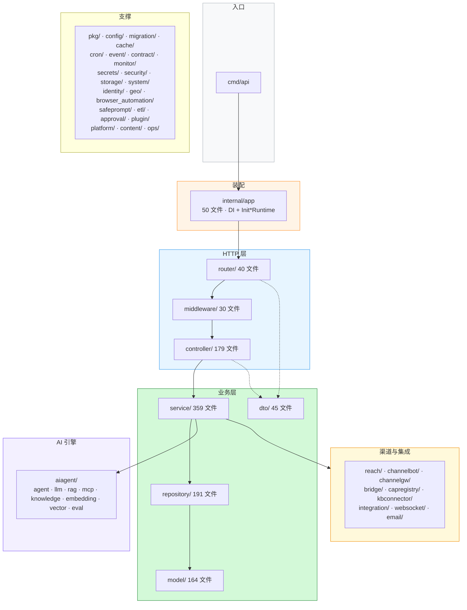
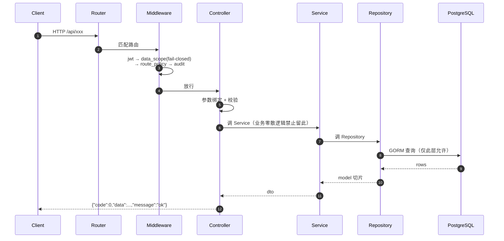
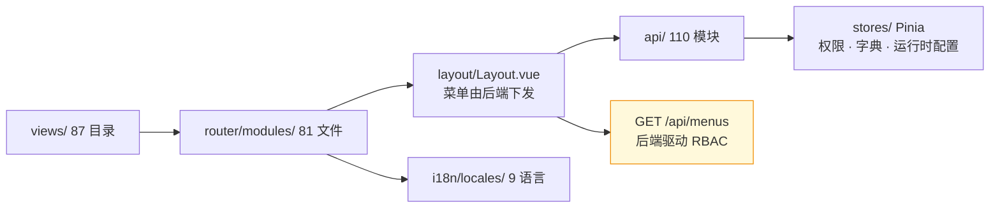

# 功能文档（AI 读版）v2.0

> 本文件是 **给 AI Agent 读的机器可读功能地图**：路由表、模块边界、文件位置、数据结构、契约。
> 目的：在不读全仓的情况下，准确定位改哪里、按什么规范改、影响谁。
>
> 若你是人类读者，请看 [功能文档（人读版）](./FEATURES-FOR-HUMANS.md)。
> 修改代码的操作规范请看 [操作手册（AI 读版）](./OPERATIONS-FOR-AI.md)。
>
> **基线**：`hivemtk/` 仓库 main，Go 1.26 / Gin / GORM / Vue3，复核 2026-10-13。
> 所有计数均为该基线的**源码实测**（`*.go` 非测试文件）。

---

## 1. 仓库拓扑

```
hivemtk/                          # ← git 仓库根（父目录不是）
├── user-server/                  # Go 后端 :8204
│   ├── cmd/                      # 入口: api/seed/pwtool/eval-trace/importfaq
│   ├── config/ + config.yaml     # 配置装载
│   ├── docs/                     # swagger.json 生成物 + dev/ 四件套
│   ├── internal/                 # 42 个顶层包，见第 2 节
│   └── docs/dev/                 # ARCHITECTURE / DEVELOPMENT / CONVENTIONS / FEATURES
├── user-web/                     # Vue3 前端 :8211
├── docs/                         # 文档（INDEX / DEPLOYMENT_GUIDE / capabilities / operations ...）
├── Makefile                      # 全家桶命令，见操作手册
└── .env-example                  # 69 个环境变量键（权威清单）
```

> ⚠️ 仓库根是 `hivemtk/` 子目录。父目录下的 `hivemtk-platform/`、`assetdpo/`、`docs/`、`cold-start/` **不属于本仓**。

---

## 2. 后端 Internal 包地图（42 个顶层包）



> ⚠️ 以下目录**存在但当前为空或无 .go 文件**，别按旧文档的描述去 import：`internal/domain/`、`internal/content/`、`internal/template/`、`internal/ops/`。
> 有文件但容易漏的：`internal/etl/`(2)、`internal/safeprompt/`(1)、`internal/approval/`(2)、`internal/capregistry/`(2)、`internal/kbconnector/`(4)、`internal/websocket/`(11)。

---

## 3. API 契约（写任何接口前必读）

| 项 | 规范 |
|----|------|
| URL 前缀 | 用户端 `/api/{domain}/{resource}`；管理端 `/api/manage/{resource}` |
| 响应体 | `{"code":0,"data":...,"message":"ok"}` |
| 错误码 | 0 成功；400 参数；401 未认证；403 无权限；404 不存在；409 冲突；500 服务端 |
| 分层 | Router → Handler → Service → Repository → Model，**禁止跨层** |
| Router 职责 | 只做路径-方法-Handler 映射，禁止写业务 |
| DI 装配 | 全部在 `internal/app/*_wiring.go`（50 文件），**禁止**在 `init()` 里 new service |
| 每域四文件 | `controller/x.go` + `service/x.go` + `repository/x.go` + `model/x.go` 必须齐全 |



补充铁律：

- Handler 只做参数绑定、调 Service、包响应；业务判断一律下沉。
- 跨层会被 `depguard` + lint 拦死，别试探。
- LTC 系列端点过 `ltc_gate` 中间件，装配开关关闭时返回 **503**，**不许**返回空列表伪装成功。
- `make audit` 覆盖 ~30 项静态门禁（api_contract / md-links / env-coverage / config-param 读点 / 硬编码可调 / i18n / 文本编码等）。

---

## 4. 健康、调试与文档端点（**含两处与旧说法不同的事实**）

| 端点 | 状态 | 说明 |
|------|------|------|
| `GET /health` | ✅ | 全量，含 LLM / Embedding / Rerank 依赖 |
| `GET /healthz` | ✅ | 存活探针 |
| `GET /readyz` | ✅ | 就绪探针 |
| `GET /__debug__/routes` | ⚠️ 门控 | 仅本地/dev，或 `ENABLE_DEBUG_ROUTES=true` **且超管** |
| `GET /swagger/*any`、`GET /api/swagger.json` | ⚠️ **双重门控** | `router.RegisterSwaggerRoutes` 已注册，但要求 `ENABLE_SWAGGER=true` **且** `isLocalRequest(ClientIP)` 仅本机；非本机返回 403 |
| `GET /metrics` | ❌ **未接线** | `internal/middleware/metrics.go` 的 `MetricsMiddleware()` 与 `internal/pkg/metrics.Handler()` **已实现但全仓零引用**（连测试都没引）。是死代码，不是已删除功能——要启用需自行在 router 挂载 |

> 📌 **订正旧说法**：不是"Swagger 未注册"（实际注册了但 dev-only 门控），也不是"`/metrics` 未实现"（实际实现了但没接线）。差异会影响你的接入判断。

---

## 5. 路由地图（按域）

> 完整清单以源码为准：`internal/router/*_routes.go`（40 文件）。实测**373 条路由注册语句**。
> 下表是骨架索引，标注了易踩坑的通配与固定 400。

### 5.1 认证与用户
| 路径 | 说明 |
|------|------|
| `/api/auth/*` | 登录 / 刷新 / 改密（`auth_routes.go`） |
| `/api/system/users` `/api/system/roles` `/api/system/config` `/api/system/menu-permissions` | 团队 / 角色 / 站点 / 菜单权限 |
| `/api/ws/agent` `/api/ws/visitor` `/api/ws/channel` | WebSocket（`websocket/` 11 文件） |
| `/api/sso/*` | SSO |

### 5.2 平台卡片
`POST /api/{douyin,kuaishou,xiaohongshu,xianyu,tiktok}-cards` → `card_routes.go`

### 5.3 知识与 RAG
`/api/knowledge/documents`、`/api/knowledge/search`、`/api/kb/*`、`/api/kb-changes/*`、`/api/kb-releases/*`
- 实现：`internal/aiagent/knowledge`、`internal/aiagent/rag`（cache / core / retrieval / incremental / eval / customer_service）
- 连接器：`internal/kbconnector`（ima / webhttp）

### 5.4 邮件 / 短信
`/api/email/{lists,smtp,drafts,jobs,send,track/open|click,unsubscribe}`
`/api/sms/{config,list,drafts,jobs}`

### 5.5 社群
`/api/community/*`、`/api/wecom/*`、`/api/telegram/*`、`/api/feishu/*`、`/api/dingtalk/*`、`/api/qq/*`、`/api/whatsapp*`

### 5.6 短链 / 活码 / 域名
`/api/short-link/*`、`/api/live-code/*`、`/api/domain-pool`

### 5.7 客户 / 线索
`/api/customer/*`、`/api/customer/360/:id`、`/api/customer-events/track`、`/api/oneid/merge`、`/api/customer-tags`、`/api/clue/*`、`/api/customer-session*`、`/api/chat-channels`、`/api/chat/public/*`、`/api/customer-rfm/compute`、`/api/user-segments`、`/api/churn/prediction`、`/api/recovery-queue`

### 5.8 营销
`/api/marketing-flows`、`/api/ab-experiments/*`、`/api/custom-reports`、`/api/dashboard/sse`、`/api/batch/*`、`/api/reach-pipelines/*`、`/api/followups/*`

### 5.9 内容 / 资产
`/api/ai-content`、`/api/market-templates/*`、`/api/material`、`/api/upload`、`/api/asset-market/*`、`/api/asset-bundle/*`、`/api/script-template/*`、`/api/persona/*`

### 5.10 系统 / 监控 / 审计
`/api/system-monitor/*`、`/api/monitor/*`（traces / trace-tree）、`/api/backup/*`、`/api/operation-logs`、`/api/security/audit/list`、`/api/llm/providers/{health,policy,circuit/reset}`、`/api/admin/tuning/{confidence/signals,humanize/scores}`、`/api/integrations`、`/api/config-param/*`、`/api/menus`

### 5.11 AI 销冠核心
`/api/memory/*`、`/api/intent/recognize`、`/api/sop/*`、`/api/sales-champions`、`/api/ai-agents`、`/api/channel-agent-bindings`、`/api/customer-service-agents`、`/api/dialogue-memory/*`、`/api/confidence/*`、`/api/humanize/*`

### 5.12 统一消息
`/api/messages`、`/api/inbox`、`/api/message-hub`、`/api/platform-accounts`、`/api/unified-message`、`/api/sales-workbench`、`/api/sales-cockpit`

### 5.13 Webhook 入站（通配 `:channel/:account_id`）
- 支持收报：wecom / feishu / dingtalk / wechat / whatsapp / telegram / qq / douyin / tiktok
- **固定 400**（能力闸拒收，别当 bug 修）：kuaishou / xiaohongshu / xianyu / custom
- 运维：`GET /api/webhook/{stats,health}`
- 微信缺 secret 时 **fail-closed**，仅 `ALLOW_INSECURE_WEBHOOK=true` 旁路
- 验签实现在 `internal/middleware/webhook_signature.go` + `service/webhook_channel_*.go`

### 5.14 Bridge
| 端点 | 说明 |
|------|------|
| `POST /api/bridge/ingest` | 入站，body ≤4MB，批 ≤200 |
| `GET /api/bridge/outbox` | 出站拉取 |
| `POST /api/bridge/outbox/ack` | 回执 |
| `GET /api/bridge/outbox/sse` | 长轮询，最长 500s |
| `GET /api/bridge/capabilities` | 能力自描述 |

白名单渠道：douyin / kuaishou / xiaohongshu / xianyu / tiktok。凭证头 `X-Bridge-Token`。扩展 CORS fail-closed。

### 5.15 LTC 链
| 端点 | 条数 | controller:行号 |
|------|---:|------|
| `POST /api/agent/order-drafts/stats`、`/api/manage/order-drafts` | 组 | `order_draft.go` |
| `/api/quote/*` | 6 | `quote.go:98-105` |
| `/api/bill/*` | 3 | `bill.go:123-127`，`accepted` 为唯一生产写入口 |
| `/api/opportunity/*` | 9 | `opportunity.go:66-75` |
| `/api/human-tasks/*` | 7 | `human_task.go:46-54` |
| `/api/approvals/:id` + `/api/approvals/:id/decide` | 2 | `approval.go:53-56`，ManagerOrAdmin |
| `/api/bad-cases/*` | 8 | `bad_case.go:42-51` |
| `/api/kb-changes/*` + `/api/kb-releases/*` | 组 | `kb_release.go:48,57` |
| `/api/manage/ltc/{config,collection}` | 2 | `ltc_routes.go:28-32`，admin |

### 5.16 MCP
`POST /api/mcp` —— 自实现 JSON-RPC 2.0 MCP Server，`internal/aiagent/mcp/`，有 `mcp_guard` 中间件。

---

## 6. AI 引擎模块地图

```
internal/aiagent/                      # 8 个子包
├── agent/          lifecycle / runtime / tooluse / portcontract
├── llm/            dispatcher_*.go（注册/调度/降级/投票/熔断/观测/持久化）
│                   fallback_tree.go / provider_failover.go / react_adapter.go
│                   embedding*.go / selfconsistency/
├── rag/            cache / core / retrieval / incremental / eval / customer_service
├── knowledge/       知识库管线
├── embedding/       向量化
├── vector/          向量存储抽象
├── mcp/             MCP Server + HTTP 传输
└── eval/            质量评测

internal/agent 相关支撑：
├── internal/service/human_escalation.go   危机升级
├── internal/service/humanize/             AB 持久化
├── internal/service/intent_recognition*.go 意图（见下）
└── internal/service/sop*.go               SOP 编排
```

### 6.1 能力实现要点

| 能力 | 实现位置 | 关键参数 | 状态 |
|------|---------|---------|------|
| F1 LLM 调度降级 | `aiagent/llm/dispatcher_*.go` | 7 场景 / 四级降级 / 熔断 5 次·60s / 多数投票 | ✅ |
| F2 Agent 五阶段 | `aiagent/agent/runtime/{perception,alignment,gatekeeper,planner,reviewer}_stage.go` | 危机词三级 23/14/9 | ✅ |
| F3 工具 + 装饰器 | `aiagent/agent/tooluse/` | 45 工具 / 15 装饰器 | ✅ |
| F4 四层短路 RAG | `aiagent/rag/{cache,core,retrieval}` | RRF 融合 + Rerank | ✅ |
| F5 知识库管线 | `aiagent/knowledge` | bge-m3 1024 维 / 15min 异步窗口 / Hash 降级 | ✅ |
| F11 拟人三层 | `service/humanize/` | 润色 <1ms / 五维门禁 0.85 | ⚠️ 行为模拟默认关 |
| F13 自学习 | `service/feedback_*.go`、`bandit_reward_reflux_cron.go` | Thompson / TraceLearning 每小时 200 条 | ✅ |
| F14 多智能体 | `service/ai_agent.go` | sales / cs / hybrid | ✅ |
| F15 质量评测 | `aiagent/eval/` | ChrF + LLM Judge | ⚠️ 薄 |

### 6.2 工具清单（45 个，`BuildXxxTools()` 实测）

| 分组 | 数量 | `internal/aiagent/agent/tooluse/` 文件 | 构造函数 |
|---|---:|---|---|
| reach 触达 | 20 | `reach_tools.go` | `NewReach{SMS,Email,WeCom,Weixin,Douyin,Kuaishou,XHS,DingTalk,Telegram,WhatsApp,Feishu,Web,Card}SendTool` + `NewReach{Batch,Schedule,Recall,Health,History,TemplateApply,AccountList}Tool` |
| customer 客户 | 8 | `customer_tools.go` | `NewCustomer{Search,Get,Create,Update,Merge,AddTag,RemoveTag,Segment}Tool` |
| knowledge 知识 | 4 | `knowledge_tools.go` | `NewRagSearchTool` / `NewKnowledge{Feedback,AddDoc,ListKB}Tool` |
| business 业务 | 6 | `business_tools.go` | `NewFollowTask{Create,Update}Tool` / `NewOrderLookupTool` / `NewAfterSale{Create,Query}Tool` / `NewLogisticsTrackTool` |
| browser 浏览器 | 3 | `browser_tools.go` | `NewBrowser{OpenTask,TaskStatus,TaskList}Tool` |
| card 卡片 | 1 | `card_show_tool.go` | `NewCardShowTool` |
| private 私信会话 | 3 | `private_message_tools.go` | open / read / send session |

### 6.3 装饰器（15 个实现，默认链 5 层）

```
默认链  BuildDefaultChain   ：Permission → Retry → Timeout → RateLimit → Audit
含熔断  BuildChainWithBreaker：Permission → RateLimit → CircuitBreaker → Retry → Timeout → Audit
可插拔（decorator*.go，15 个）：
  ApprovalGate · RiskGate · RiskGateBlock · CircuitBreaker · CircuitBreakerShadow
  DeadLetterQueue · FeedbackCollector · LoopGuard · ParamValidator · ResultCache
  DNC · Permission · RateLimit · Retry · Timeout · Audit
```

入口：`ChainDecorators` / `BuildDefaultChain` / `BuildChainWithBreakerDecorator` / `BuildChainWithCircuitBreaker`（均在 `tooluse/decorator.go`）。
风险门禁另见 `permission_highrisk.go`、`permission_whitelist.go`、`risk_gate.go`、`double_intercept.go`。

### 6.4 意图与 SOP 的真实规模

| 项 | 常量定义 | 数量 |
|---|---|---:|
| 粗意图 | `service/intent_recognition.go` | **16** |
| 细意图 | `service/intent_recognition_fine.go` | **34**（8 个大类 + 26 子类） |
| SOP 节点类型 | `service/sop.go:47+` | **15** |

> ⚠️ 旧说法"粗 13 / 细 27""SOP 19 节点"已不准确。SOP 是 DAG，节点由模板决定，**15 是类型数不是模板节点数**。
> 细意图大类（8）：consult / price_inquiry / objection / after_sale / complaint / churn / intent_buy / ask_product。

### 6.5 GEO
`internal/geo/`：品牌配置 → 关键词蒸馏 → 内容创作 → 多模型验证 → 平台发布；路由 `geo_routes.go`（含 `POST /metrics/analyze` 子路径，与 Prometheus 无关）。设计稿 `docs/architecture/GEO_*.md`、`user-server/docs/geo-module-guide.md`。

---

## 7. 前端模块地图



```
user-web/src/
├── api/              110 个 API 模块（与后端域对应）
├── views/            87 个业务视图目录（+ 4 个根级 .vue：Login/Profile/Notifications/NotFound）
├── router/modules/   81 个路由模块（index.js 汇总）
├── stores/           Pinia：app / user / permission / dictionary / material / geo / browserAutomation / runtimeConfig
├── i18n/locales/     9 语言：ar de en es fr ja pt ru zh
├── layout/Layout.vue 主框架
└── components/ config/ constants/ types/ utils/ styles/
```

**顶级菜单 7 项**（`model.SystemMenuTree`，共 208 个菜单 key、33 个二级节点）：

```
workspace  工作台        customer     客户中心      aiAgent  智能体
reach      触达运营      knowledge    知识中心      analytics 数据分析
system     系统设置
```

权限：`stores/permission.js` + 后端 `/api/menus`（角色过滤）+ `role_menu_permissions`。**前端不做静态角色过滤**——菜单看不到先查后端权限分配。系统管理仅 admin。

> 前端规模已重测（2026-10-13，main）：**7** 顶级菜单 / **81** 路由模块 / **87** 视图目录 / **9** 语言。此前文档流传的「8 菜单 / 62 路由 / 79 视图 / 四语言」为过期误测，已在本册订正；README.md 亦不含这些过期数字。

---

## 8. 关键数据结构（Model 层位置）

| 实体 | 文件 | 说明 |
|------|------|------|
| `AIAgent` | `model/ai_agent.go` | 智能体 |
| `AgentStatus` | `model/agent_status.go` | 座席状态 |
| `ApprovalRequest` | `model/approval_request.go` | 审批 |
| `BadCase` | `model/bad_case.go` | 坏案例 |
| `Bill` | `model/bill.go` | 账单 |
| `BridgeAccount` / `BridgeProtocol` | `model/bridge_account.go` / `bridge_protocol.go` | Bridge |
| `Clue` | `model/clue.go` | 线索（评分 `clue_score`） |
| `Confidence` | `model/confidence.go` | 置信度 |
| `ConfigParam` / `ConfigParamGroup` | `model/config_param.go` | 配置项驱动 |
| `CronJobLease` | `model/cron_job_lease.go` | 定时任务租约 |
| `Customer` / `CustomerEvent` / `CustomerSession` | `model/customer*.go` | 客户 / CDP / 客服会话 |
| `Community` | `model/community.go` | 社群 |
| `SOPTemplate` / `SOPExecution` | `model/sop_template.go` | SOP 模板与执行 |
| `SystemMenuNode` / `SystemMenuTree` | `model/menu.go` | **菜单权威注册表** |
| `MenuCapabilityRoutes` | `model/menu_capability_routes.go` | 菜单-能力路由映射 |
| `Menu` | `model/menu.go` | 菜单实体 |
| `KnowledgeBase` | `model/knowledge_base.go` | 知识库 |
| `Memory` | `model/memory.go` | 智能体记忆 |
| `SLA` | `model/sla.go` | SLA |
| `AssetBundle` | `model/asset_bundle.go` | 资产包 |

DTO 在 `internal/dto/`（45 文件，与 controller 对应）。仓储在 `internal/repository/`（191 文件）。
**GORM 查询只允许出现在 repository 层**——这是 depguard 强制的。

---

## 9. 中间件清单（30 个文件，改接口先看这个）

### 9.1 安全与鉴权
| 中间件 | 文件 | 作用 |
|------|------|------|
| `jwt` | `middleware/jwt.go` | 认证 + 吊销 |
| `mfa` | `middleware/mfa.go` | 多因素 |
| `data_scope` | `middleware/data_scope.go` | 行级数据隔离，**fail-closed** |
| `permission` | `middleware/permission.go` | 角色/能力校验 |
| `require_admin` | `middleware/require_admin.go` | 仅超管 |
| `ownership` | `middleware/ownership.go` | 资源归属 |
| `route_capability` / `route_policy` | `route_capability.go` / `route_policy.go` | **能力面守卫，fail-closed** |
| `app_key_auth` | `middleware/app_key_auth.go` | Widget AppKey |
| `webhook_signature` | `middleware/webhook_signature.go` | webhook 验签 |
| `brute_force` | `middleware/brute_force.go` | 暴力破解防护 |
| `sanitize` | `middleware/sanitize.go` | 输入净化 |

### 9.2 限流与配额
| 中间件 | 文件 | 作用 |
|------|------|------|
| `ratelimit` | `middleware/ratelimit.go` | 通用限流 |
| `rate_quota` | `middleware/rate_quota.go` | 配额 |
| `visitor_rate_limit` | `middleware/visitor_rate_limit.go` | 访客限流（Widget） |
| `bridge_ingress_guard` | `middleware/bridge_ingress_guard.go` | Bridge 入站鉴权 |
| `body_limit` | `middleware/body_limit.go` | 请求体大小限制 |

### 9.3 装配与业务门
| 中间件 | 文件 | 作用 |
|------|------|------|
| `ltc_gate` | `middleware/ltc_gate.go` | LTC 装配门→未装配回 503 |
| `mcp_guard` | `middleware/mcp_guard.go` | MCP 鉴权 |
| `init_guard` | `middleware/init_guard.go` | 初始化守卫 |
| `install_status` | `middleware/install_status.go` | 安装状态 |

### 9.4 观测与上下文
| 中间件 | 文件 | 作用 |
|------|------|------|
| `api_logger` | `middleware/api_logger.go` | 请求日志 |
| `audit` | `middleware/audit.go` | 审计 |
| `trace` | `middleware/trace.go` | 链路追踪 |
| `context` | `middleware/context.go` | 上下文注入 |
| `lang_resolver` / `locale` | `middleware/lang_resolver.go` / `locale.go` | 语言解析 |
| `ai_crawler_monitor` | `middleware/ai_crawler_monitor.go` | 爬虫监控 |
| `metrics` | `middleware/metrics.go` | **已实现但未接线**，见第 4 节 |

---

## 10. 配置与运行时开关（17 项 + 陷阱）

| 变量 | 默认 | 作用与陷阱 |
|------|------|---------|
| `POSTGRES_PASSWORD` / `REDIS_PASSWORD` / `JWT_SECRET` | 必改 | 首次部署必须改，别留默认 |
| `GIN_MODE` | debug | 生产必须 `release` |
| `PLATFORM_ENABLED` | false | true 才启用 platform-server :8205 |
| `REQUIRE_PRIVATE_NETWORK` | — | 私网限制 |
| `CORS_ALLOW_ORIGINS_USER` | — | 前端跨域白名单 |
| `CORS_ALLOWED_EXTENSIONS` | — | Chrome 扩展白名单（Bridge），**fail-closed** |
| `BRIDGE_INGRESS_AUTH` | 开启 | `off` 是逃生阀，别默认关 |
| `ALLOW_INSECURE_WEBHOOK` | **false** | `true` 会关验签，**可被伪造报文驱动触达** |
| `ENABLE_DEBUG_ROUTES` | false | true 暴露 `/__debug__/routes`（仍需超管） |
| `ENABLE_SWAGGER` | 未设 | `true` 且仅本机才可访问 swagger |
| `EMBEDDING_ALLOW_FALLBACK` | — | 向量化降级为 Hash，**检索质量下降** |
| `LLM_*` / `EMBEDDING_*` / `RERANK_*` | — | llama.cpp 三件套连接参数 |
| `LAY_*` | — | Laya 决策服务 |
| `HIVEMTK_PROFILE` | — | 运行档位 |
| `PUBLIC_BASE_URL` / `GEO_SITE_BASE_URL` | — | 外部访问基址 |

`.env-example` 69 个键是权威清单。**新增环境变量必须同步 `.env-example`**，否则 `make audit` 的 env-coverage 门会挂。
动态配置项走 `ConfigParam` 表 + `/api/config-param/*`，改配置前先看 `service/config_param_seeds.go`。

---

## 11. 测试基础设施

- 每个路由文件都有配对的 `*_routes_test.go`
- `internal/pkg/goldentest` 提供 golden 测试；`internal/pkg/testutil` 提供工具
- 测试密集区：`router/`（注册与门禁）、`aiagent/llm/`（降级/熔断/嵌入）、`service/inbox_ingress*`（收件箱入站）
- **新增接口必须补路由测试 + 分层测试**
- `make test-go` 跑全部；`make audit` 里的 `check-test-nil-deref.py` 会盯测试里的 nil 解引用（需登记基线）

---

## 12. 相关文档

| 文档 | 用途 |
|------|------|
| [操作手册（AI 读版）](./OPERATIONS-FOR-AI.md) | 动手改代码前必读 |
| `user-server/docs/dev/ARCHITECTURE.md` | 后端架构 |
| `user-server/docs/dev/CONVENTIONS.md` | 编码规范 |
| `user-server/docs/dev/FEATURES.md` | 94 个业务子模块明细 |
| `user-web/docs/dev/*` | 前端四件套 |
| `docs/DEV_DOCS_INDEX.md` | 开发文档索引 |
| `docs/capabilities.md` | 渠道能力矩阵（自动生成，勿手改） |
| `docs/standards/MASTER_RULES.md` | 工程铁律 |
