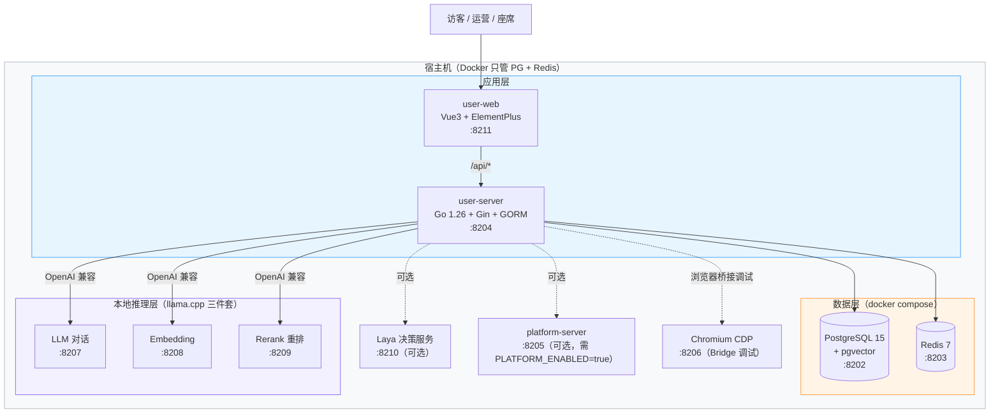
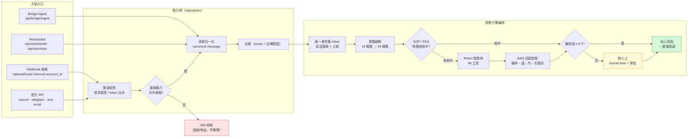
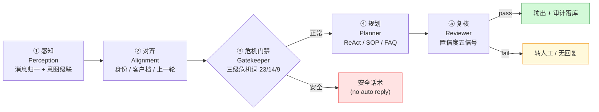
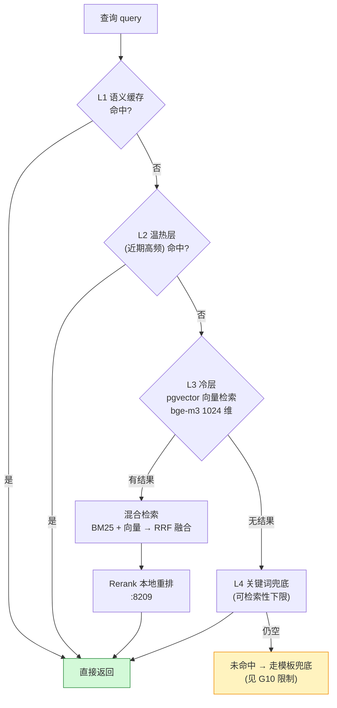
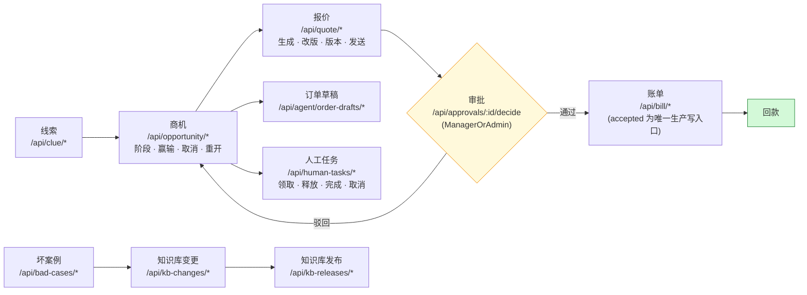

# 功能文档（人读版）v2.0

> 本文件是 **HiveMtk 功能全集的事实清单**：只写已经实现并且在代码里能验证的能力。
> 未完成/半成品/已知缺陷单独在「已知限制」列出，不含糊、不夸大。
>
> **读者**：产品负责人、运营、实施顾问、采购评估。
> **代码基线**：`hivemtk/` 仓库 main 分支，复核日期 2026-10-13。
>
> | 想做什么 | 看哪份 |
> |---|---|
> | 上手部署 / 教会运营用 | [操作手册（人读版）](./OPERATIONS-FOR-HUMANS.md) |
> | 查接口、查目录、查数据结构 | [功能文档（AI 读版）](./FEATURES-FOR-AI.md) |
> | 改代码、加功能 | [操作手册（AI 读版）](./OPERATIONS-FOR-AI.md) |
>
> 引用口径：业务子模块 94 个（`user-server/docs/dev/FEATURES.md`）、引擎能力 F1–F15（`docs/marketing-features/README.md`）。本文另附**实测代码统计**，与文档口径不一致时以实测为准。

---

## 1. 一句话定位

**HiveMtk 是一套单商户本地部署的开源私域营销 AI 系统**（AGPL-3.0）：把抖音、快手、小红书、闲鱼、TikTok 的网页端私信，与微信、企业微信、飞书、钉钉、Telegram、WhatsApp、短信、邮件统一接进来，由 ReAct 智能体 + 本地知识库（RAG）自动拟人回复，并把线索 → 成交 → 回款（LTC）全流程跑通。

三条硬边界，先说清楚：

| 边界 | 说明 | 违反后果 |
|------|------|---------|
| **单商户单租户** | 开源版**没有**多租户 / 注册开户 / 在线付费 / License 校验，已从开源版移除 | 无法承载第二个商户，扩容需改架构 |
| **数据零出域** | LLM / Embedding / Rerank 全部跑在宿主机 llama.cpp，无外部模型厂商依赖 | 断网可用；但推理质量受本地模型规格限制 |
| **有闸门的自动化** | 主动触达（短信/邮件/私信）有不可关闭的 `[COMPLIANCE]` 合规日志 | 合规责任由部署方承担，见 [DISCLAIMER.md](../../DISCLAIMER.md) |

---

## 2. 部署拓扑与端口



| 组件 | 端口 | 说明 |
|------|------|------|
| user-web（Vue3 前端） | 8211 | 7 顶级菜单 · 81 路由模块 · 9 语言 |
| user-server（Go 后端） | 8204 | 五层架构 · 94 业务子模块 · 373 路由注册 |
| PostgreSQL 15 + pgvector | 8202 | 主存储；向量 1024 维（bge-m3） |
| Redis 7 | 8203 | 缓存 / 限流 / SSO 会话 |
| llama.cpp LLM | 8207 | 本地对话推理 |
| llama.cpp Embedding | 8208 | 本地向量化 |
| llama.cpp Rerank | 8209 | 本地重排 |
| Laya 决策服务 | 8210 | 可选，模型决策增强 |
| platform-server | 8205 | 可选，仅 `PLATFORM_ENABLED=true` |
| Chromium CDP | 8206 | 浏览器桥接调试端口 |

端口权威清单见 `docs/PORT_REGISTRY.md`。

---

## 3. 代码规模实测（2026-10-13）

文档口径（`user-server/docs/dev/FEATURES.md`）为 **94 个业务子模块**。为了让评估者有个量级，以下是 `main` 分支实测统计：

| 层 / 目录 | 文件数（非测试） | 说明 |
|---|---:|---|
| `internal/controller/` | 179 | HTTP 入站层（本项目 Handler 即 Controller） |
| `internal/service/` | 359 | 业务编排层 |
| `internal/router/` | 40 | 路由注册 |
| `internal/model/` | 164 | 数据模型 |
| `internal/router/*.go` 路由注册语句 | **373** | 实际端点总数（含分组嵌套展开） |
| `user-web/src/api/` | 110 | 前端 API 模块 |
| `user-web/src/router/modules/` | 81 | 前端路由模块 |
| `user-web/src/views/` | 87 个目录 | 业务视图 |
| `user-web/src/i18n/locales/` | 9 | ar / de / en / es / fr / ja / pt / ru / zh |
| 后端菜单注册表 | 208 个 key | 7 顶级菜单 + 33 个二级节点（`model.SystemMenuTree`，**后端驱动 RBAC**） |

> **与 README 的一致说明**：README 顶部指标已同步为 **45 个智能体工具**（`BuildReachTools` 等 7 组共 45 个）。本文的实测数字以源码为准。

---

## 4. 渠道接入能力

接入方式分四类：**Bridge（浏览器桥接）**、**官方 API**、**Webhook 收报文**、**知识库连接器**。权威能力矩阵由 `docs/capabilities.md`（`capregistry` 自动生成，**禁止手改**）维护。

| 渠道 | Bridge | 官方 API | Webhook 收报 | 能力 |
|------|:--:|:--:|:--:|------|
| 抖音 | ✅ | — | ✅ | 私信收发 + 线索挖掘（LLM 复核） |
| 快手 | ✅ | — | ⚠️ | 私信收发（通配路由固定返回 400，能力闸拒收） |
| 小红书 | ✅ | — | ⚠️ | 私信收发 + 线索挖掘 |
| 闲鱼 | ✅ | — | ⚠️ | 私信收发 |
| TikTok | ✅ | — | ✅ | 私信收发（海外） |
| 企业微信 | — | ✅ | ✅ | 私信发送 + 应用消息 |
| 飞书 | — | — | ✅ | 应用消息（信封验签） |
| 钉钉 | — | — | ✅ | 应用消息 |
| 微信（公众号/小程序） | — | — | ✅ | 报文接收（缺 secret 时 fail-closed） |
| Telegram | — | ✅ | ✅ | 私信发送 + Bot 收报 |
| WhatsApp | — | — | ✅ | 报文接收（另有 bulk-send / 群发 API） |
| QQ | — | — | ✅ | Bot 收报 |
| 短信（阿里云） | — | ✅ | — | 短信发送 |
| 邮件（SMTP） | — | ✅ | — | 邮件发送 + 打开/点击追踪 |
| 腾讯 IMA | — | — | — | 知识库文件类同步 |

**为什么需要 Bridge**：抖音/快手/小红书/闲鱼没有开放私信 API，只能由用户自己 Chrome 上的扩展代收代发。后端提供五个端点支撑：

| 端点 | 方向 | 关键限制 |
|------|------|---------|
| `POST /api/bridge/ingest` | 入站 | body ≤ 4MB，单批 ≤ 200 条 |
| `GET /api/bridge/outbox` | 出站 | 取待发送 |
| `POST /api/bridge/outbox/ack` | 出站回执 | — |
| `GET /api/bridge/outbox/sse` | 出站长轮询 | 最长 500s |
| `GET /api/bridge/capabilities` | 能力探测 | 与 capability registry 对齐 |

安全边界：凭证头 `X-Bridge-Token`（支持 prev token 灰度）、`CORS_ALLOWED_EXTENSIONS` 扩展白名单 **fail-closed**、逃生阀 `BRIDGE_INGRESS_AUTH=off`。

---

## 5. 消息入站数据流



关键设计：**能力闸先于业务**。通配路由里存在但能力矩阵未开放的渠道（快手/小红书/闲鱼的 webhook）**固定返回 400**，而不是静默丢弃——这让配置错误在对接期就暴露。

---

## 6. 十九大业务域功能清单

### 6.1 认证与用户管理
- JWT 登录 / 刷新 / 改密，支持 MFA 多因素
- 登录风控异常检测（暴力破解、异地登录等）
- 团队成员管理 `/api/system/users`、角色与菜单权限（`role_menu_permissions`，**后端驱动**）
- 行级数据隔离：`data_scope` 中间件 + `RoutePolicyGuard` 能力面守卫，**fail-closed**（无策略即拒绝）
- WebSocket：`/api/ws/agent`（座席工作台）、`/api/ws/visitor`（访客）、`/api/ws/channel`（Bridge 隧道），带 seq / ack / notify 可靠性机制

### 6.2 多平台内容卡片
抖音 / 快手 / 小红书 / 闲鱼 / TikTok 五个平台的卡片生成，`POST /api/{douyin,kuaishou,xiaohongshu,xianyu,tiktok}-cards`。

### 6.3 智能客服与自动回复（RAG）
- 智能客服自动回复：webhook 触发 → `sales_engine` 销售引擎编排 → 拟人文案回发
- 知识库检索 `POST /api/knowledge/search`，文档管理 `/api/knowledge/documents`
- RAG 健康检查端点
- 话术库（`script_library`）与脚本 A/B

### 6.4 邮件营销
`/api/email/*`：邮件列表、SMTP 账号、草稿、发送任务、发送、打开/点击追踪像素 + webhook、退订。

### 6.5 短信
`/api/sms/*`：短信配置、接收人列表、草稿、发送任务。已对接阿里云；腾讯云/华为云为配置位。

### 6.6 社群运营
- WhatsApp：bulk-send、群发任务、群消息（`/api/community/*`）
- Telegram：账号管理 + AI 自动化
- 企业微信：`/api/wecom/*`，含账号健康度
- 飞书、钉钉应用接入；QQ Bot；通用社群 community

### 6.7 短链与活码
`/api/short-link/*` 短链 + 点击统计、`/api/live-code/*` 活码（轮询二维码）、`/api/domain-pool` 域名池。

### 6.8 线索与客户管理
- 线索 `/api/clue/*`（自动评分 `clue_score`）、客户 360 视图 `/api/customer/360/:id`
- CDP 事件追踪 `/api/customer-events/track`、OneID 合并 `/api/oneid/merge`、客户标签 `/api/customer-tags`
- 客服会话、客服代理、快捷回复、会话标签、AI 建议
- 客服 Web Widget：`/api/chat-channels`（AppKey + origin 白名单）、公开聊天 `/api/chat/public/*`（`X-Chat-Visitor-Id` / `X-Chat-Channel-Id`）

### 6.9 营销自动化与实验
营销流程 `/api/marketing-flows`、A/B 实验 `/api/ab-experiments/*`（结果 / 转化事件 / 统计 / CUPED / 诊断）、RFM `/api/customer-rfm/compute` + 用户分群 `/api/user-segments`、流失预警 `/api/churn/prediction`、挽回队列 `/api/recovery-queue`、自定义报表 `/api/custom-reports`、SSE 数据大屏 `/api/dashboard/sse`、批量操作 `/api/batch/*`。

### 6.10 内容创作与素材
AI 内容生成 `/api/ai-content`、模板市场 `/api/market-templates/*`、素材 `/api/material`、上传 `/api/upload`。

### 6.11 系统管理
站点设置 `/api/system/config`、系统监控 `/api/system-monitor/*`、业务链路监控 `/api/monitor/*`（traces / trace-tree）、OBS 存储配置、备份恢复 `/api/backup/*`、操作日志 `/api/operation-logs`、安全审计 `/api/security/audit/list`、SSE 驾驶舱、LLM Provider 降级管理 `/api/llm/providers/{health,policy}` + 熔断复位 `/circuit/reset`、调层面板 `/api/admin/tuning/{confidence/signals,humanize/scores}`。

### 6.12 安全与权限
角色管理 `/api/system/roles`、菜单权限（后端驱动）、行级数据隔离 + 能力面守卫（fail-closed）。

### 6.13 第三方对接
`/api/integrations` + `sync-logs` 同步日志。

### 6.14 统一消息中心
`/api/messages`、统一收件箱 `/api/inbox`、消息中台 `/api/message-hub`、平台账号 `/api/platform-accounts`。

### 6.15 AI 销冠引擎（核心）
- 对话记忆系统 `/api/memory/*`
- 意图识别 `/api/intent/recognize`：**16 类粗意图 → 34 类细意图**（8 个大类 + 26 子类），常量定义在 `internal/service/intent_recognition_fine.go`
- SOP 智能体 `/api/sop/*`：DAG 执行，**15 种节点类型**（start / message / branch / wait / action / end / ai_decide / send_offer / greeting / inquire / introduce / handle / close / invite / follow_up）
- LLM 多模型路由：6 厂商 / 8 场景，四级降级，熔断 5 次/60s，多数投票
- 异议处理、销冠画像 `/api/sales-champions`、触达 Pipeline `/api/reach-pipelines/*`（9 步）

### 6.16 多智能体
AI 智能体 `/api/ai-agents`：CRUD、test、context，sales / cs / hybrid 三角色；渠道-智能体绑定 `/api/channel-agent-bindings`；客服智能体 `/api/customer-service-agents`。

### 6.17 数据分析
客户旅程 `/api/customer-journey`、转化漏斗 `/api/conversion-funnel`、智能体产能 `/api/ai-productivity`。

### 6.18 AI Agent 工具与 MCP
**45 个原子工具**（源码 `BuildXxxTools()` 实测）：

| 分组 | 数量 | 代表工具 |
|---|---:|---|
| reach（触达） | 20 | sms/email/wecom/weixin/douyin/kuaishou/xhs/dingtalk/telegram/whatsapp/feishu/web 各一发、card、batch、schedule、recall、health、history、template-apply、account-list |
| customer（客户） | 8 | search / get / create / update / merge / add-tag / remove-tag / segment |
| knowledge（知识） | 4 | rag-search / feedback / add-doc / list-kb |
| business（业务） | 6 | follow-task create+update、order-lookup、after-sale create+query、logistics-track |
| browser（浏览器自动化） | 3 | open-task / task-status / task-list |
| card（卡片） | 1 | card-show |
| private-message（私信会话） | 3 | open-session / read-session / send-message |

MCP Server：`POST /api/mcp`（自实现 JSON-RPC 2.0）。

### 6.19 GEO 品牌曝光
品牌配置 → 关键词蒸馏 → 内容创作 → 多模型验证 → 平台同步发布。设计稿见 `docs/architecture/GEO_*.md`、`user-server/docs/geo-module-guide.md`；前端有 `geoTools` 菜单组（配置/生产/发布/监控四组）。

---

## 7. AI 引擎能力（F1–F15）

| 编号 | 能力 | 状态 |
|------|------|------|
| F1 | LLM 调度降级：7 场景路由、四级降级、熔断、ReAct 适配、多数投票 | ✅ |
| F2 | Agent 五阶段闭环：感知 → 对齐 → 危机门禁 → 规划 → 复核（危机词三级 23/14/9） | ✅ |
| F3 | 45 工具 + 15 装饰器 + LoopGuard + MCP | ✅ |
| F4 | 四层短路 RAG：缓存 → 温 → 冷 → 关键词兜底；混合检索（RRF + Rerank） | ✅ |
| F5 | 知识库管线：URL 抓取（SSRF 校验）、分块、bge-m3 1024 维、15 分钟异步窗口、Hash 降级 | ✅ |
| F11 | 拟人三层：润色（<1ms）/ 五维门禁（0.85）/ 行为模拟 | ⚠️ 行为模拟默认关 |
| F13 | 自学习：FeedbackLearner、销冠聚类、PromptIterator、SOPAutoOptimizer、BanditAllocator（Thompson）、TraceLearning（每小时 200 条） | ✅ |
| F14 | 多智能体三角色（sales / cs / hybrid） | ✅ |
| F15 | 质量评测：ChrF + LLM Judge | ⚠️ 薄 |

### 7.1 智能体五阶段闭环



### 7.2 RAG 四层短路



### 7.3 工具调用装饰链

工具执行不是裸调，而是按链逐层包。默认链 **5 层**，启用熔断后 **6 层**；另有风险门禁 / 审批 / 死信 / 结果缓存等 **15 个装饰器**实现可插拔。

```
默认链（BuildDefaultChain）：Permission → Retry → Timeout → RateLimit → Audit
含熔断链：Permission → RateLimit → CircuitBreaker → Retry → Timeout → Audit
可插拔装饰器：ApprovalGate · RiskGate · RiskGateBlock · DNC · DeadLetterQueue ·
             FeedbackCollector · LoopGuard · ParamValidator · ResultCache（共 15 个）
```

### 7.4 销售管线与置信度决策

12 步销售管线中，**置信度 ≥ 0.7** 才自动发送；FAQ/SOP 命中走快路径。置信度由五信号构成，经校准链、六否决链，落入动态阈值区间 **[0.40, 0.95]** 的四档决策：

| 档位 | 动作 |
|---|---|
| 高 | 直接发送 |
| 中 | 降级发送 / 附人工待办 |
| 低 | 转人工，不自动回复 |
| 否决 | 命中否决链 → 一律转人工 |

SOP 执行用 DAG + AB 实验（权重和 = 100，FNV-1a 哈希做粘性分配），失败走 Saga 补偿 + Outbox 投递。

---

## 8. LTC（线索到回款）新链

`router.go` 已接线，但**装配开关默认关闭**：未装配时端点返回 **503 Service Unavailable**，而不是返回空列表骗人——这是本仓刻意的设计取舍。



装配开关（对应 `app.Init*Runtime`，**默认 off ⇒ 不打日志不装配 ⇒ 端点回 503**）：

`InitOrderDraftRuntime` · `InitApprovalRuntime` · `InitHumanTaskRuntime` · `InitHumanTaskSLA` · `InitBadCaseRuntime` · `InitKBReleaseRuntime` · `InitBusinessNotifier` · `InitOpportunityRuntime` · `InitQuoteRuntime` · `InitBillRuntime` · `InitPaymentRuntime` · `InitEmailRuntime`

管理端入口：`/api/manage/ltc/{config,collection}`、`/api/manage/order-drafts`（admin 权限）。

---

## 9. 运维可观测性

| 端点 | 用途 |
|------|------|
| `GET /health` | 全量健康检查（**含 LLM / Embedding / Rerank 依赖**） |
| `GET /healthz` | 存活探针 |
| `GET /readyz` | 就绪探针 |
| `GET /__debug__/routes` | 调试路由表；仅本地/开发环境，或 `ENABLE_DEBUG_ROUTES=true` **且超管权限** |
| `GET /api/webhook/{stats,health}` | 渠道收报运维状态 |

**没有** `/metrics`，Swagger 未注册。排障链路靠 `/api/monitor/*`（traces / trace-tree）与 `/api/security/audit/list`。

---

## 10. 明确没有的功能

写清楚边界，避免采购评估误判：

| 没有 | 说明 |
|------|------|
| 多租户 / SaaS | 开源版已移除，单商户私域部署 |
| 在线注册开户、定价页、支付网关 | 开源版已移除 |
| License 校验 / OTA 升级 / 版本下载 | 开源版已移除 |
| `/metrics` Prometheus 端点 | 未实现，接监控需自行埋点 |
| Swagger / OpenAPI UI | 未注册，接口需按代码或本文档查 |
| 主动外联触达的完整四格编排 | **骨架未接线**，见下条 G11 |
| 官方小程序 / App 客户端 | 只有 Web 端 + Web Widget + Chrome 扩展 |
| 数据仓库 / OLAP 查询引擎 | 分析靠自定义报表 + SSE 大屏，非 OLAP |

---

## 11. 已知限制与缺陷（截至 2026-10 复核，未修）

| 编号 | 问题 | 影响 |
|---|---|---|
| **G4** | 置信度两套体系未打通 | 存在两套置信度计算，尚未合并，阈值语义需人工确认 |
| **G7** | 行为拟人默认关 | 五维门禁默认关闭，实际只有润色层生效 |
| **G9** | 四层检索短路 | 短路已实现，但冷层/兜底层质量未充分验证 |
| **G10** | 模板兜底文案单一 | 兜底回复只支持单一模板，不能按渠道定制 |
| **G11** | **主动外联四格 UNWIRED** | 主动外联是骨架，端点已定义但未接线（本清单第 10 节相应条目即此项） |
| **G12** | 质量评测薄 | 只有 ChrF + LLM Judge，覆盖面与基准都很薄 |

跨域欠债：

- **进程内存态泛滥** —— 存在以进程内存为状态的实现，重启即丢，多副本部署会状态分裂。
- **双体系并行** —— 两套收件箱、两套 RFM、两套话术、两套记忆同时存在，**数据可能不一致**，接入时需确认自己用的是哪一套。
- **错误吞没** —— 部分路径错误被静默吞掉，排障困难。
- **安全红线** —— `ALLOW_INSECURE_WEBHOOK`（关验签）、unlock 越狱 prompt、Secret 明文 KV 三处需在部署时重点处置，处置步骤见 [操作手册（人读版）](./OPERATIONS-FOR-HUMANS.md) 第 6 节。

---

## 12. 相关文档

| 文档 | 内容 |
|------|------|
| [操作手册（人读版）](./OPERATIONS-FOR-HUMANS.md) | 部署、配置、日常运营、备份恢复 |
| [功能文档（AI 读版）](./FEATURES-FOR-AI.md) | 接口清单、模块地图、数据结构 |
| [操作手册（AI 读版）](./OPERATIONS-FOR-AI.md) | 在本仓库安全干活的规范 |
| [`../INDEX.md`](../INDEX.md) | 全仓文档索引 |
| [`user-server/docs/dev/FEATURES.md`](../../user-server/docs/dev/FEATURES.md) | 94 个业务子模块明细（含状态/包路径/路由） |
| [`../marketing-features/README.md`](../marketing-features/README.md) | AI 引擎能力总览 F1–F15 |
| [`../DEPLOYMENT_GUIDE.md`](../DEPLOYMENT_GUIDE.md) | 部署详细指南 |
| [`../TROUBLESHOOTING.md`](../TROUBLESHOOTING.md) | 故障排查 |
| [`../capabilities.md`](../capabilities.md) | 渠道能力矩阵（自动生成，勿手改） |
| [`../standards/MASTER_RULES.md`](../standards/MASTER_RULES.md) | 工程铁律 |
