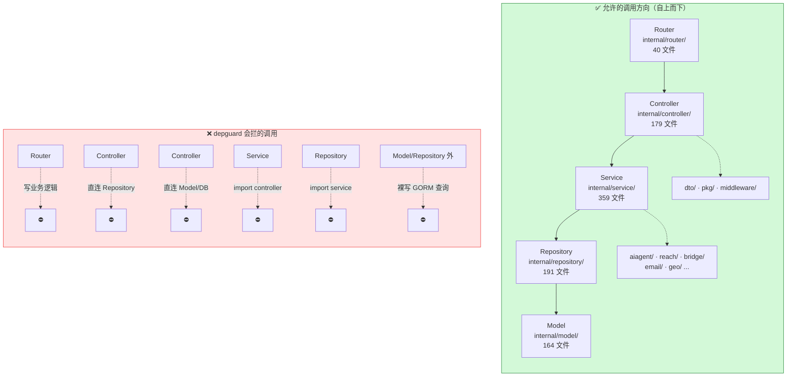
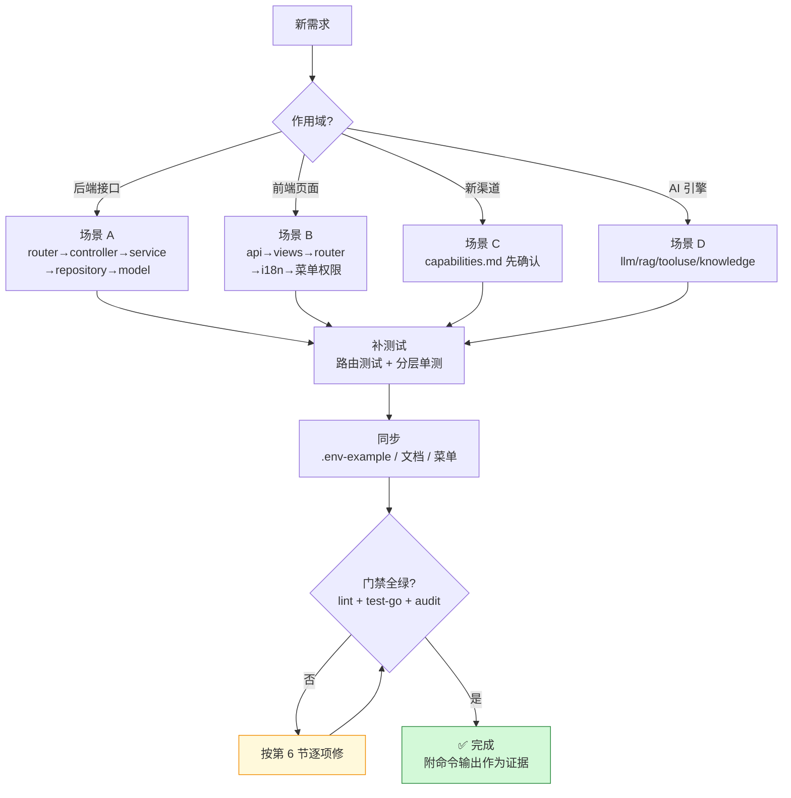

# 操作手册（AI 读版）v2.0

> 本文件是 **给 AI Agent 的操作手册**：你在 `hivemtk/` 仓库里安全干活的规范与命令。
> 目标：改完的代码能过一次 `make audit`，且不破坏五层架构。
>
> 功能地图请看 [功能文档（AI 读版）](./FEATURES-FOR-AI.md)。
> **本仓库有大量硬门禁（lint / depguard / audit），动手前先读完第 1、2、3 节。**
> 基线：main，复核 2026-10-13。

---

## 目录

1. [铁律（违反即返工）](#1-铁律违反即返工)
2. [允许与禁止的依赖方向](#2-允许与禁止的依赖方向)
3. [常用命令速查](#3-常用命令速查)
4. [新增一个功能的完整流程](#4-新增一个功能的完整流程)
5. [验证口径（不许跳过的证据链）](#5-验证口径不许跳过的证据链)
6. [`make audit` 高频失败项与规避](#6-make-audit-高频失败项与规避)
7. [禁止事项](#7-禁止事项)
8. [已知坑位](#8-已知坑位)
9. [快速定位表](#9-快速定位表)

---

## 1. 铁律（违反即返工）

1. **五层架构不可跨**：Router → Handler → Service → Repository → Model。Handler 禁止直接碰 Repository/Model；Service 禁止 import controller；Router 禁止写业务。
2. **DI 装配只在 `internal/app/`**：用现成的 `Init*Runtime` / `*_wiring.go` 模式，禁止在 `init()` 里构造依赖。
3. **每域四文件齐全**：`controller/x.go`、`service/x.go`、`repository/x.go`、`model/x.go`。
4. **API 契约**：用户端 `/api/{domain}/{resource}`、管理端 `/api/manage/{resource}`；响应 `{"code":0,"data":...,"message":"ok"}`。
5. **不要造假数据**：能力未装配就返回 503（LTC 已有先例），不要把空列表当成功。
6. **不要手改生成物**：`docs/capabilities.md` 由 `capregistry` 生成。
7. **改 `.env-example` 必须同步**：新增环境变量不补，`make audit` 的 env-coverage 直接挂。
8. **golangci-lint 版本必须一致**：v2.10.0，Makefile 与 CI 必须 pin 同一版本。

---

## 2. 允许与禁止的依赖方向



**唯一例外是装配层**：`internal/app/`（50 文件）可以横向 import 各层并 wire，因为它就是 DI 容器。除 `app/` 外任何横向 import 都是违规。

---

## 3. 常用命令速查

### 3.1 开发
```bash
make dev              # air 热更新（*.go/*.yaml/*.html/*.json/.env，增量 ~1.5s）
make dev-stop
make dev-clean
make dev-all          # 数据库 + 推理 + 服务
make dev-down
make dev-help         # 查看全部 dev 子命令
```

### 3.2 构建与依赖
```bash
make install          # 后端 go mod + 前端 node_modules + 本地工具
make user-build       # user-server 二进制
make web-build        # user-web 产物
make sdk-build        # embed-sdk 产物
```

### 3.3 数据库
```bash
make db-up            # PostgreSQL :8202 + Redis :8203
make db-down
make db-ps
make db-logs
make db-backup
make db-restore FILE=<path>
make test-db-prune    # 清理测试库残留
```

### 3.4 推理栈（llama.cpp）
```bash
make inference-host-install
make inference-host-models
make inference-host-models-prod
make inference-host-up
make inference-host-down
make inference-host-warmup     # 首次预热，否则首请求超时
make inference-host-test
make inference-host-status
make inference-host-ps
make inference-host-logs
```

### 3.5 Laya（可选）
```bash
make laya-models / laya-up / laya-warmup / laya-test / laya-logs / laya-down
```

### 3.6 质量门禁（**提交前必跑**）
```bash
make lint                  # golangci-lint v2.10.0 + depguard
make lint-config-verify    # 校验 lint 配置一致性
make lint-version-check    # 校验 Makefile 与 CI 版本一致
make vet
make fmt
make fmt-check
make test-go               # 全量 Go 测试
make audit                 # ~30 项静态门禁
make audit-artifacts
make audit-secrets         # 密钥泄露扫描
make go-cache-trim
```

> **规则：`make lint && make test-go && make audit` 全绿才算完成。**
> `make audit` 的部分门禁**只认 git 索引**（如 md-links）：新建文档后先 `git add` 再跑，否则会误报断链。

---

## 4. 新增一个功能的完整流程



### 场景 A：新增一个后端接口

1. **定位域**：去 `internal/router/`（40 文件）找对应 `*_routes.go`；没有就新建 `xxx_routes.go`。
2. **加路由**：只写 `router.Group("/xxx").POST("", controller.XXX)`，不做任何判断。
3. **写四件套**：
   - `internal/controller/xxx.go`：绑参 → 调 service → 包 `Response{code,data,message}`
   - `internal/service/xxx.go`：业务逻辑
   - `internal/repository/xxx.go`：**所有 GORM 查询只在这里**（全仓 191 文件）
   - `internal/model/xxx.go`：GORM 实体
4. **加 DTO**：`internal/dto/xxx.go`（45 文件）
5. **加中间件**（如需要）：鉴权走 `jwt`；有行级隔离需求**必须**挂 `data_scope`（缺策略会 fail-closed，别绕过）；能力面挂 `route_capability`/`route_policy`。
6. **装配**：`internal/app/` 加 `Init*Runtime` 或 `*_wiring.go`。带装配开关的能力，未装配时端点必须返回 **503**（照抄 LTC 的做法）。
7. **补测试**：`internal/router/xxx_routes_test.go` + service 层单测。
8. **同步**：新环境变量 → `.env-example`；新可调参数 → `ConfigParam` 种子而非 `os.Getenv`；更新 `docs/handbook/FEATURES-FOR-AI.md`。

### 场景 B：新增一个前端页面

1. `user-web/src/api/` 加接口模块（已有 **110** 个，对齐命名风格）。
2. `user-web/src/views/` 建目录写视图（已有 **87** 个目录）。
3. `user-web/src/router/modules/` 注册路由模块（已有 **81** 个）。
4. 菜单权限：菜单树是**后端驱动**（`model.SystemMenuTree`，208 个 key）。需要在 `internal/model/menu.go` 登记菜单节点，不是只改前端。
5. 文案必须走 i18n：`user-web/src/i18n/locales/`，**9 种语言**（ar / de / en / es / fr / ja / pt / ru / zh）都要补，漏一个 `make audit` 的 i18n 门就挂。
6. 系统管理类页面标 admin。

> ⚠️ **前端 7 个顶级菜单**（workspace / customer / aiAgent / reach / knowledge / analytics / system）不是 8 个。新页面归到既有顶级菜单下，别造第 8 个。

### 场景 C：接入一个新渠道

1. **先看 `docs/capabilities.md`**（`capregistry` 生成，勿手改）确认该渠道有没有真实能力，别接空气。
2. 若是无 API 的网页渠道：走 Bridge（`internal/bridge/` + chrome 扩展 + `X-Bridge-Token` + `CORS_ALLOWED_EXTENSIONS` 白名单）。
3. 若有 Webhook：`internal/controller/webhook.go` 加分支，**验签必做**；微信缺 secret 时 fail-closed，禁配 `ALLOW_INSECURE_WEBHOOK=true` 绕过。
4. 若有官方 API：`internal/reach/` 或对应域加 sender，走统一降级链。
5. 若该渠道**能力未开放**：按现有惯例让通配路由**固定返回 400**（快手/小红书/闲鱼就是这样），不要静默丢弃。
6. 跑 `make audit` 的 env-coverage 与 api_contract。

### 场景 D：改 AI 引擎

- **改 LLM 调度**：`internal/aiagent/llm/dispatcher_*.go`。保留四级降级、熔断 5 次/60s、多数投票语义；别破坏 `fallback_tree.go` 的回退树。
- **改 RAG**：`internal/aiagent/rag/`。四层短路顺序（缓存→温→冷→关键词兜底）有测试保护。
- **改工具注册**：`internal/aiagent/agent/tooluse/`。**45 个工具**（reach 20 / customer 8 / knowledge 4 / business 6 / browser 3 / card 1 / private 3）+ **15 个装饰器** + LoopGuard。加工具要走 `BuildXxxTools()` 返回 `[]Tool` 的模式。
- **改装饰链**：`tooluse/decorator.go` 的 `BuildDefaultChain`（5 层）与 `BuildChainWithBreakerDecorator`（6 层）。
- **改意图**：`service/intent_recognition.go`（16 粗）+ `intent_recognition_fine.go`（34 细，8 大类 + 26 子类）。
- **改 SOP**：`service/sop.go`（15 种节点类型）+ `sop_*.go` 系列；AB 权重和必须 = 100。
- **改知识库管线**：`internal/aiagent/knowledge/`。URL 抓取的 **SSRF 校验不能删**。
- **改危机门禁**：`aiagent/agent/runtime/gatekeeper_stage.go`（危机词三级 23/14/9）。放松阈值前想清楚这是安全边界。

> ⚠️ **置信度有两套体系**（G4），改之前先确认自己改的是哪一套。

---

## 5. 验证口径（不许跳过的证据链）

| 阶段 | 命令 | 通过标准 |
|------|------|---------|
| 编译 | `make user-build` | 无 error |
| Lint | `make lint` | 0 issue（含 depguard 分层违规） |
| Lint 版本 | `make lint-version-check` | Makefile 与 CI 版本一致 |
| 单测 | `make test-go` | 全 PASS，无 skip 新增 |
| 静态门禁 | `make audit` | ~30 项全过：api_contract / md-links / env-coverage / config-param 读点 / 硬编码可调 / i18n / 文本编码 / shellcheck / check-test-nil-deref 等 |
| 密钥 | `make audit-secrets` | 无新增泄露 |
| 运行时 | `make dev` + `curl :8204/health` | `/health` 的 LLM / Embedding / Rerank 段健康 |
| 前端 | `make web-build` | 构建成功 |

**禁止**用「应该没问题」「逻辑上等价」替代命令输出证据。任何声称「完成 / 已修复 / 通过」必须附上述命令的实际输出。

---

## 6. `make audit` 高频失败项与规避

| 失败项 | 原因 | 规避 |
|------|------|------|
| api_contract | 新接口不符合 `/api/{domain}/{resource}` 或响应结构 | 对照第 1 节铁律 4 |
| md-links | 文档相对链接 404；**新文档未 `git add` 会误报** | 改完文档先 `git add` 再跑；新文档挂到 `docs/INDEX.md` |
| env-coverage | 用了新环境变量但没写进 `.env-example` | 立刻补 |
| config-param 读点 | 可调参数直读 `os.Getenv` 而非配置层 | 走 `internal/config` + `ConfigParam` |
| 硬编码可调 | magic number / 硬编码阈值 | 提为 ConfigParam，参考 `docs/HARDCODE_INVENTORY.md` |
| i18n | 文案硬编码，或 **9 种语言漏补** | 走 i18n，locales 下 9 个 json 全补 |
| 文本编码 | 非 UTF-8 / BOM | 保持 UTF-8 无 BOM |
| check-test-nil-deref | 测试里新增未登记的 nil 解引用模式 | 对照 `scripts/*.baseline` 登记或改写测试 |

---

## 7. 禁止事项

- 禁止 `os.Getenv` 直读可配参数
- 禁止在 Handler 写业务判断
- 禁止在 Service/Controller 直接写 GORM 查询
- 禁止在 `init()` 里做依赖装配
- 禁止手改 `docs/capabilities.md`
- 禁止把 LLM / Embedding / Rerank 指向外部云服务（破坏「数据零出域」，改配置也不行）
- 禁止为让测试通过而 fake 掉 fail-closed 逻辑
- 禁止删 webhook 验签、删 SSRF 校验、删 LoopGuard、删 data_scope 的 fail-closed 分支
- 禁止在未装配时返回空列表（必须 503）
- 禁止用 `ALLOW_INSECURE_WEBHOOK=true` 或 `GIN_MODE=debug` 作为默认配置
- 禁止顺手启用 `metrics.MetricsMiddleware()` 之外的"死者复苏"式改动而不登记设计意图
- 禁止给空目录 `internal/domain/`、`internal/content/`、`internal/template/`、`internal/ops/` 编造文件引用

---

## 8. 已知坑位

| 坑 | 位置 | 说明 |
|----|------|------|
| 进程内存态 | 多处 | 有实现以进程内存为状态，重启丢数据；别当持久层依赖 |
| 双体系并行 | 收件箱 / RFM / 话术 / 记忆 | 两套并存，改一套要评估另一套是否同步 |
| 错误吞没 | 部分路径 | 有静默吞 error 的写法；改到时顺手补日志 |
| 主动外联四格 UNWIRED | G11 | 端点存在但未接线，**不要对外宣称可用** |
| 置信度两套体系 | G4 | 未打通，改前确认改的是哪套 |
| 行为拟人默认关 | G7 | 默认只有润色层，别假设行为模拟生效 |
| `/metrics` 是死代码 | `middleware/metrics.go` | 已实现但全仓零引用；要用得自己接线并说明 |
| `/swagger` 双重门控 | `router/swagger.go` | `ENABLE_SWAGGER=true` **且**仅本机 IP，否则 403 |
| 空包目录 | `domain/` `content/` `template/` `ops/` | 存在但无 .go 文件，别 import |
| MD 门禁只认 git 索引 | `make audit` | 新文档先 add 再 audit |

技术债全景见 `docs/architecture/TECH_DEBT.md`；安全事项见 [功能文档（人读版）](./FEATURES-FOR-HUMANS.md) 第 11 节。

---

## 9. 快速定位表

| 我要做什么 | 去哪 |
|------|------|
| 加接口 | `internal/router/` + `internal/controller/` |
| 加业务 | `internal/service/`（359 文件） |
| 加表 / 改字段 | `internal/model/`（164）+ `internal/migration/` |
| 装配依赖 | `internal/app/`（50 文件） |
| 加鉴权 / 隔离 | `internal/middleware/`（30 文件） |
| 加 DTO | `internal/dto/`（45 文件） |
| 改 LLM 降级 | `internal/aiagent/llm/` |
| 改 RAG | `internal/aiagent/rag/` |
| 改工具 | `internal/aiagent/agent/tooluse/`（45 工具 / 15 装饰器） |
| 改意图 | `internal/service/intent_recognition*.go`（16 粗 / 34 细） |
| 改 SOP | `internal/service/sop*.go`（15 节点类型） |
| 加知识库连接器 | `internal/kbconnector/` |
| 加渠道发送 | `internal/reach/` + `internal/channelbot/` |
| 加 webhook | `internal/controller/webhook.go` + `middleware/webhook_signature.go` |
| 加 Bridge | `internal/bridge/` |
| 加 GEO | `internal/geo/` |
| 加菜单 | `internal/model/menu.go`（208 key） |
| 加前端页 | `user-web/src/views/` + `src/api/` + `src/router/modules/` + `src/i18n/locales/`（9 语言） |
| 查渠道能力 | `docs/capabilities.md` |
| 查端口 | `docs/PORT_REGISTRY.md` |
| 查可调参数 | `docs/HARDCODE_INVENTORY.md` |
| 查业务子模块 | `user-server/docs/dev/FEATURES.md`（94 个） |

---

## 10. 相关文档

| 文档 | 用途 |
|------|------|
| [功能文档（AI 读版）](./FEATURES-FOR-AI.md) | 路由 / 模块 / 数据地图 |
| [功能文档（人读版）](./FEATURES-FOR-HUMANS.md) | 业务视角 |
| [操作手册（人读版）](./OPERATIONS-FOR-HUMANS.md) | 部署 / 运营 |
| `user-server/docs/dev/{ARCHITECTURE,DEVELOPMENT,CONVENTIONS,FEATURES}.md` | 后端四件套 |
| `docs/standards/MASTER_RULES.md` | 工程铁律 |
| `docs/DEV_DOCS_INDEX.md` | 开发文档索引 |
