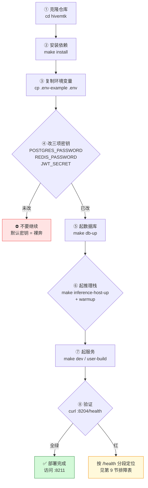
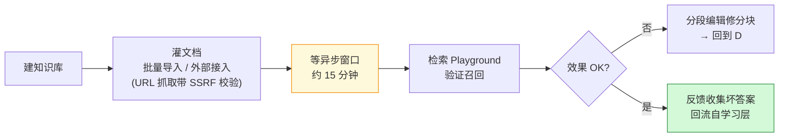

# 操作手册（人读版）v2.0

> 本文件是 **给人用的操作手册**：从零部署到日常运营的完整操作路径。
> 只写可执行、已验证的步骤；与既有详细文档重叠处给出链接，不重复抄。
>
> **读者**：实施工程师、运维、运营。
> **代码基线**：`hivemtk/` 仓库 main 分支，复核日期 2026-10-13。
> 功能范围请看 [功能文档（人读版）](./FEATURES-FOR-HUMANS.md)。

---

## 目录

1. [环境与硬件要求](#1-环境与硬件要求)
2. [首次部署（含启动顺序图）](#2-首次部署)
3. [密钥与安全配置（必做）](#3-密钥与安全配置必做)
4. [启动推理栈](#4-启动推理栈)
5. [启动服务](#5-启动服务)
6. [安全红线处置](#6-安全红线处置)
7. [日常运营操作（含前端菜单地图）](#7-日常运营操作)
8. [备份与恢复](#8-备份与恢复)
9. [健康检查与排障入口](#9-健康检查与排障入口)
10. [升级与迭代](#10-升级与迭代)

---

## 1. 环境与硬件要求

| 项 | 最低（开发/试用） | 推荐（生产，含 14B 模型） |
|----|------|------|
| CPU | 4 核 | 8 核 |
| 内存 | 8 GB | 16 GB |
| 磁盘 | 50 GB | 按模型规模另行评估（14B 量化级约再 +15GB） |

**软件前置**：Git · Go 1.26+ · Node（前端构建）· Docker + Compose（仅 PG/Redis）· llama.cpp 运行时。

> ⚠️ **关键认知**：Docker 在本项目里**只**负责 PostgreSQL 与 Redis。`user-server`、推理三件套、前端全部跑在宿主机——别去找"一键起全栈的 compose"，没有。

> 详细环境与架构说明见 [`docs/DEPLOYMENT_GUIDE.md`](../DEPLOYMENT_GUIDE.md)、[`docs/operations/MERCHANT_DEPLOYMENT.md`](../operations/MERCHANT_DEPLOYMENT.md)。

---

## 2. 首次部署



```bash
# ① 进入仓库
cd hivemtk

# ② 安装依赖（后端 go mod / 前端 node_modules / 本地工具）
make install

# ③ 复制环境变量模板（69 个键）
cp .env-example .env

# ⑤ 起数据库（PostgreSQL 8202 + Redis 8203）
make db-up
make db-ps      # 确认容器状态
```

前端构建（可选，开发期可直接 `make dev`）：

```bash
make web-build      # 前端产物
make sdk-build      # 嵌入 SDK 产物
```

---

## 3. 密钥与安全配置（必做）

编辑 `.env`，**至少**修改以下三项，不可留默认值：

| 变量 | 说明 | 生成建议 |
|------|------|---------|
| `POSTGRES_PASSWORD` | PostgreSQL 密码 | 随机 32 位 |
| `REDIS_PASSWORD` | Redis 密码 | 随机 32 位 |
| `JWT_SECRET` | JWT 签名密钥 | `openssl rand -base64 48` |

平台端相关（仅 `PLATFORM_ENABLED=true` 时需要）：

| 变量 | 说明 |
|------|------|
| `PLATFORM_ADMIN_PASSWORD` | 平台超管密码 |
| `MERCHANT_API_SECRET` | 商户 API 密钥 |

按场景挑的常用可选项：

| 变量 | 作用 | 生产该设成什么 |
|------|------|--------------|
| `GIN_MODE` | Gin 运行模式 | `release` |
| `REQUIRE_PRIVATE_NETWORK` | 是否限制仅私网访问 | `true`（除非有公网需要） |
| `PUBLIC_BASE_URL` / `GEO_SITE_BASE_URL` | 外部访问基址 | 实际域名 |
| `CORS_ALLOW_ORIGINS_USER` | 前端跨域白名单 | 仅列实际前端源 |
| `CORS_ALLOWED_EXTENSIONS` | Chrome 扩展 ID 白名单（Bridge 用） | 逐 ID 列，**不要留空** |
| `BRIDGE_INGRESS_AUTH` | Bridge 入站鉴权逃生阀 | 保持默认（勿设 off） |
| `EMBEDDING_ALLOW_FALLBACK` | 向量化降级开关 | 按容忍度，见下 |
| `LLM_*` / `EMBEDDING_*` / `RERANK_*` | 本地推理三件套连接参数 | 与 `make inference-host-status` 一致 |
| `LAY_*` | Laya 决策服务参数 | 未启用则不配 |
| `HIVEMTK_PROFILE` | 运行档位 | 与硬件档匹配 |

> 💡 `EMBEDDING_ALLOW_FALLBACK` 打开后，Embedding 服务挂掉会用 Hash 降级继续跑——**能保业务不断，但检索质量会明显下降**。打开前想清楚这是降级还是掩护故障。

> `.env-example` 共 69 个键，含全部可选项与注释。
> 密钥轮换流程见 [`docs/operations/secret_rotation.md`](../operations/secret_rotation.md)。

---

## 4. 启动推理栈

推理三件套是**回复质量的上限**，起不来或没 warmup，前端表现为"回复慢 / 超时 / 检索不到"。

```bash
# 安装 llama.cpp 运行时
make inference-host-install

# 下载模型
make inference-host-models        # 默认模型集
make inference-host-models-prod   # 生产模型集

# 启动 / 停止
make inference-host-up
make inference-host-down

# 预热（首次加载模型，避免首请求超时）
make inference-host-warmup

# 自检与查看
make inference-host-test
make inference-host-status
make inference-host-ps
make inference-host-logs
```

Laya 决策服务（可选）：

```bash
make laya-models
make laya-up
make laya-warmup      # 同样建议预热
make laya-test
make laya-logs
make laya-down
```

---

## 5. 启动服务

### 开发模式（热更新）

```bash
make dev            # air 热重启，监听 *.go / *.yaml / *.html / *.json / *.env，增量约 1.5s
make dev-stop
make dev-clean
make dev-help       # 看全部 dev 子命令
```

### 生产模式

```bash
make user-build
# 按 docs/DEPLOYMENT_GUIDE.md 的方式以 release 模式运行
```

### 一键起全部

```bash
make dev-all       # 数据库 + 推理 + 服务
make dev-down
```

### 访问与首登

- 前端：`http://<host>:8211`
- 后端：`http://<host>:8204`
- 健康：`http://<host>:8204/health`

**首次登录后立刻做三件事**：① 改默认超管密码；② 开启 MFA；③ 建自己的角色与账号，别长期用超管。

---

## 6. 安全红线处置

上线前逐项确认，**不要**用默认/关闭状态进生产：

| 红线 | 风险 | 正确做法 |
|------|------|---------|
| `ALLOW_INSECURE_WEBHOOK=true` | 关闭 webhook 验签，可被**伪造报文驱动触达** | 保持 `false`；为每个渠道配置官方要求的 secret/token |
| unlock 越狱 prompt | 系统 prompt 中存在可被诱导绕过限制的路径 | 使用方需自行审计并封堵；定期看 `/api/security/audit/list` |
| Secret 明文 KV | 密钥以明文存 KV | 部署后立即轮换全部密钥，限制 `.env` 权限 `chmod 600` |
| `BRIDGE_INGRESS_AUTH=off` | Bridge 入站免鉴权，任何人可灌假消息 | 保持默认开启；仅排障时临时关闭并限网络 |
| `ENABLE_DEBUG_ROUTES=true` | 暴露 `/__debug__/routes` | 生产保持关闭 |
| `GIN_MODE=debug` | 泄露内部错误细节 | 生产设为 `release` |

> ⚠️ 额外一条**架构级风险**：系统存在**进程内存态**实现（见功能文档已知限制），重启即丢、多副本会状态分裂。生产多副本部署前先确认你要的能力有没有持久化，别把单机行为当集群行为用。

源码级安全审计清单见 [`docs/standards/MASTER_RULES.md`](../standards/MASTER_RULES.md)；合规声明见 [`DISCLAIMER.md`](../../DISCLAIMER.md)。

---

## 7. 日常运营操作

### 7.0 前端菜单地图（后端驱动 RBAC）

菜单树由后端 `GET /api/menus` 按角色下发（`model.SystemMenuTree`），前端不静态过滤——**某个菜单看不到，先查角色权限分配，不是前端 bug**。

| 顶级菜单 | 覆盖的日常动作 |
|---|---|
| **工作台** | 统一收件箱、客服会话三栏看板、统一消息、消息中台、企微账号 |
| **客户中心** | 客户 360、客户事件、OneID、标签分层、RFM 分群、客服 Widget 渠道、客户身份 |
| **智能体** | 智能体 CRUD、被动应答（对话记忆/意图识别/异议处理/话术）、主动触达、客服工作台与渠道、销售智能（销冠画像/SOP）、能力支撑（置信度/拟人度/反馈学习/LLM 路由） |
| **触达运营** | 营销自动化、触达 Pipeline、批量操作、活码、短链、邮件、短信、五平台卡片、各社群（WhatsApp/Telegram/飞书/QQ）、域名池 |
| **知识中心** | 知识库工作台、RAG 产品配置、外部接入、导入/统计/反馈、资产市场与资产包 |
| **数据分析** | AI 产能、转化漏斗、客户旅程大屏、数据大屏、自定义报表、A/B 实验、流失预警、GEO 工具 |
| **系统设置** | 站点配置、团队/角色/权限、平台账号、素材库、监控、备份恢复、操作日志、安全审计、多语言、浏览器自动化 |

### 7.1 渠道接入（一次性，之后日常巡检查活）

| 渠道 | 操作 |
|------|------|
| 抖音 / 小红书 / 快手 / 闲鱼 / TikTok | 装 Chrome 扩展 → 在对应菜单绑定账号 → 确认 Bridge `X-Bridge-Token` 已配 + 扩展 ID 在 `CORS_ALLOWED_EXTENSIONS` → 验证 `GET /api/bridge/capabilities` |
| 企业微信 / 飞书 / 钉钉 / 微信 | 按各平台开放平台口径配 AppID/Secret → [平台账号] 绑定 → 确认 webhook 验签通过 |
| Telegram | 建 Bot Token → [电报社群] 绑定 |
| 短信 | [短信] → 配阿里云凭证 → 建列表 → 建草稿 → 发任务 |
| 邮件 | [邮件] → 配 SMTP → 建列表 → 建草稿 → 发任务 → 看打开/点击追踪 |

⚠️ **快手/小红书/闲鱼的 webhook 通配路由固定返回 400**——这是能力闸在拒收，不是故障。这三个平台的私信只能走 Bridge。

Bridge 详细运维见 [`docs/operations/Bridge_Runbook.md`](../operations/Bridge_Runbook.md)；Widget 嵌入见 [`docs/operations/CHAT_WIDGET_EMBED.md`](../operations/CHAT_WIDGET_EMBED.md)。

### 7.2 知识库建设（**决定回复质量，优先做**）



1. [知识中心] → 新建知识库
2. 灌入文档（URL 抓取带 SSRF 校验）
3. **等约 15 分钟**异步窗口
4. [检索 Playground] 验证召回效果
5. [分段编辑] 修分块，回到 4 迭代
6. [反馈] 收集坏答案，回流自学习层

> ⚠️ 灌完立刻去检索大概率是空的——不是坏了，是 F5 管线的 15 分钟异步窗口没到。

### 7.3 智能体配置

1. [智能体] → 新建，选角色（sales / cs / hybrid）
2. [渠道绑定] 把智能体挂到具体渠道账号
3. [对话记忆] 查看历史上下文
4. [置信度面板 / 拟人度面板 / 反馈学习面板] 调参观察
5. [SOP 智能体] 配置 DAG，**AB 权重和必须 = 100**
6. [LLM 路由] 确认降级链与熔断策略

> ⚠️ **行为拟人默认关**（F11/G7），实际只有润色层生效。要更自然的回复需手动开启，并观察五维门禁（0.85）的误杀率——门禁过严会大量转人工。
> SOP 编排的单位是**节点**，源码提供 15 种节点类型（start/message/branch/wait/action/end/ai_decide/send_offer/greeting/inquire/introduce/handle/close/invite/follow_up），不是固定 19 节点模板。

### 7.4 客户与线索日常

- [统一收件箱] 处理跨渠道会话，三栏看板（会话/客户/工单）
- [客户360] 看单客户全貌；[OneID] 合并重复客户
- [线索] 列表 + 统计，优先跟进 `clue_score` 高的
- [RFM 分群] / [流失预警] / [挽回队列] 建议每周跑一次
- [客服 Widget] 接入官网

### 7.5 营销与触达

- [营销自动化] 建流程；[A/B 实验] 跑对照
- [触达 Pipeline] 9 步推进
- [批量操作] / [活码] / [短链]（看点击统计）/ [域名池]
- [卡片生成] 五平台内容物料

> ⚠️ **主动外联触达的完整编排目前是骨架未接线**（G11）。能用的主动外联是短信/邮件/WhatsApp 群发这类显式发送任务，不是全自动的"四格"编排。每次主动触达服务端会打不可关闭的 `[COMPLIANCE]` 日志。

### 7.6 LTC 商机跟进

商机阶段推进、报价、账单、人工任务、审批、坏案例归档、知识库发布。

> ⚠️ LTC 装配开关默认关，端点回 **503** 表示该能力未启用——需管理员在 `/api/manage/ltc/config` 开启，不是接口坏了。

### 7.7 监控与审计（每日）

- [监控] 业务链路 traces、trace-tree
- [操作日志]、[安全审计]
- [AI 产能]、[转化漏斗]、[客户旅程大屏]、[数据大屏]、[自定义报表]

> 注意**没有** `/metrics` Prometheus 端点，接自有监控需自行埋点或用 `/api/system-monitor/*`。

---

## 8. 备份与恢复

```bash
# 备份
make db-backup

# 恢复
make db-restore FILE=<备份文件路径>
```

应用层备份走 `/api/backup/*`。

> ⚠️ **进程内存态的能力重启即丢，数据库备份不覆盖这部分**。备份方案设计前先确认目标能力是否持久化。

灾备与高可用详见 [`docs/operations/HA_DEPLOYMENT.md`](../operations/HA_DEPLOYMENT.md)、[`docs/operations/DR_RECOVERY.md`](../operations/DR_RECOVERY.md)、[`docs/operations/SLA_SLO.md`](../operations/SLA_SLO.md)、[`docs/operations/secret_rotation.md`](../operations/secret_rotation.md)。

---

## 9. 健康检查与排障入口

```bash
curl http://localhost:8204/health    # 全量，含 LLM/Embedding/Rerank 依赖
curl http://localhost:8204/healthz
curl http://localhost:8204/readyz
```

| 现象 | 先查哪里 |
|------|---------|
| 回复慢 / 超时 | `/health` 的 LLM/Embedding 段；`make inference-host-ps`；`make inference-host-logs` |
| 检索不到内容 | 知识库 15 分钟窗口；分块质量；Embedding 服务是否活 |
| 渠道收不到报文 | webhook 验签配置；Bridge token；`GET /api/webhook/health` |
| 502 / 起不来 | `.env` 密钥；`make db-ps`；后端日志 |
| 前端某个菜单看不到 | 角色菜单权限分配（后端驱动 RBAC），不是前端问题 |
| LTC 接口 503 | 装配开关未开，`/api/manage/ltc/config` |
| 主动外联不自动跑 | 设计如此（G11 骨架），改用显式发送任务 |

详细排查见 [`docs/TROUBLESHOOTING.md`](../TROUBLESHOOTING.md)、[`docs/PERFORMANCE_BENCHMARK`](../operations/) 相关专题。

---

## 10. 升级与迭代

```bash
git pull
make install
make db-up
# 检查 .env 是否有新增键（与 .env-example 对比）
diff <(grep -o '^[A-Z_]*' .env) <(grep -o '^[A-Z_]*' .env-example)
```

改完代码后建议跑一遍门禁（命令详解见 [操作手册 AI 读版](./OPERATIONS-FOR-AI.md)）：

```bash
make lint        # golangci-lint v2.10.0（CI pin 一致）
make test-go
make audit       # ~30 项静态门禁，红就得修
```

---

## 相关文档

| 文档 | 内容 |
|------|------|
| [功能文档（人读版）](./FEATURES-FOR-HUMANS.md) | 功能全集与已知限制 |
| [功能文档（AI 读版）](./FEATURES-FOR-AI.md) | 接口清单、模块地图 |
| [操作手册（AI 读版）](./OPERATIONS-FOR-AI.md) | 门禁与新增功能流程 |
| [`../DEPLOYMENT_GUIDE.md`](../DEPLOYMENT_GUIDE.md) | 部署详细指南 |
| [`../TROUBLESHOOTING.md`](../TROUBLESHOOTING.md) | 故障排查 |
| [`../PORT_REGISTRY.md`](../PORT_REGISTRY.md) | 端口注册表 |
| [`../operations/`](../operations/) | 高可用 / 灾备 / SLO / 密钥轮换 / Bridge 等专题 |
| [`../capabilities.md`](../capabilities.md) | 渠道能力矩阵（自动生成，勿手改） |
