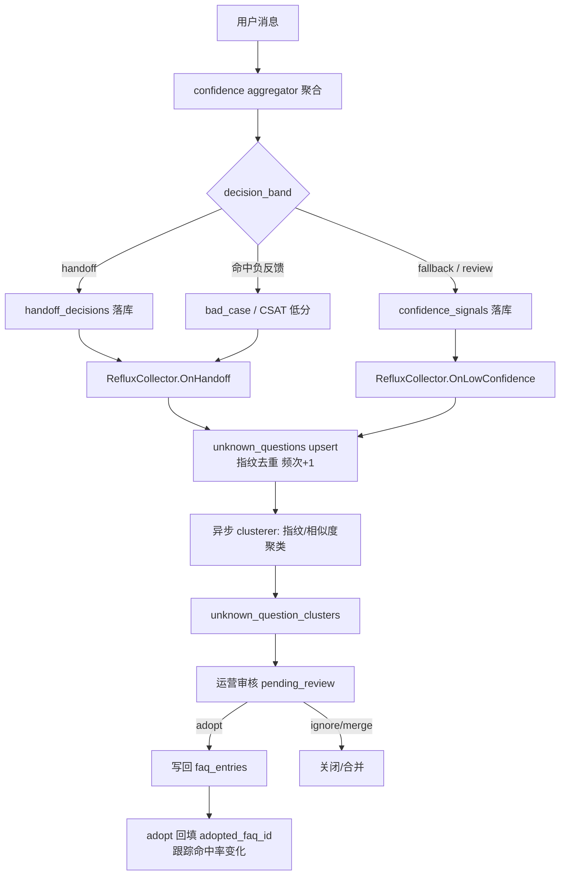
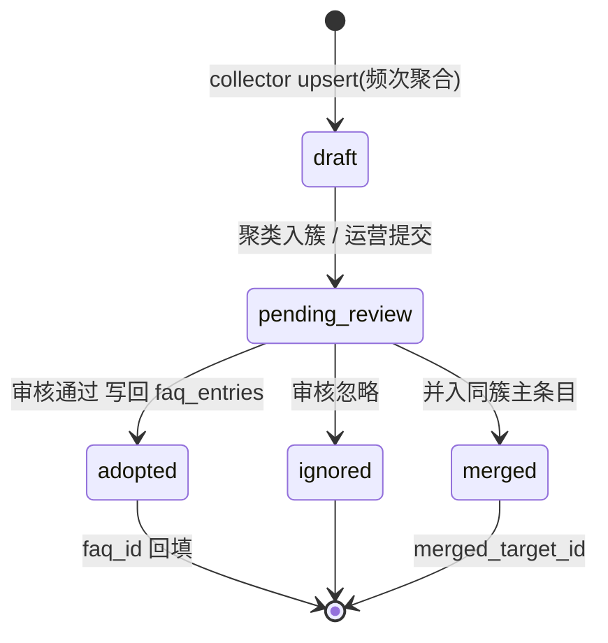

# T1：低置信度问题回流知识库（Confidence Reflux Pipeline）

> 设计文档 · user-server · 2026-10
>
> 关联已有设施：`internal/model/confidence.go`（confidence_signals / confidence_calibrations / handoff_decisions）、`internal/service/confidence/`（aggregator、platt/conformal 校准、dynamic_threshold、veto_rule）、`model/faq_entry.go` + `controller/faq.go`、`model/human_task.go`、`model/bad_case.go`、`model/csat.go`、`repository/support_metrics.go`。
>
> 缺失环节（本文档补齐）：低置信/未答问题 → 去重沉淀 → 聚类 → 人工审核 → 写回 `faq_entries` 的完整回流管道。

## 1. 竞品依据

### 1.1 Intercom Fin — Suggestions from Conversations（聚类审核回流）

Fin 会对**未解决（unresolved）会话**做全量分析，对比机器人回复与人工坐席的最终答复，自动聚类生成 "Content gap" 建议条目，由运营人员**审核后一键写入 Knowledge Center**，形成"识别缺口 → 聚类 → 审核 → 回流"闭环（参考：[Intercom 官方帮助文档：Use AI-powered content recommendations to improve Fin](https://www.intercom.com/help/en/articles/11394959-use-ai-powered-content-recommendations-to-improve-fin)、[Fin Research: Generating Knowledge Center Content from Customer Service Conversations](https://fin.ai/research/generating-knowledge-center-content-from-customer-service-conversations)）。社区实践中也把 Fin 未解决会话按 topics 分组归堆来组织未知问题（[Fin unresolved conversation analysis in bulk](https://community.intercom.com/ask-the-intercom-team-about-fin-54/fin-unresolved-conversation-analysis-and-optimization-in-bulk-7003)）。

对本设计的启示：**回流必须以"会话聚类 + 人工审核"为前置门槛**，不能自动直写知识库；且建议条目需携带"原始问句 + 坐席最终答案"证据链。

### 1.2 Chatbase — Deflection vs Resolution 指标观

Chatbase 与 Fin 均强调：**Deflection（拦截率）是虚荣指标，Resolution（真实解决率）才是北极星**——一个平台可以有 90% 拦截率却只有 40% 真实解决率（参考：[Chatbase: Deflection vs. Resolution: Key Differences in AI Support](https://www.chatbase.co/blog/deflection-vs-resolution)、[Fin.ai: Resolution vs. Deflection Rate](https://fin.ai/learn/resolution-rate-vs-deflection-rate)、[Chatbase: AI Customer Service Statistics](https://www.chatbase.co/blog/ai-customer-service-statistics)）。

对本设计的启示：回流管道的成功指标应绑定 **resolution 提升**（采纳新 FAQ 后低置信率下降、CSAT 上升），而非"收集了多少未知问题"。因此本设计将 `csat.go` 的负反馈与 `bad_case.go` 作为回流的重要触发源之一。

### 1.3 智齿科技 — 未知问题运营

智齿明确将"未命中答案的问法定义为未知问题"，支持配置是否入库学习，后台提供**未知问题统计看板 + 待学习队列**，由知识运营人员批量处理（参考：[智齿：知识运营统计使用指南](https://help.zhichi.com/pages/9b63aa/)、[智齿在线客服机器人：未知问题配置](https://www.yun88.com/product/3969.html)、[知识库运营决定智能客服效果](https://zhiqi.163.com/cms/ai-ke-fu-qi-yu-zhi-neng-ke-fu-2026-SW4te5V0.html)）。

对本设计的启示：需要**独立的"未知问题队列 + 频次统计 + 运营操作流水"**，让运营工作量可统计、处理动作可审计。

## 2. 目标 / 非目标 / 范围

### 2.1 目标

1. **沉淀**：低置信（decision_band ∈ {handoff, fallback} 或未命中）的用户问题自动去重沉淀为 `unknown_questions`，带频次与指纹。
2. **聚类**：按指纹 + pg_trgm 相似度将未知问题聚类为 `unknown_question_clusters`，运营按簇处理而非逐条处理。
3. **审核**：状态机 `draft → pending_review → adopted | ignored | merged`，操作全程留痕于 `unknown_question_review_logs`。
4. **回流**：审核采纳后按第 6 章映射规则写回 `faq_entries`（含关键词去泛化），立即被 Layer1 FAQ 匹配使用。
5. **指标闭环**：采纳后跟踪该簇问题命中率变化，输出到 support_metrics 报表，验证 resolution 提升。

### 2.2 非目标

- 不做自动写回（无人工审核的直写）——竞品共识均为人工审核门槛（见 1.1）。
- 不改动 confidence 校准（platt/conformal）与动态阈值逻辑，仅**消费**其输出。
- 不做跨语言聚类、语义向量聚类（本版仅指纹 + pg_trgm，见 4.3）。
- 不涉及 admin 端界面（仅 user-web 运营端）。

### 2.3 范围

| 层 | 变更 |
|---|---|
| model | 新增 `unknown_question.go`、`unknown_question_cluster.go`、`unknown_question_review_log.go` |
| repository | 新增 `unknown_question.go` 等 3 个仓库 + 单测 |
| service | 新增 `internal/service/reflux/`（collector、clusterer、adopter） |
| controller | 新增 `internal/controller/unknown_question.go`，路由挂 `/api/unknown-questions` |
| migration | `v3_83_0_unknown_question_reflux_migration.go`（036+ 语义编号见 §8） |
| 前端 | `user-web/src/views/unknownQuestion/`（List.vue / Detail.vue），对齐 faq 视图风格 |
| 触发挂接 | `service/confidence/aggregator.go` 决策后 hook、bad_case / CSAT 负反馈 hook |

## 3. 数据模型

> 判据说明：本仓库租户隔离由 `internal/pkg/tenancyidx/tenant_callback.go` 注册的 GORM callback 执行——on 模式下 Query/Update/Delete 自动注入 `WHERE tenant_id = ?`、Create 自动填充，**判定一张表是否被隔离的唯一依据是该表 model 含 `TenantID` 列**（参考 `bridge_selector_health.go` 注释）。故本文三张表均带 `TenantID uint \`gorm:"not null;default:1;index"\``，置于结构体首字段，与 `confidence.go` / `faq_entry.go` 现有风格完全一致。

### 3.1 UnknownQuestion（unknown_questions，未知问题去重沉淀）

```go
// UnknownQuestion 低置信/未命中的用户问题沉淀（对应 unknown_questions 表）
type UnknownQuestion struct {
	TenantID uint `gorm:"not null;default:1;index" json:"tenant_id"`

	ID           int64  `gorm:"primaryKey;autoIncrement" json:"id"`
	QuestionHash string `gorm:"column:question_hash;size:64;not null;uniqueIndex:uk_uq_tenant_hash,priority:1" json:"question_hash"` // sha256(normalized question) 十六进制
	Question     string `gorm:"column:question;type:text;not null" json:"question"`            // 首次原始问句
	ClusterID    int64  `gorm:"column:cluster_id;default:0;index:idx_uq_cluster" json:"cluster_id"`

	// 状态机: draft -> pending_review -> adopted | ignored | merged
	Status       string `gorm:"column:status;size:32;not null;default:'draft';index:idx_uq_tenant_status,priority:2" json:"status"`
	Source       string `gorm:"column:source;size:32;not null" json:"source"` // low_confidence | handoff | bad_case | csat_negative | no_match
	SourceID     string `gorm:"column:source_id;size:64;default:''" json:"source_id"` // signal_id / decision_id / bad_case_id / csat_id
	SessionID    string `gorm:"column:session_id;size:128;default:''" json:"session_id"`
	CustomerID   string `gorm:"column:customer_id;size:64;default:''" json:"customer_id"`
	AgentID      uint   `gorm:"column:agent_id;default:0;index:idx_uq_tenant_status,priority:3" json:"agent_id"`
	IntentType   string `gorm:"column:intent_type;size:64;default:''" json:"intent_type"`
	LowConfScore float64 `gorm:"column:low_conf_score;type:decimal(5,4);default:0" json:"low_conf_score"` // 触发时的 aggregated_conf

	Frequency      int        `gorm:"column:frequency;not null;default:1" json:"frequency"`
	FirstSeenAt    time.Time  `gorm:"column:first_seen_at;not null;default:now()" json:"first_seen_at"`
	LastSeenAt     time.Time  `gorm:"column:last_seen_at;not null;default:now();index:idx_uq_last_seen" json:"last_seen_at"`
	MergedTargetID int64      `gorm:"column:merged_target_id;default:0" json:"merged_target_id"` // merged 时指向簇内主条目
	AdoptedFaqID   uint       `gorm:"column:adopted_faq_id;default:0" json:"adopted_faq_id"`     // adopted 时回填 faq_entries.id
	ReviewedBy     string     `gorm:"column:reviewed_by;size:64;default:''" json:"reviewed_by"`
	ReviewedAt     *time.Time `gorm:"column:reviewed_at" json:"reviewed_at,omitempty"`
	CreatedAt      time.Time  `gorm:"column:created_at;not null;default:now()" json:"created_at"`
	UpdatedAt      time.Time  `gorm:"column:updated_at;not null;default:now()" json:"updated_at"`
}

// TableName 表名
func (UnknownQuestion) TableName() string { return "unknown_questions" }
```

- **去重指纹**：`question_hash = sha256(normalize(question))`；normalize = 去首尾空白 + 全角转半角 + 去标点 + 小写。联合唯一索引 `(tenant_id, question_hash)` 防重入库，重复出现走 `frequency++ / last_seen_at` 更新（upsert）。
- 状态机转换：`draft→pending_review`（入簇/运营提交）、`pending_review→adopted|ignored`、`pending_review→merged`（归入同簇主条目）。

### 3.2 UnknownQuestionCluster（unknown_question_clusters，聚类簇）

```go
// UnknownQuestionCluster 未知问题聚类簇（对应 unknown_question_clusters 表）
type UnknownQuestionCluster struct {
	TenantID uint `gorm:"not null;default:1;index" json:"tenant_id"`

	ID            int64  `gorm:"primaryKey;autoIncrement" json:"id"`
	ClusterHash   string `gorm:"column:cluster_hash;size:64;not null;uniqueIndex:uk_uqc_tenant_hash" json:"cluster_hash"` // 首条目 hash（簇代表）
	Title         string `gorm:"column:title;size:255;not null" json:"title"`          // 代表问句（高频成员问句）
	AgentID       uint   `gorm:"column:agent_id;default:0;index" json:"agent_id"`
	Status        string `gorm:"column:status;size:32;not null;default:'pending_review';index:idx_uqc_status" json:"status"` // pending_review | adopted | ignored
	QuestionCount int    `gorm:"column:question_count;not null;default:0" json:"question_count"`  // 成员数
	TotalFrequency int   `gorm:"column:total_frequency;not null;default:0" json:"total_frequency"` // 成员频次合计（排序主键）
	SampleQuestions pq.StringArray `gorm:"column:sample_questions;type:text[];default:'{}'" json:"sample_questions"` // 簇内样本（≤10）
	AdoptedFaqID  uint       `gorm:"column:adopted_faq_id;default:0" json:"adopted_faq_id"`
	ReviewedBy    string     `gorm:"column:reviewed_by;size:64;default:''" json:"reviewed_by"`
	ReviewedAt    *time.Time `gorm:"column:reviewed_at" json:"reviewed_at,omitempty"`
	CreatedAt     time.Time  `gorm:"column:created_at;not null;default:now()" json:"created_at"`
	UpdatedAt     time.Time  `gorm:"column:updated_at;not null;default:now()" json:"updated_at"`
}

// TableName 表名
func (UnknownQuestionCluster) TableName() string { return "unknown_question_clusters" }
```

### 3.3 UnknownQuestionReviewLog（unknown_question_review_logs，审核操作流水）

```go
// UnknownQuestionReviewLog 审核操作流水（对应 unknown_question_review_logs 表，仅追加）
type UnknownQuestionReviewLog struct {
	TenantID uint `gorm:"not null;default:1;index" json:"tenant_id"`

	ID         int64  `gorm:"primaryKey;autoIncrement" json:"id"`
	TargetType string `gorm:"column:target_type;size:16;not null;index:idx_uqrl_target,priority:1" json:"target_type"` // question | cluster
	TargetID   int64  `gorm:"column:target_id;not null;index:idx_uqrl_target,priority:2" json:"target_id"`
	Action     string `gorm:"column:action;size:32;not null" json:"action"` // submit | adopt | ignore | merge | reopen
	FromStatus string `gorm:"column:from_status;size:32;default:''" json:"from_status"`
	ToStatus   string `gorm:"column:to_status;size:32;default:''" json:"to_status"`
	OperatorID string `gorm:"column:operator_id;size:64;not null" json:"operator_id"`
	Detail     string `gorm:"column:detail;type:text;default:''" json:"detail"` // 采纳时的 faq_id / 合并目标等
	CreatedAt  time.Time `gorm:"column:created_at;not null;default:now();index:idx_uqrl_target,priority:3" json:"created_at"`
}

// TableName 表名
func (UnknownQuestionReviewLog) TableName() string { return "unknown_question_review_logs" }
```

### 3.4 索引设计汇总

| 表 | 索引 | 用途 |
|---|---|---|
| unknown_questions | uk (tenant_id, question_hash) | 指纹去重 |
| unknown_questions | idx (tenant_id, status, agent_id) | 运营队列按状态/坐席过滤 |
| unknown_questions | idx (last_seen_at) | 高频近期问题排序 |
| unknown_questions | idx (cluster_id) | 簇成员展开 |
| unknown_question_clusters | uk (tenant_id, cluster_hash) | 簇去重 |
| unknown_question_clusters | idx (status, total_frequency) | 审核队列按频次排序 |
| unknown_question_review_logs | idx (target_type, target_id, created_at) | 详情页流水时间线 |
| 三表 | idx (tenant_id) | tenancyidx callback 注入 WHERE 的前缀 |
| unknown_questions | GIN trgm (question) | pg_trgm 相似聚类（迁移中显式 SQL 创建，见 §4.3） |

## 4. 触发与聚类

### 4.1 触发时机与挂接点



| 触发源 | 挂接点 | 条件 |
|---|---|---|
| 低置信信号 | `service/confidence/aggregator.go` 决策产出后（后置 hook，不阻塞主链路） | `decision_band ∈ {handoff, fallback}`，即低于 `confidence_calibrations` 校准后经 `dynamic_threshold` 得出的阈值 |
| 转人工 | `HandoffDecisionRecord` 创建后 | reason = low_confidence 等 |
| 坏例 | `model/bad_case.go` 新增/人工标记 | 负例问题文本 |
| CSAT 负反馈 | `model/csat.go` score ≤ 2 时 | 会话末轮用户问句 |
| 未命中 | FAQ Match top1 score < 0.60（`controller/faq.go` Match 阈值下限） | `source = no_match` |

实现要点：collector 以**事件异步消费**（goroutine + 有界 channel，丢弃计数入日志），绝不在问答主链路内同步写库；阈值复用 `threshold_policies` 的 band 分界，不新造阈值常量。

### 4.2 状态机



### 4.3 聚类选型论证：指纹优先 + pg_trgm 补充

| 方案 | 优点 | 缺点 | 结论 |
|---|---|---|---|
| 精确指纹（sha256 normalized） | 零成本、绝对无歧义 | 无法覆盖改写问句 | **第一道闸**：拦截 60%+ 重复（同一句式复问占比高） |
| pg_trgm 相似度 | 纯 PG 扩展、GIN 索引、`similarity()` 直接 SQL，中文 trigram 对字面改写有效 | 字面不同但语义同义召回弱 | **第二道闸**：新问题入库时 `ORDER BY similarity(question, $new) DESC LIMIT 1` 找已有簇（阈值 0.55），命中即 `cluster_id` 归属 |
| 向量语义聚类（pgvector + embedding） | 语义召回强 | 引入 embedding 调用成本、向量维度选型、簇心漂移维护复杂度 | **本版不做**；表结构已预留 `cluster_id` 迁移路径，后续加 `embedding vector` 列即可升级 |

在线单条归簇（新问题到来时一次 trgm 相似查询）而非离线批量 K-Means：无簇心维护、簇随 upsert 增长自然形成，运营可见 `question_count / total_frequency` 排序。GIN trgm 索引在迁移中以显式 SQL 创建：`CREATE INDEX idx_uq_question_trgm ON unknown_questions USING gin (question gin_trgm_ops)`（迁移文件内先 `CREATE EXTENSION IF NOT EXISTS pg_trgm`，幂等）。

## 5. API 设计

> 对齐 `controller/faq.go` 风格：controller 持 `svc`、`RegisterRoutes(router *gin.RouterGroup)` 分组注册、`pagination.Parse` + `dto.Filter`、`response.Success / Error / ErrorFromDB / SuccessWithPage`、swag godoc 注释、binding required 结构体。路由挂载点与 `/api/faqs` 同级。

路由组 `/api/unknown-questions`：

| Method | Path | 说明 | 对标 faq.go |
|---|---|---|---|
| GET | `/` | 未知问题分页列表（filter: keyword / status / source / agent_id） | List |
| GET | `/stats` | 统计（total / pending / adopted 采纳率 / top 簇） | Stats |
| GET | `/:id` | 详情（含审核流水 + 簇成员） | Get |
| POST | `/:id/submit` | draft→pending_review | — |
| POST | `/:id/review` | 审核动作 `{action: adopt\|ignore\|merge, faq_id?, merged_target_id?, answer?}` | Toggle 风格（窄字段专用接口） |
| GET | `/clusters` | 簇列表分页（按 total_frequency 排序） | List |
| GET | `/clusters/:id` | 簇详情（成员列表 + 样本问句 + 流水） | Get |
| POST | `/clusters/:id/review` | 簇级审核（adopt 时对全簇生效，生成一条 FAQ） | — |

### 5.1 关键接口示例

```
POST /api/unknown-questions/clusters/:id/review
{ "action": "adopt", "answer": "标准答案文本", "category": "aftersales" }
→ 200 { "code": 0, "data": { "cluster_id": 12, "faq_id": 88, "adopted_count": 7 } }
```

- `adopt` 服务端（adopter）执行：簇代表问句→faq_entries.question；answer→answer；关键词生成走第 6 章去泛化；全簇成员置 adopted 并回填 `adopted_faq_id`；写 review_log。
- 权限：与 `/api/faqs` 同一中间件链（BearerAuth + 租户 ctx），tenant 隔离由 tenancyidx callback 兜底。

### 5.2 DTO

`internal/dto/unknown_question.go`：`UnknownQuestionFilter{Keyword, Status, Source, AgentID, Page, PageSize}`、`ClusterFilter{Status, AgentID, Page, PageSize}`、`ReviewReq{Action string binding:"required,oneof=adopt ignore merge submit"`、`FaqID uint`、`MergedTargetID int64`、`Answer string`、`Category string`。

## 6. 采纳流程（写回 faq_entries）

### 6.1 字段映射

| unknown_question(s) | faq_entries | 说明 |
|---|---|---|
| 簇代表问句（`clusters.title`，或单条 `question`） | `Question` | 去泛化后的规范化问句（见 6.2） |
| 审核请求 `answer`（必填） | `Answer` | 不允许空答案直写 |
| adopter 生成的关键词 | `Keywords`（text[]） | 分词后数组，禁泛化子串（见 6.2） |
| 审核请求 `category` | `Category` | 默认 `reflux` |
| 簇 `agent_id`（>0 时） | `AgentID` | 对齐 faq.go Create 的强 1对1 绑定语义 |
| — | `Intent` | 继承 `unknown_questions.intent_type`（非空时） |
| — | `Confidence` | 取簇成员 `low_conf_score` 均值的补数 `1-avg`，表示人工背书基准置信度 |
| — | `Enabled` | true（审核采纳即生效） |
| 簇 `total_frequency` | — | 记录于 review_log.detail，供回溯 |
| `clusters.id` | — | `unknown_questions.adopted_faq_id` 回填 faq_id |

复用 `service.FAQService.Create`（而非 repository 直插），保证 Layer1 关键词索引与 `idx_faq_gin` 维护逻辑一致。

### 6.2 关键词去泛化（历史教训硬约束）

**教训**：关键词中含泛化子串（如"怎么""什么""如何""可以吗""帮忙""请问"、单字"的/吗/了"、以及"价格""问题"这类跨品类泛词）会导致 Layer1 `MatchByKeyword` 大面积误命中，把无关消息路由到该 FAQ。

adopter 关键词生成规则（`internal/service/reflux/keyworder.go`）：

1. 分词后剔除停用词表（内置泛化停用词 + 各租户可配置扩展，存 `system_config`）。
2. 剔除长度 < 2 的词元。
3. **黑名单校验**：生成关键词若命中泛化黑名单 → 剔除；剔除后剩余关键词数 < 2 → **拒绝采纳**，返回 400 `关键词过于泛化，请人工补充专属关键词`，条目停留 pending_review 并写 review_log(action=reject_detail)。
4. 关键词必须包含至少一个**区分性词元**（在该 agent 现有 faq_entries 关键词全集中出现频次 = 0 的新词），避免与既有 FAQ 完全同键冲突。
5. 单元测试锁定：`TestKeyworder_RejectsGeneralized`（"怎么退款"→保留"退款"剔"怎么"；"怎么办"→直接拒绝）。

### 6.3 采纳后跟踪

采纳后 7 天窗口内，按 `adopted_faq_id` 统计 `faq_entries.hit_count` 增量与该簇 source 问题的复现次数（question_hash 再出现即视为未解决），写入 support_metrics 汇总；复现率不降的簇在列表页标记 `adopt_needs_review` 提示运营复审。

## 7. 前端设计（对齐 user-web/src/views/faq/）

现有 faq 视图为 `Index.vue / List.vue / Editor.vue`：el-card shadow=never 包头部（标题+副标题+右上操作按钮）、el-table 列表、抽屉式编辑。新视图目录 `user-web/src/views/unknownQuestion/`：

- **List.vue**（主列表页）
  - 头部 el-card：`未知问题运营` / 副标题"低置信与未命中问题聚类审核，采纳后写回 FAQ 知识库"；右侧按钮：刷新、`去 FAQ 库`（router push /faq）。
  - Tab 切换：`问题列表` / `聚类簇`（簇视图默认按 total_frequency 降序）。
  - 筛选区：el-select 状态（draft/pending_review/adopted/ignored/merged）、来源（low_confidence/handoff/bad_case/csat_negative/no_match）、坐席下拉；与 faq List 的 filter 风格一致。
  - 表格列：问句、频次（badge）、来源 tag、状态 tag、最近出现、操作（详情 / 提交审核 / 采纳 / 忽略 / 合并）。
  - 簇视图列：代表问句、成员数、频次合计、样本问句（el-tooltip 展示 ≤3 条）、操作（批量采纳 / 忽略）。
- **Detail.vue**（详情页）
  - 上半：问句元信息（el-descriptions，对齐 faq Editor 布局）。
  - 下半：审核流水时间线（el-timeline，读 review_logs）；簇成员子表。
  - 采纳弹窗：答案 textarea（必填）、分类、关键词回显（由后端生成、前端可增删）+ 泛化黑名单实时校验提示（调 `POST /api/unknown-questions/keywords/validate`，400 时红字提示）。
  - 状态 tag 配色复用 faq List 的 enabled 开关语义：pending_review=warning、adopted=success、ignored=info、draft、merged。
- API 封装对齐 `src/api/faq.ts` 风格，新增 `src/api/unknownQuestion.ts`。

## 8. 迁移、部署与回滚

### 8.1 迁移

- 文件：`v3_83_0_unknown_question_reflux_migration.go`（当前最高 v3_82_0，对齐 T2/T3 文档既定命名）。036+ 语义编号在文件头注释标明：**036 unknown_questions、037 unknown_question_clusters、038 unknown_question_review_logs**。
- 三表走 `AutoMigrate`（GORM tag 即 DDL，含 uk/idx）；以下例外用显式 SQL（幂等）：
  ```sql
  CREATE EXTENSION IF NOT EXISTS pg_trgm;
  CREATE INDEX IF NOT EXISTS idx_uq_question_trgm ON unknown_questions USING gin (question gin_trgm_ops);
  ```
- 回滚：drop 三表 + trgm 索引（`DROP TABLE IF EXISTS unknown_question_review_logs, unknown_question_clusters, unknown_questions CASCADE`；不 drop extension，避免影响其他表）。回滚仅丢未审核沉淀数据，faq_entries 不受影响。

### 8.2 部署顺序

1. 迁移先行（加表，对现有链路零侵入）。
2. 服务发版：collector hook 默认 **TENANT_MODE 无关、reflux 开关 `REFLUX_ENABLED=false`**，配置中心灰度开启。
3. 开启后观察 24h：channel 有界队列丢弃率 < 1%、unknown_questions 日增量量级符合预期（约为低置信会话的 30%~60%，指纹去重后）。
4. 前端随下一窗口发版（接口向后兼容，可后发）。

### 8.3 回滚

关闭 `REFLUX_ENABLED` 即停采（已有数据保留可查）；迁移回滚仅在彻底放弃功能时执行。faq_entries 误采纳可通过既有 `DELETE /api/faqs/:id` + toggle 下线兜底。

## 9. 测试计划

- **环境变量**：集成测试对齐本仓惯例——`POSTGRES_TEST_DSN` 或 `POSTGRES_TEST_HOST` 缺失即 `t.Skip`（参考 `internal/aiagent/rag/retrieval/hybrid_searcher_test.go` 头注释）。
- **单测**（无 DB）：
  - normalize + sha256 指纹稳定性（全半角/标点/大小写等价输入同 hash）。
  - keyworder：泛化黑名单、区分性词元校验（§6.2 第 5 条用例）。
  - 状态机非法迁移拒绝（draft→adopted 直接 400）。
  - 聚类归簇阈值边界（similarity 0.55 上下）。
- **集成测**（`internal/repository/unknown_question_test.go` 等，仿 `faq_entry_test.go` / `bad_case_tenant_test.go`）：
  - upsert 并发去重：同一 hash 并发 10 写 → 1 行 frequency=10。
  - tenant 隔离：双租户同 hash 各自独立（复用 bad_case_tenant_test 断言模式）。
  - 采纳事务性：adopt 后 faq_entries 存在、成员全 adopted、review_log 落 3 行。
- **异步断言**：collector 为异步，测试用**有上限轮询**（`require.Eventually`，timeout 5s / tick 20ms）断言 unknown_questions 出现，**禁止固定 sleep**。
- **回归**：`service/confidence/` 既有测试全绿（collector 为后置 hook 不改聚合逻辑）；`faq_entry_test.go` 全绿（faqs 路由未动）。

## 10. 任务拆解与风险

### 10.1 子任务

| # | 任务 | 估时 |
|---|---|---|
| 1 | model 三表 + dto + 迁移文件（含 trgm 索引 SQL） | 0.5d |
| 2 | repository ×3 + upsert/tenant 集成测 | 1d |
| 3 | service/reflux：collector（事件接入 aggregator/bad_case/csat hook，有界队列）+ 单测 | 1.5d |
| 4 | clusterer（指纹 + trgm 归簇）+ 单测 | 1d |
| 5 | adopter + keyworder（去泛化黑名单）+ 单测 | 1d |
| 6 | controller + 路由注册 + swag 注释 | 0.5d |
| 7 | 前端 unknownQuestion List/Detail + api 封装 | 1.5d |
| 8 | support_metrics 回流漏斗指标 + 采纳跟踪 | 0.5d |
| 9 | 联调 + 灰度开关 + 文档收尾 | 0.5d |

合计约 **8 人日**（单人串行；3/7 可并行减至 7 人日）。

### 10.2 风险

| 风险 | 等级 | 缓解 |
|---|---|---|
| 泛化关键词污染 Layer1 造成误命中 | 高 | §6.2 硬校验 + 拒绝采纳兜底 + 单测锁定 |
| 高流量下 unknown_questions 膨胀 | 中 | 指纹去重 + 保留策略（ignored/draft 90 天清理任务）+ 有界队列丢弃计数 |
| trgm 中文相似度召回不足（语义改写） | 中 | 预留 pgvector 升级路径（cluster_id 已解耦）；阈值可配 |
| aggregator hook 影响问答主链路 | 中 | 纯后置异步、panic recover、开关可关 |
| 多租户串数据 | 中 | 三表 TenantID + tenancyidx callback + 双租户集成测 |


