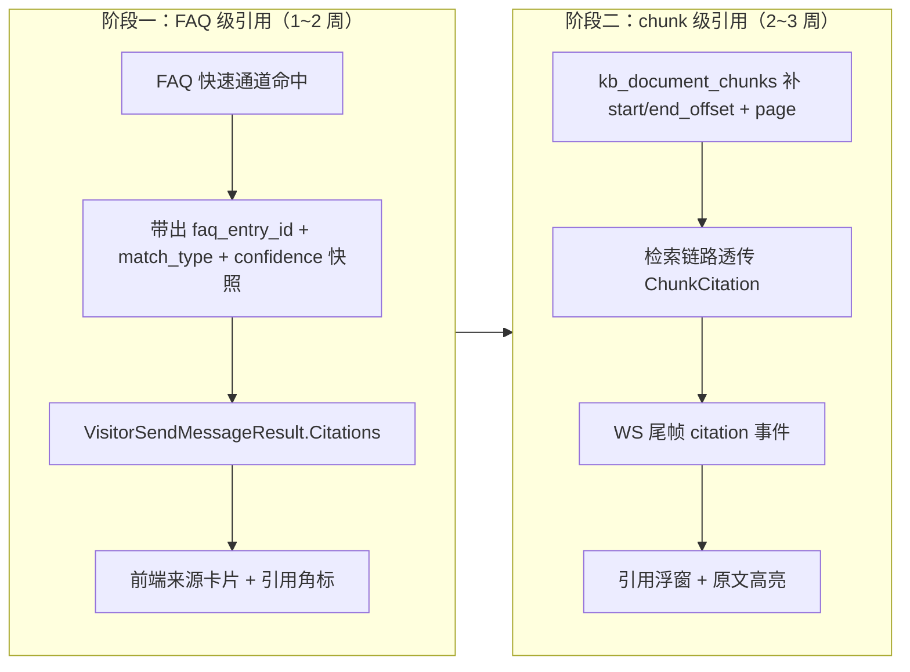

# T2 答案引用溯源（Answer Citation）功能设计文档

> 版本：v1.0
> 范围：官网 AI 客服 / 访客对话链路的 FAQ 级与 chunk 级引用溯源
> 关联：T1（低置信度问题回流知识库）、T3（Trace 级观测）、T4（知识库冷启动）
> 阅读对象：后端 Go 开发、前端 Vue 开发、测试

---

## 1. 背景与问题

### 1.1 现状

官网 AI 客服（网页右下角 widget）回答访客问题时，**不携带任何来源信息**：

- FAQ 命中（Layer1 快速通道，`internal/repository/faq_entry.go` 的 `ScoreCandidates`：精确 / jaccard 词元 / 关键词命中）→ 直接返回 `faq_entries.answer`，访客不知道答案出处；
- RAG 检索（`internal/aiagent/knowledge/service/rag_searcher*.go`，BM25/向量混合）→ `dto.RAGChunk` 只有 `Content/Source/Score/DocID/ChunkID/Weight`，`SalesResponse` 里虽然带 `rag_chunks`，但**从未透传到访客侧**（`VisitorSendMessageResult` 无任何引用字段），前端 `ChatMessages.vue` 也没有渲染出处的能力。

### 1.2 问题

1. 访客无法验证答案可信度，AI 回答"像凭空捏造"；
2. 运营侧无法回答"这条错误答案来自哪条 FAQ / 哪个 chunk"（与 T1 低置信度回流、T3 观测报表的归因诉求直接冲突）；
3. chunk 内容被截断（`truncateText(content, ChunkContentPreview())`），即使透传也读不到原文上下文。

### 1.3 历史教训（设计红线）

- FAQ 匹配**只认精确命中**，词元命中只做兜底；关键词必须**去泛化**（避免"可以/怎么/价格"这类泛词命中造成假引用）。引用透传时必须把**匹配方式（match_type）一并带出**，泛词兜底命中不得作为高置信引用展示。

---

## 2. 竞品依据

通过 WebSearch 调研三家主流对话式 RAG 产品的引用实现，得到三种粒度范式：

| 竞品 | 引用粒度 | 定位方式 | 交互形态 | 对本设计的启示 |
|---|---|---|---|---|
| **FastGPT**（4.9.1+ 分块阅读器） | chunk 级 | chunk → 原文 **offset 映射**（分块时保留原文定位），点击引用打开浮窗呈现**完整原文 + 高亮被引用片段** | 浮窗阅读器 + 高亮 | 阶段二的 `start_offset/end_offset` 设计来源：chunk 切分时必须落偏移量，否则后期无法补 |
| **RAGFlow** | chunk 级 + 页面级 | chunk 存**页面坐标 / bbox**（PDF 图文定位）；流式回答最后一帧返回 `reference.chunks` + `doc_aggs`（按文档聚合的来源汇总） | 流式 + 引用面板（文档聚合列表） | ① 引用随**流式/WS 响应尾部帧**下发的设计范式；② `doc_aggs` 式来源卡片（按文档去重聚合）优于逐 chunk 平铺 |
| **Chatbase** | **文档级** | 只给来源文档卡片（文档名/链接），不定位到片段 | 来源文档卡片 | 阶段一的 FAQ 级引用等价物：最轻量的"可信度背书"，实现成本最低，可先行 |

**三种粒度对比结论**：文档级（Chatbase）→ 最便宜，背书作用；chunk 级（FastGPT/RAGFlow）→ 真正可溯源，依赖切分期写入定位信息。本仓库 FAQ 答案本身就是"标准答案条目"，FAQ 级引用 = Chatbase 式卡片，天然适合阶段一；chunk 级引用需要给 `kb_document_chunks` 补 offset/page，适合阶段二。

> Sources: [FastGPT 知识库引用分块阅读器](https://doc.fastgpt.io/zh-CN/guide/chat/quoteList)、[FastGPT 引用原文定位](https://fastgpt.cn/troubleshoot/fastgpt-missing-doc-location)、[RAGFlow Python API（reference chunks 说明）](https://ragflow.io/docs/python_api_reference)、[RAGFlow HTTP API（SSE 流式约定）](https://ragflow.io/docs/http_api_reference)

---

## 3. 总体方案：两阶段分级



- **阶段一（FAQ 级）**：回答返回 `faq_entry_id` 列表 + 命中来源 + 匹配方式（exact / token / keyword-fallback）+ confidence 快照。不改表结构（FAQ 数据已存在），只透传字段。前端来源卡片 = Chatbase 式。
- **阶段二（chunk 级）**：`kb_document_chunks` 增加 `start_offset / end_offset / page` 列，检索链路把命中 chunk 的定位信息组装为 `citation` 区间随回答下发。前端引用浮窗 = FastGPT 式分块阅读器，多文档来源聚合 = RAGFlow 式 `doc_aggs`。

---

## 4. 数据模型

### 4.1 迁移一：`036_kb_chunk_citation_offset_migration.go`

> 编号说明：迁移编号采用 036+（033 / 035 已被占用）。目录：`internal/migration/migrations/`，命名对齐现有 `v3_82_0_*` 风格：`v3_83_0_kb_chunk_citation_offset_migration.go`（版本号 + 036 语义编号在注释中标明）。

```sql
ALTER TABLE kb_document_chunks
    ADD COLUMN IF NOT EXISTS start_offset BIGINT NOT NULL DEFAULT 0,
    ADD COLUMN IF NOT EXISTS end_offset   BIGINT NOT NULL DEFAULT 0,
    ADD COLUMN IF NOT EXISTS page         INT    NOT NULL DEFAULT 0;

CREATE INDEX CONCURRENTLY IF NOT EXISTS idx_kb_chunk_doc_idx
    ON kb_document_chunks (document_id, chunk_index);
```

- `start_offset / end_offset`：UTF-8 **字节偏移**（Go `[]byte` 索引口径，与后端切分逻辑一致），指向 `kb_documents.content`（纯文本文档）或 `FilePath` 提取文本（文件型文档）；`start_offset = 0` 表示历史数据未回填，前端**降级为不高亮、只展示 chunk 原文**。
- `page`：PDF/分页文档页码，纯文本文档恒 0。
- 不加 `NOT NULL` 强约束（走 DEFAULT），保证存量行零成本迁移、可回滚（`ALTER TABLE ... DROP COLUMN` 三列即可，见 §9.3）。

### 4.2 迁移二：`037_answer_citation_snapshot_migration.go`

引用快照落库（供坐席端/运营端回看与 T3 归因）：

```sql
ALTER TABLE session_messages
    ADD COLUMN IF NOT EXISTS citations JSONB NOT NULL DEFAULT '[]';
```

`session_messages.citations` 存回答最终下发的引用快照 JSON（结构见 §5.3），与 `Confidence` 同期写入，构成一次回答的可追溯证据链。

### 4.3 Go 模型变更

`internal/repository/kb_document_chunk_repo.go`：

```go
type KBDocumentChunkRow struct {
    // ... 现有字段不动（含 EmbeddingHash）
    StartOffset int64 `gorm:"not null;default:0" json:"start_offset"`
    EndOffset   int64 `gorm:"not null;default:0" json:"end_offset"`
    Page        int   `gorm:"not null;default:0" json:"page"`
}
```

`internal/model/faq_entry.go`：**不改表**。新增 DTO（`internal/dto/faq_citation.go`）：

```go
// FAQCitation 阶段一 FAQ 级引用
type FAQCitation struct {
    FAQEntryID uint    `json:"faq_entry_id"`            // faq_entries.id
    Question   string  `json:"question"`                // FAQ 问句（卡片标题）
    Answer     string  `json:"answer,omitempty"`        // 标准答案摘要（前 200 字）
    MatchType  string  `json:"match_type"`              // exact | token | keyword_fallback | semantic
    Score      float64 `json:"score"`                   // ScoreCandidates 得分
    Confidence float64 `json:"confidence"`              // 命中时点的 confidence 快照
}
```

---

## 5. API / 流式接口设计

### 5.1 现状确认（读码结论）

访客侧对话**不是 SSE，是 HTTP + WebSocket 混合**：

- `POST /api/chat/public/session/:id/messages`（`internal/controller/chat_public.go` → `VisitorChatService.SendMessage`）：同步返回 `VisitorSendMessageResult`；
- `WS /api/ws/visitor`（`chatSocket.js`，消息帧 `{type, payload, seq}`，ACK/恢复机制齐备）：服务端经 `websocket.SendToVisitor(TypeNewMessage / TypeAITyping, ...)` 主动推送 AI 回复。

### 5.2 引用字段扩展方式（向后兼容）

**原则：纯增量字段，老前端忽略未知字段即兼容；WS 帧不新增 type，复用 `new_message`。**

1. **HTTP 同步响应**：`VisitorSendMessageResult` 增加：

```go
type VisitorSendMessageResult struct {
    // ...现有字段全部不动
    Citations []Citation `json:"citations,omitempty"` // 空时不输出（omitempty）
}

type Citation struct {
    Type       string        `json:"type"`                  // "faq" | "chunk"
    FAQ        *FAQCitation  `json:"faq,omitempty"`         // 阶段一
    Chunks     []ChunkCitation `json:"chunks,omitempty"`    // 阶段二，同文档聚合
    DocAggs    []DocAgg      `json:"doc_aggs,omitempty"`    // RAGFlow 式来源聚合
}

type ChunkCitation struct {
    ChunkID     uint64 `json:"chunk_id"`
    DocumentID  uint   `json:"document_id"`
    DocTitle    string `json:"doc_title"`
    ChunkIndex  int    `json:"chunk_index"`
    Score       float64 `json:"score"`
    Snippet     string  `json:"snippet"`              // chunk 内容（截断 500 字）
    StartOffset int64   `json:"start_offset"`         // 0 = 未回填，前端不高亮
    EndOffset   int64   `json:"end_offset"`
    Page        int     `json:"page"`
}

type DocAgg struct {
    DocumentID  uint   `json:"document_id"`
    DocTitle    string `json:"doc_title"`
    ChunkCount  int    `json:"chunk_count"`
}
```

2. **WS 推送**：`SendToVisitor(TypeNewMessage, payload, sessionID)` 的 payload 中，AI 消息对象追加 `citations` 字段（结构同上）。流式期间引用在**回复内容完整落定后的最后一帧**随 `new_message` 下发（对齐 RAGFlow 尾帧 reference 范式），不在打字流中逐帧发引用。

3. **历史接口**：`GET /api/chat/public/session/:id/messages` 每条 AI 消息从 `session_messages.citations` 反序列化回填，保证刷新/换端后引用可回看。

### 5.3 Citations 快照 JSON（落库格式）

```json
[
  {
    "type": "faq",
    "faq": {
      "faq_entry_id": 12,
      "question": "支持哪些支付方式？",
      "match_type": "exact",
      "score": 0.92,
      "confidence": 0.88
    }
  },
  {
    "type": "chunk",
    "chunks": [{ "chunk_id": 301, "document_id": 7, "doc_title": "产品手册.md",
                 "chunk_index": 14, "score": 0.81, "start_offset": 12560, "end_offset": 13210, "page": 0 }],
    "doc_aggs": [{ "document_id": 7, "doc_title": "产品手册.md", "chunk_count": 1 }]
  }
]
```

---

## 6. 检索链路改造点

### 6.1 FAQ 侧（阶段一核心）

| 改造点 | 文件 | 内容 |
|---|---|---|
| ① 命中方式显式化 | `internal/repository/faq_entry.go` `ScoreCandidates` | 返回值从 `[]model.FAQEntry` 扩为 `[]FAQScoredEntry{Entry, MatchType, Score}`（新增类型，保留旧签名薄包装避免破坏 4 个调用方）；`MatchType` 判定：问题串完全相等 → `exact`；jaccard ≥ 阈值 / 关键词强命中 → `token`；仅泛词兜底命中 → `keyword_fallback`（**去泛化清单**沿用现有 tokenize 过滤，引用侧再过滤一层停用泛词表） |
| ② 快速通道透传 | FAQ fastpath（`sales_engine_faq_fastpath` 路径，`SalesEngine.Handle`/`HandleStream`） | 命中即组装 `FAQCitation{Confidence: conf 快照}` 挂到 `SalesResponse.Citations` |
| ③ 编排器汇总 | `internal/service/smart_cs_orchestrator.go` `HandleResult` | `HandleResult` 增加 `Citations []dto.Citation`；置信度判定（`extractConfidenceWithTopK`）完成后写入当轮快照，转人工轮次 citations 留空 |
| ④ 消息落库 | `chat_visitor.go` SendMessage 尾部 | `AIResponse.Citations` 写入 `session_messages.citations`；同时通过 `websocket.SendToVisitor(TypeNewMessage, ...)` 随帧下发 |

### 6.2 RAG 侧（阶段二核心）

| 改造点 | 文件 | 内容 |
|---|---|---|
| ① 切分器写 offset | `internal/aiagent/rag/retrieval/markdown_chunk_strategy.go` 等切分入口 | 切分时记录每个 chunk 在原文中的字节起止（`strings.Index` 前缀累加）与页码（PDF 按页切分时天然可得）；经 `kb_document_chunk_repo.Create` 落库 |
| ② 检索返回定位 | `internal/aiagent/knowledge/service/rag_searcher_bm25.go` / `rag_searcher_vector.go` / `rag_searcher_types.go` | `chunkRow` 与 `RAGChunk/MerchantRAGChunk` 增加 `StartOffset/EndOffset/Page/ChunkIndex`（SQL Select 列表补列）；BM25 全表扫描路径同样补列 |
| ③ 结果转 Citation | `internal/dto/sales.go` `SalesResponse` | `RAGChunks` 旁新增 `Citations []dto.Citation`（chunk 型，按 `document_id` 聚合生成 `DocAggs`），由 orchestrator 从 topK 结果统一组装 |
| ④ `rag_customer.go` 输出 | `internal/aiagent/rag/customer_service/rag_customer.go` | `Response.References`（现有 `Reference{DocumentID,Content,Score,Source,ChunkIndex}`，见 `interfaces.go`）扩展为携带 `StartOffset/EndOffset/Page/MatchType`；`ProcessMessage` 组装 `searchResults` 的 `interfaceResult` map 时同步带出这些键，保证 `responseGenerator` 与 `qualityAssessor` 都能取到 |
| ⑤ Embedding 缓存不受影响 | `EmbeddingHash` | 引用定位字段是切分期产物，embedding 生成与命中缓存逻辑零改动；但 **content 变更重切时 offset 必须重算**（内容 diff 后 offset 失效，切分器始终整文重切，天然一致） |

### 6.3 泛化防护（红线落地）

- `keyword_fallback` 类型引用在前端默认**折叠展示**（"可能相关"样式），不与精确引用并列；
- 引用透传前在 service 层过滤：`MatchType == "keyword_fallback" && Score < 0.3` 的直接丢弃；
- 引用选择只取 top1~top3（FAQ）/ top3（chunk），防止引用面板变成检索 dump。

---

## 7. 前端设计（user-web）

### 7.1 现状确认

- 嵌入式客服组件：`src/views/chat/embed/ChatWindow.vue` + `src/views/chat/embed/components/ChatMessages.vue`（气泡内 `v-html="formatContent(msg.content)"` 渲染）；
- 通道：`src/utils/chatSocket.js`（`onmessage` 解析 `{type, payload, seq}` 帧并分发给 handlers）；
- API 层：`src/api/chatPublic.js`。

### 7.2 组件设计

```
src/views/chat/embed/components/citation/
├── CitationList.vue        # 气泡下方引用行：角标 [1][2] + 来源卡片（FAQ 卡 / 文档卡）
├── CitationCard.vue        # 单张来源卡片：FAQ 问句 or 文档标题 + page/匹配方式徽标
└── CitationDrawer.vue      # 点击后浮窗：原文全文 + 高亮区间 + 上下文滚动定位
```

- **气泡内引用角标**：`ChatMessages.vue` 渲染 `msg.citations` 存在时在 `.bubble-content` 下方追加 `<CitationList :citations="msg.citations" />`；正文中的 `[n]` 标记由后端生成（阶段二由 prompt 约定"引用时输出 [n]"），前端只对已存在的 citation 序号渲染可点击样式，**没有 citation 的 [n] 不渲染**（防幻觉序号）。
- **高亮渲染**：`CitationDrawer` 拉取文档原文（新接口 `GET /api/chat/public/documents/:document_id/content?visitor_token=...`，校验该文档确在本会话 citation 中，防越权读任意文档），按 `start_offset/end_offset` 字节区间换算为字符串区间做 `<mark>` 包裹（UTF-8 安全切分：按 rune 边界对齐，offset 越界或 `start_offset===0` 时降级为只显示 snippet）。对齐 FastGPT 分块阅读器交互。
- **来源卡片**：`doc_aggs` 聚合渲染（RAGFlow 式），FAQ 卡显示 `match_type` 徽标：`精确命中`（实心）/ `语义匹配`（描边）/ `可能相关`（灰色折叠，keyword_fallback）。
- **chatSocket.js**：`new_message` handler 透传 payload（含 citations）给消息 store，不改帧协议。

---

## 8. 影响面分析：三处消费方

| 消费方 | 链路 | 是否透传 | 说明 |
|---|---|---|---|
| **官网对话**（网页 widget） | `chat_public.go` HTTP + `SendToVisitor` WS | ✅ 全量 | 本设计主场景，阶段一即覆盖 |
| **用户端对话**（坐席工作台 inbox / `views/chat`） | 坐席读 `session_messages` 历史 | ✅ 只读展示 | 引用快照已落 `session_messages.citations`，坐席端消息面板增加只读引用卡片（复用 `CitationCard`），**不**改坐席收发协议 |
| **扩展桥接**（微信/Telegram/QQ 等渠道，`bridge_capabilities.go`、`webhook*.go`） | `HandleResult → WebhookService` 出站 | ⛔ 阶段一不透传 | IM 渠道无富文本引用 UI，引用只会变成噪音；`HandleResult.Citations` 字段存在但 webhook 出站侧**不拼接**。阶段二若需要，可在桥接出站追加"来源：xxx 文档"一行文本（独立子任务评估） |

**结论**：透传链路收敛在 `HandleResult` → `VisitorSendMessageResult` / `SendToVisitor` / `session_messages` 三点，桥接侧只加字段不加行为，改动面可控。

---

## 9. 测试计划

### 9.1 单元测试

- `faq_entry_test.go` / `faq_match_quality_test.go` 扩展：`MatchType` 判定矩阵（精确/词元/泛词兜底），**泛词不产生 exact/token 引用**；
- `chunk offset` 切分测试：中文多字节边界、markdown 标题边界、PDF 页码、offset 与 content 一致性（`content[start:end] == chunk_content` 归一化后）；
- `SendMessage` citations 落库 + WS 帧结构测试（对齐 `web_chat_e2e_test.go` 风格）；
- `rag_customer_test.go` 扩展：`Response.References` 新字段断言。

### 9.2 回归红线

- **`internal/service/confidence/website_handoff_regression_test.go` 必须保持通过**：citations 透传不得触碰 `ConfidenceAggregator` 五信号取值与转人工判据链——实现约束：引用组装发生在 `extractConfidenceWithTopK` **之后**，纯旁路，不进置信度计算；
- `sales_engine_faq_fastpath_test.go`：FAQ 快速通道零 LLM 语义不变（只加旁路字段）；
- `smart_cs_*` / `kb_gate_rag_searcher_test.go` 全量回归。

### 9.3 迁移与回滚

- 迁移幂等（`ADD COLUMN IF NOT EXISTS`），升级路径：`036` → 回填脚本（对 `kb_documents.content` 非空且 chunk 非空的存量做 `position()` 计算，分批 1000 行）→ `037`；
- 回滚：代码侧字段全为增量（omitempty），旧代码可直读新表；DDL 回滚 `DROP COLUMN start_offset/end_offset/page/citations` 三分钟内完成；**回滚后 offset 数据丢失不可逆**——上线前确认回填完成再考虑。

### 9.4 验收用例（节选）

| # | 用例 | 期望 |
|---|---|---|
| A1 | 精确 FAQ 命中「退款政策」 | 回答带 `match_type=exact` 的 FAQ 卡 |
| A2 | 泛词问句「可以吗」 | 无 citations（泛词兜底被过滤） |
| A3 | chunk 引用点击 | 浮窗打开、高亮区间正确、无权限文档不可读 |
| A4 | 转人工轮次 | citations 为空 |
| A5 | 旧前端 + 新后端 | 未知字段忽略，功能正常 |

---

## 10. 任务拆解与估时

| 子任务 | 内容 | 估时 |
|---|---|---|
| T2-01 | FAQ MatchType 显式化 + 泛词过滤（repo + dto + 单测） | 1.5d |
| T2-02 | FAQCitation 组装接入 fastpath + orchestrator（旁路，不碰置信度） | 1d |
| T2-03 | `VisitorSendMessageResult`/`HandleResult`/`SendToVisitor` 字段透传 + 落库 037 | 1d |
| T2-04 | **阶段一**前端：CitationList/Card 组件 + ChatMessages 接入 | 1.5d |
| T2-05 | 阶段一回归（含 website_handoff_regression_test）+ 联调 | 1d |
| T2-06 | 036 迁移 + 切分器写 offset/page + 回填脚本 | 2d |
| T2-07 | 检索器（bm25/vector/types）补列透传 + RAGChunk 扩展 | 1.5d |
| T2-08 | ChunkCitation/DocAggs 组装 + 文档原文只读接口（权限校验） | 1.5d |
| T2-09 | CitationDrawer 浮窗 + 高亮渲染 + chatSocket 透传 | 2d |
| T2-10 | 坐席端只读引用卡片 | 0.5d |
| T2-11 | 阶段二回归 + e2e（offset 边界、越权用例） | 1.5d |

合计：后端 ~8d，前端 ~4d（部分并行），总 ~14 人日。

## 11. 风险

| 风险 | 等级 | 缓解 |
|---|---|---|
| 置信度判据链被误改导致官网转人工回归（历史事故） | 高 | 引用组装严格旁路；CI 强制 `website_handoff_regression_test` + `sales_engine_faq_fastpath_test` |
| 存量 chunk offset 回填成本高/失败 | 中 | DEFAULT 0 兼容、分批回填、`start_offset=0` 前端降级不高亮 |
| 文档原文接口越权读任意文档 | 中 | visitor_token + "文档必须出现在本会话 citation"双校验 |
| BM25 全表扫描补列增加 IO | 低 | 只补 4 个定长数值列，扫描 Limit 不变 |
| LLM 正文 [n] 序号与 citation 不一致（幻觉角标） | 中 | 前端只渲染已存在序号；阶段二在 prompt 中强约束引用格式并做后校验 |
| `rag_customer.go` 的 `interfaceResults []any` map 传参脆弱 | 中 | 新键值集中定义常量 key + 单测断言，避免拼写漂移 |
