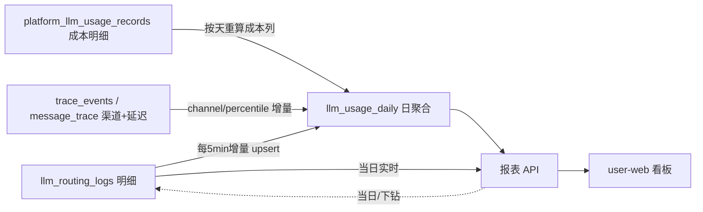

# T3 · 观测报表（Observability Reports）功能设计文档

> 模块：user-server · LLM 调用量 / 错误率 / Token / 成本多维报表与看板
> 状态：设计稿 → 可实施
> 关联：T1（低置信度回流）、T2（引用溯源）、`dispatcher_observability.go`、`dashboard_sse.go`

---

## 1. 竞品依据

### 1.1 Langfuse 数据模型

Langfuse 把观测数据组织为三层：**Session → Trace → Observation**，Observation 分为
`EVENT / SPAN / GENERATION` 三种类型；`GENERATION` 专门承载一次 LLM 调用，记录
`model`、`modelParameters`、`input/output`、`usage`（prompt/completion/total tokens、
`unit`、`inputCost`/`outputCost`/`totalCost`）、`latency`、`completionStartTime`、
`level`（DEBUG/INFO/WARNING/ERROR）与 `statusMessage`。成本可在 ingestion 时按
model price 计算，也可回填自定义 usage/cost。仪表盘基于这些字段做 cost / latency /
volume / quality 的多维分析。
来源：
- <https://langfuse.com/docs/observability/data-model>
- <https://langfuse.com/docs/observability/features/observation-types>
- <https://langfuse.com/docs/observability/overview>

对我们的启示：**成本必须输入/输出分列**（本仓 `platform_llm_usage_records` 已经做对了，
`llm_routing_logs` 的 splitCost 是按 token 比例的假拆分，报表层要能分辨口径）；
**错误必须是一等公民**（level + statusMessage），不能只有 success 布尔。

### 1.2 LiteLLM StandardLoggingPayload

LiteLLM 为每次调用构造标准化日志对象，关键字段（规格见
<https://docs.litellm.ai/docs/proxy/logging_spec>，回调说明见
<https://docs.litellm.ai/docs/proxy/logging>）：

| 字段组 | 字段 |
|---|---|
| 标识 | `id`、`call_id`、`trace_id`、`requester_metadata` |
| 模型 | `model`、`model_id`、`model_group`、`custom_llm_provider`、`api_base` |
| 用量 | `usage: {prompt_tokens, completion_tokens, total_tokens, cache_read_input_tokens, cache_creation_input_tokens}` |
| 成本 | `response_cost`、`cost_breakdown: {input_cost, output_cost, …}` |
| 质量/时延 | `start_time`、`end_time`、`completion_start_time`（TTFT）、`status: success/failure`、`error_information: {error_code, error_class, llm_provider}` |
| 场景 | `call_type`（completion/embedding/…）、`requester_metadata`、`cache_hit` |

启示：错误信息要结构化（error_code / error_class / provider 三元组），TTFT 可独立采集；
`call_type` 对应本仓的 `scenario`；`api_base` 对应 vendor 推断。

### 1.3 扣子罗盘（Coze Loop）

- 「观测 → 统计看板」自动统计 AI Agent 的**质量数据（延迟、错误请求数）与成本数据
  （Token 消耗）**，按时间范围、任务节点、观测对象过滤，用于快速定位性能瓶颈与错误：
  <https://docs.coze.cn/cozeloop_trace-statistics>
- Trace 列表 + 详情页支持按应用/时间/节点筛选： <https://docs.coze.cn/cozeloop_trace-data>
- **Trace 自动评测**：对筛选出的 Trace 建自动评测任务（准确性/简洁性/合规性等维度），
  结果回填到 Trace 列表与详情页——本仓 `trace_eval_log` 已具备承接结构：
  <https://docs.coze.cn/cozeloop_auto-evaluation>

启示：统计看板与 Trace 列表必须可**互相下钻**（看板上的异常柱点 → 点击进入该天/该模型
的错误 Trace 列表）。

### 1.4 OpenRouter Activity

Activity 仪表盘按 **model、provider、API key、user/agent** 维度展示 spend、tokens、
request volume、cache hit rate、latency，支持时间趋势；每行是一条 generation 明细。
来源：<https://openrouter.ai/docs/guides/features/activity>、
<https://openrouter.ai/blog/announcements/activity-dashboard/>

启示：报表要支持**双轴展示**（请求数柱状 + 成本折线）以及「明细 ↔ 聚合」两级视图。

---

## 2. 现状盘点

### 2.1 数据资产逐字段盘点

**① `trace_events`（`model/trace_event.go`）** —— span 树：

| 字段 | 类型 | 说明 | 报表可用性 |
|---|---|---|---|
| tenant_id | uint | 租户，index | ✅ 租户维度 |
| trace_id / span_id / parent_span_id | varchar(64) | span 树 | ✅ 下钻 |
| kind | varchar(32) | `llm_call` / `tool_call` / `db_op` / `log` | ✅ 过滤 LLM 调用 |
| service / operation | varchar | 服务与操作名 | ✅ 场景近似维度 |
| **duration_ms** | int64 | 耗时 | ✅ P50/P95 |
| **status** | varchar(16) | 默认 `'ok'` | ⚠️ 有错误语义但需确认失败路径写的是 `'error'`（见 §7） |
| metadata | jsonb(text+json serializer) | 自由扩展 | ⚠️ token/成本只能进这里 |
| timestamp | time | index | ✅ 时间维度 |

**② `llm_routing_logs`（由 `dispatcher_observability.go:LogRoutingDecision` 写入，map 裸写）** ——
每次 dispatch 决策一行，字段最全：trace_id、scenario、provider、model、prompt/completion/total
tokens、cost、**latency_ms**、**success**、**error_msg**、from_cache、model_type、vendor、
base_url、is_fallback、prompt_cost/completion_cost（历史数据为按比例拆分的假口径）、
token_source、estimator、source（dispatch/cache/fallback/null）、scenario_provider、
cache_hit、跨语字段。**这是当前唯一同时具备「错误 + 延迟 + 成本 + 场景」的表**，
但注意：**没有 tenant_id 显式列的报表级索引**（GlobalDispatcher 是全局单键，
`LoadProvidersFromDB` 只装 tenant_id=1）。

**③ `platform_llm_usage_records`（`internal/model/tenant_module.go:215-244`）** ——
平台垫资分列明细：request_id（uniqueIndex，幂等）、provider、model、plan_code、scenario、
trace_id、agent_id、user_id、prompt_tokens、completion_tokens、
**input_cost_cents / output_cost_cents / total_cost_cents（真分列计价）**、occurred_at。
TenantID 有 default:1 + index。**无延迟、无错误字段**——只记成功调用
（`recordPlatformUsage` 在 tokens<=0 时直接 return，失败的调用根本不落这张表）。

**④ `llm_usage_records`（迁移 v3.4.0 建，uuid 主键）** —— 聚合向：只有 token 总量与成本
合计，无 provider/幂等键/归因（见 tenant_module.go 注释）。被 `internal/ops/repository/
ai_productivity.go`（AI 产能看板）与 `llm_platform_usage.go` 消费。**形状老旧，报表不新增依赖。**

**⑤ `message_trace`（`model/message_trace.go`）** —— 会话/节点级 span：trace_id、
conversation_id、account_id、**channel**（渠道维度来源）、node、direction、duration_ms、
status、error、abnormal、turn_index、tool_name、agent_id。**渠道维度（官网/用户端/扩展/API）
从这里来。**

**⑥ `trace_eval_log`** —— Trace 评测结果（罗盘式自动评测的承接表），T3 只做联动展示，不做扩展。

### 2.2 已有 / 缺失矩阵

| 能力 | trace_events | llm_routing_logs | platform_llm_usage_records | llm_usage_records | message_trace | 结论 |
|---|---|---|---|---|---|---|
| 调用数（按模型） | ✅(kind) | ✅ | ⚠️ 仅成功 | ✅ | ❌ | 可查但需 UNION 口径 |
| 调用数（按天） | ✅ timestamp | ✅ created_at | ✅ occurred_at | ⚠️ | ✅ created_at | 实时查可行，量大后需预聚合 |
| 错误数/错误率 | ⚠️ status 需验证写入 | ✅ success + error_msg | ❌ 失败不落 | ❌ | ✅ status/error | **缺口见 §7** |
| 输入/输出 token 分列 | ❌(metadata 内) | ✅ | ✅ | ❌ 仅总量 | ❌ | ✅ |
| 成本（分列计价） | ❌ | ⚠️ 假拆分口径 | ✅ 真分列 | ⚠️ 总价 | ❌ | 平台模型走 ③ |
| 延迟 P50/P95 | ✅ duration_ms | ✅ latency_ms | ❌ | ❌ | ✅ duration_ms | PG 用 percentile_cont |
| 租户维度 | ✅ | ⚠️ 隐式 | ✅ | ✅ | ✅ | 需补 ② 的租户列 |
| 场景/模型/vendor | ⚠️ operation | ✅ | ✅ | ❌ | ⚠️ node | ✅ |
| 渠道（官网/用户端/扩展/API） | ❌ | ❌ | ❌ | ❌ | ✅ channel | **缺口：usage 表无渠道列** |
| 错误类型分类 | ❌ | ⚠️ 只有 error_msg 文本 | ❌ | ❌ | ⚠️ error 文本 | **缺口：error_class** |
| 按日预聚合表 | ❌ | ❌ | ❌ | ❌ | ❌ | **新建 §3.3** |

### 2.3 现有查询/展示接口

- `llm.QueryScenarioStats(ctx, window, limit, enabledProviders)`：llm_routing_logs 按
  (scenario, provider) 聚合，window ∈ today/week/month/all，含 success/failed/avg latency。
  —— T3 的模型维度报表可复用其聚合写法。
- `DashboardSSEController`（`/api/dashboards/stream|snapshot|metrics`）：SSE 2s 推送 +
  15s 心跳，**租户分域快照缓存（2s TTL）+ 订阅计数**，`collectLLMMetrics` 目前返回空壳
  `LLMRealTimeMetrics{}`——T3 实时看板正是要填这个洞。
- `SalesWorkbenchController`（`/api/sales-workbench/overview|team-dashboard|...`）：
  常规 GET + `response.Success(ctx, data, "ok")` 风格。
- `internal/ops/repository/ai_productivity.go`：AI 产能看板，消费 llm_usage_records。

---

## 3. 报表设计

### 3.1 维度

| 维度 | 取值来源 | 说明 |
|---|---|---|
| 租户 | tenant_id | 平台端看全量，商户端强制本租户 |
| 模型 × provider | model / provider | 报表主维度 |
| 时间 | 天（date） | 下钻到小时仅走明细查询 |
| 场景 | scenario | dispatch 场景（chat/translate/...） |
| 错误类型 | error_class（新增，见 §7） | timeout / rate_limit / auth / upstream_5xx / context_length / empty_response / unknown |
| 渠道 | channel | `web`（官网）/ `app`（用户端）/ `extension`（扩展）/ `api`（开放 API），来自 message_trace.channel，usage 侧新增列 |
| 计费来源 | source：self / platform | self 只统计不计费 |

### 3.2 指标

- 调用数 `call_count`（排除 source=cache 命中与不,缓存命中单列 `cache_hit_count`）
- 错误数 `error_count`、错误率 `error_rate = error_count / call_count`
- 输入/输出 token、总 token；平台模型另出成本 `input_cost_cents / output_cost_cents / total_cost_cents`
- 延迟 P50 / P95 / AVG（PG：`percentile_cont(0.5) WITHIN GROUP (ORDER BY latency_ms)`）
- TTFT 预留（`metadata->>'first_token_ms'`，本期只采不保证全量）

### 3.3 聚合策略：实时查 vs 日聚合表

**数据量评估**：`llm_routing_logs` 一次 LLM 调用一行。按一个商户 50 请求/天 × 每请求
3 次 LLM 调用（主答 + 意图 + 翻译）估算 = 150 行/天/租户；100 租户 ≈ 1.5 万行/天，
450 万行/年。单表 PG 加 `(created_at)` 与 `(scenario, provider)` 索引后，**90 天窗口的
实时聚合在毫秒~几十毫秒级，当前量级完全扛得住**。但：本设计面向多商户 SaaS 增长期，
量级到 50 万行/天后 90 天窗口的 percentile 聚合会到秒级，且看板是高频刷新面。

**决策：建日聚合表 `llm_usage_daily`（物化到天粒度），但**同时保留实时查询兜底**：

- **看板/报表 API 默认读聚合表**（天粒度及以上），响应 P99 < 50ms，与数据量解耦；
- **当日数据实时查**（当天尚未聚合，量小、索引命中）；
- 小时粒度、单 Trace 下钻走明细表直查；
- 聚合任务失败时 API 自动 fallback 到明细实时查询（降级开关）。

**取舍论证**：
1. 不选纯实时：错误率/成本看板是商户每天看的高频面，不能随明细表增长线性变慢；
2. 不选全量预聚合（小时+天+周）：天粒度 + 当日实时已覆盖 95% 视图，周/月由天行二次
   SUM 即可，无冷热分层成本；
3. 不复用 `llm_usage_records`：uuid 主键、无 provider/幂等/分列语义（tenant_module.go
   注释已明确"形状完全不同"），硬塞会让两套语义打架；
4. upsert 用 `(tenant_id, stat_date, provider, model, scenario, channel, source, error_class)`
   复合唯一键 + `ON CONFLICT DO UPDATE`，幂等可重跑——**注意本仓已知陷阱：冲突目标必须
   与库里实际索引形状一致**（见 `savePlatformProviders` 的 42P10 教训）。

### 3.4 聚合流水线



- 增量窗口：`now()-10min`，覆盖乱序写入；每天 00:10 全量重算前一天（成本以
  platform_llm_usage_records 为准）。
- 锁：任务用 advisory lock 防多实例并发——**必须用本仓惯用写法
  `FROM (SELECT 1) AS t WHERE pg_try_advisory_lock(...)`**（禁止裸 `SELECT pg_advisory_lock`）。

---

## 4. API 设计

对齐现有风格：路由前缀 `/api`，响应统一 `response.Success(ctx, data, "ok")` /
`response.Error(ctx, code, msg)`；租户从 `tenant.FromContext` 取，SSE 复用
`streamTenant` 语义（on 模式无绑定 → 401，off 模式归默认租户）。

### 4.1 路由与权限

| 方法 | 路由 | 权限 | 数据源 |
|---|---|---|---|
| GET | `/api/reports/llm/overview` | 租户管理员 | daily + 当日实时 |
| GET | `/api/reports/llm/timeseries` | 租户管理员 | daily（当日实时补） |
| GET | `/api/reports/llm/breakdown` | 租户管理员 | daily |
| GET | `/api/reports/llm/errors` | 租户管理员 | daily + 明细 |
| GET | `/api/reports/llm/export` | 租户管理员 | CSV 导出（复用上述查询） |
| GET | `/api/platform/reports/llm/overview` | **平台级管理员**（跨租户，`tenant_id` 为必填筛选或 "all"） | daily |
| GET | `/api/dashboards/stream`（扩展） | 既有 SSE | 在 `LLMRealTimeMetrics` 空壳中填入当日 call/error/token/cost 快照 |

注册：仿 sales_workbench 在 router 中挂 `NewReportController(...)`，controller 注入
`ReportService{db, dailyRepo}`。

### 4.2 参数与响应

**GET /api/reports/llm/overview**

```
?from=2026-10-01&to=2026-10-07&channel=web&source=platform
```

```json
{ "code": 0, "message": "ok", "data": {
  "range": {"from":"2026-10-01","to":"2026-10-07"},
  "totals": {
    "call_count": 15230, "error_count": 312, "error_rate": 0.0205,
    "prompt_tokens": 48210000, "completion_tokens": 6120000,
    "input_cost_cents": 120500, "output_cost_cents": 36720, "total_cost_cents": 157220,
    "p50_latency_ms": 820, "p95_latency_ms": 3400, "avg_latency_ms": 1080,
    "cache_hit_rate": 0.12
  },
  "delta_vs_prev": {"call_count": 0.08, "error_rate": -0.004, "total_cost_cents": 0.15}
}}
```

**GET /api/reports/llm/timeseries** —— `?from&to&granularity=day&metric=call_count,error_rate,total_cost_cents&model=qwen-max&scenario=chat`

```json
{ "data": { "points": [
  {"date":"2026-10-01","call_count":2100,"error_count":41,"error_rate":0.0195,
   "prompt_tokens":6100000,"completion_tokens":820000,"total_cost_cents":22100,
   "p50_latency_ms":800,"p95_latency_ms":3300}
]}}
```

**GET /api/reports/llm/breakdown** —— `?from&to&by=model|scenario|channel|error_class|provider`（单选，可叠加 model/scenario/channel 过滤）

```json
{ "data": { "rows": [
  {"model":"qwen-max","provider":"qwen","call_count":9200,"error_count":180,
   "error_rate":0.0196,"completion_tokens":3200000,"total_cost_cents":88000,
   "p95_latency_ms":3600}
], "total": 12 }}
```

**GET /api/reports/llm/errors** —— `?from&to&error_class=timeout&page=1&page_size=20`
返回按 error_class 聚合 + 失败明细列表（trace_id、provider、model、error_msg 截断 500 字、
occurred_at），trace_id 可跳转 message_trace / trace_events 详情。

**GET /api/platform/reports/llm/overview** —— 同上结构，额外必带 `?tenant_id=`（或
`tenant_id=all`），仅平台管理员角色中间件可访问；服务端显式按 tenant_id 过滤，**禁止**
依赖隐式租户 callback（平台端要跨租户查询，必须走 system scope 的只读查询路径）。

**SSE 扩展**：`collectLLMMetrics(ctx)` 实现填充 —— 当日 call/error/token/cost 四数 +
最近 1h 每分钟调用柱（明细表 `created_at >= now()-1h`，量小实时查），沿用现有 2s
快照缓存与租户分域缓存，不新增订阅类型，走 `dashboard_update` 事件。

### 4.3 查询实现示例（GORM 陷阱规避）

```go
// 按模型×天聚合（读 llm_usage_daily）
rows := db.Table("llm_usage_daily").
    Select(`stat_date, model,
            SUM(call_count) AS call_count,
            SUM(error_count) AS error_count,
            SUM(prompt_tokens) AS prompt_tokens,
            SUM(output_cost_cents) AS output_cost_cents`).
    Where("tenant_id = ? AND stat_date BETWEEN ? AND ?", tenantID, from, to).
    Group("stat_date, model").          // 列名分组；本仓已知陷阱：Group("1") 在 PG 上是坏的，禁用
    Order("stat_date").Scan(&out).Error

// 实时 P95（当日走明细 llm_routing_logs）
db.Table("llm_routing_logs").
    Select(`percentile_cont(0.5) WITHIN GROUP (ORDER BY latency_ms) AS p50,
            percentile_cont(0.95) WITHIN GROUP (ORDER BY latency_ms) AS p95`).
    Where("created_at >= ?", dayStart).Scan(&lat).Error

// 聚合任务的 advisory lock —— 本仓惯用写法：
// 必须带 FROM (SELECT 1) AS t，裸 SELECT pg_try_advisory_lock 在部分驱动下不可解析
var locked bool
db.Raw(`SELECT pg_try_advisory_lock(?) AS locked FROM (SELECT 1) AS t`, lockKey).
    Scan(&locked)
```

---

## 5. 新表：`llm_usage_daily`

```go
// model/llm_usage_daily.go
type LLMUsageDaily struct {
    TenantID uint `gorm:"not null;default:1" json:"tenant_id"`
    ID       int64 `gorm:"primaryKey;autoIncrement" json:"id"`

    StatDate   string `gorm:"type:varchar(10);not null" json:"stat_date"` // '2026-10-07'（本地时区日）
    Provider   string `gorm:"type:varchar(64);not null;default:''" json:"provider"`
    Model      string `gorm:"type:varchar(128);not null;default:''" json:"model"`
    Scenario   string `gorm:"type:varchar(64);not null;default:''" json:"scenario"`
    Channel    string `gorm:"type:varchar(30);not null;default:''" json:"channel"`   // web/app/extension/api/''
    Source     string `gorm:"type:varchar(16);not null;default:''" json:"source"`    // self/platform
    ErrorClass string `gorm:"type:varchar(32);not null;default:''" json:"error_class"` // 成功行为 ''

    CallCount       int64 `gorm:"not null;default:0" json:"call_count"`
    ErrorCount      int64 `gorm:"not null;default:0" json:"error_count"`
    CacheHitCount   int64 `gorm:"not null;default:0" json:"cache_hit_count"`
    PromptTokens    int64 `gorm:"not null;default:0" json:"prompt_tokens"`
    CompletionTokens int64 `gorm:"not null;default:0" json:"completion_tokens"`
    InputCostCents  int64 `gorm:"not null;default:0" json:"input_cost_cents"`
    OutputCostCents int64 `gorm:"not null;default:0" json:"output_cost_cents"`
    TotalCostCents  int64 `gorm:"not null;default:0" json:"total_cost_cents"`
    LatencySumMs    int64 `gorm:"not null;default:0" json:"latency_sum_ms"`
    P50LatencyMs    int64 `gorm:"not null;default:0" json:"p50_latency_ms"`
    P95LatencyMs    int64 `gorm:"not null;default:0" json:"p95_latency_ms"`
    SumSquaresLat   int64 `gorm:"not null;default:0" json:"sum_squares_latency_ms"` // 供二次聚合 AVG

    UpdatedAt time.Time `gorm:"autoUpdateTime" json:"updated_at"`
}
func (LLMUsageDaily) TableName() string { return "llm_usage_daily" }
```

唯一索引：`(tenant_id, stat_date, provider, model, scenario, channel, source, error_class)`
（迁移中用显式 SQL 建复合唯一索引，upsert 冲突目标与此严格一致——避免 42P10）。
迁移文件：`v3_83_0_llm_usage_daily_migration.go`（当前最高 v3_82_0）。行数估算：
100 租户 × 30 模型组合 × 8 错误类 ≈ 数万行/天，天级完全可控。

## 6. 渠道与错误率采集补录

### 6.1 渠道维度

- `platform_llm_usage_records` 增列 `channel varchar(30) default ''`（索引）。
- 写入点：`llm.PlatformUsageEvent` 增加 `Channel` 字段；dispatcher 发事件处从
  ctx/message_trace 侧携带（web/app/extension/api，由入口中间件注入 ctx key）。
- `llm_routing_logs` 同步补 `channel` 列（map 写入处加一项即可）。
- 存量数据 channel=''，看板归类为「未知」档。

### 6.2 错误结果补录（当前失败调用几乎不落 usage 表）

1. **llm_routing_logs 已记 success=false**，补录重点是分类：
   写入时新增 `error_class` 列，由 `LogEntry.ErrorMsg` 经
   `ClassifyError(msg) → timeout|rate_limit|auth|upstream_5xx|context_length|empty_response|unknown`
   归类（关键字匹配，简单可测）。
2. **平台 usage 表也记失败**：`recordPlatformUsage` 放开「tokens<=0 直接 return」的
   限制——失败调用落一行 `prompt_tokens=0, completion_tokens=0, total_cost_cents=0,
   error_class=<分类>`（需加 error_class 列）；**但成本聚合按 tokens>0 过滤**，账面不受影响。
   幂等仍靠 request_id 唯一索引。
3. **trace_events**：dispatcher 失败路径补写一条 `kind=llm_call, status='error'` 的 span
   （metadata 带 error_class），使 trace 树与报表错误数可对账。
4. 历史无 error_class 的行：聚合任务对 `error_msg <> '' AND success=false` 回填
   `unknown`（一次性 UPDATE + 迁移内幂等条件）。

## 7. 前端看板（user-web）

**图表库：ECharts 6（package.json 已有 `"echarts": "^6.0.0"`，无需新增依赖）**，
按需引入 `echarts/core` + LineChart/BarChart/PieChart + GridComponent/TooltipComponent/
DataZoomComponent，配 `element-plus` 的 `el-card`/`el-date-picker`。

页面结构（`user-web/src/views/reports/LlmUsageDashboard.vue`，路由 `/reports/llm`）：

1. **筛选栏**：日期范围（默认近 7 天）、模型/场景/渠道/来源下拉（选项来自
   breakdown API by=model 等）。
2. **KPI 卡片行**：调用量、错误率（红/绿箭头 vs 上期）、Token 消耗、成本（元）、
   P95 延迟 —— `overview` API。
3. **趋势区**：双轴图（Bar=调用数，Line=错误率；可切 metric 到成本/Token）—— `timeseries`。
4. **分布区**：模型维度横向条形图（调用数+成本）、错误类型饼图 —— `breakdown`。
5. **错误明细表**：el-table，列 trace_id（点击跳 Trace 详情页）/模型/错误类/错误消息/时间 —— `errors`。
6. **实时条**：接入既有 `/api/dashboards/stream` SSE，展示当日实时调用/错误
   （`LLMRealTimeMetrics` 填充后自动生效）。
7. 平台管理员额外有租户切换器，请求 `/api/platform/reports/llm/*`。

## 8. 测试计划

| 层 | 用例 |
|---|---|
| 单元 | `ClassifyError` 全分支表驱动；`Overview` 指标计算（错误率除零、空窗口）；delta_vs_prev |
| 单元（GORM 陷阱） | 聚合 SQL 断言：无 `GROUP BY 1`；advisory lock 语句含 `FROM (SELECT 1) AS t`；upsert 冲突目标与唯一索引列序一致 |
| 集成（sqlite/PG 测试库） | 聚合任务幂等重跑（同窗口跑两遍结果一致）；乱序写入覆盖；失败调用落 usage 表且成本为 0；channel 归档；错误回填 unknown |
| API | 租户隔离（A 租户管理员查不到 B）；平台端 tenant_id=all 权限；SSE `LLMRealTimeMetrics` 推送含非零指标 |
| 前端 | vitest 组件渲染 + playwright：筛选→图表更新→下钻错误明细 |
| 性能 | 500 万行明细下 timeseries API P99 < 100ms（走聚合表） |

## 9. 迁移与任务拆解

迁移：`v3_83_0_llm_usage_daily_migration.go`（建表 + 复合唯一索引 + 三张明细表加列
channel/error_class + 历史回填），仿 v3_82_0 文件结构，AutoMigrate 之外的关键索引用显式 SQL。

| # | 子任务 | 估时 |
|---|---|---|
| 1 | 迁移 036：建表/加列/回填/索引 | 0.5d |
| 2 | model + ClassifyError + LogEntry/UsageEvent 加字段与写入点改造 | 1d |
| 3 | 聚合任务（增量 upsert + 日终重算 + advisory lock + SafeGo） | 1.5d |
| 4 | ReportService/Controller + 5 个 API + router 注册 + swagger 注释 | 2d |
| 5 | SSE `LLMRealTimeMetrics` 填充 | 0.5d |
| 6 | 前端看板页（4 个图表 + 筛选 + 错误表 + SSE 实时条） | 2.5d |
| 7 | 测试（上述计划）+ 平台端跨租户 API | 1.5d |
| 合计 | | **9.5d** |

## 10. 风险

| 风险 | 缓解 |
|---|---|
| 失败调用落 usage 表改变既有消费方口径 | 成本聚合统一按 `tokens>0` 过滤；`ai_productivity.go` 消费点回归验证 |
| upsert 冲突目标与索引不一致（42P10） | 迁移显式建索引，测试断言列序一致（savePlatformProviders 前车之鉴） |
| 聚合任务多实例并发 | advisory lock（含 FROM (SELECT 1) AS t 写法）+ 幂等重跑 |
| channel 上报不全（存量/未改造入口） | 归「未知」档展示，不做强制 |
| 成本双口径（routing_logs 假拆分 vs platform 表真分列） | 平台模型成本以 platform_llm_usage_records 为准，routing_logs 只供延迟/错误聚合 |
| 明细表增长 | 日聚合解耦看板性能；后续可按 6 个月分区/归档（本期不做） |

## 11. 参考资料

- Langfuse 数据模型 / Observation 类型：https://langfuse.com/docs/observability/data-model · https://langfuse.com/docs/observability/features/observation-types
- LiteLLM StandardLoggingPayload：https://docs.litellm.ai/docs/proxy/logging_spec · https://docs.litellm.ai/docs/proxy/logging
- 扣子罗盘：https://docs.coze.cn/cozeloop_trace-statistics · https://docs.coze.cn/cozeloop_trace-data · https://docs.coze.cn/cozeloop_auto-evaluation
- OpenRouter Activity：https://openrouter.ai/docs/guides/features/activity · https://openrouter.ai/blog/announcements/activity-dashboard
