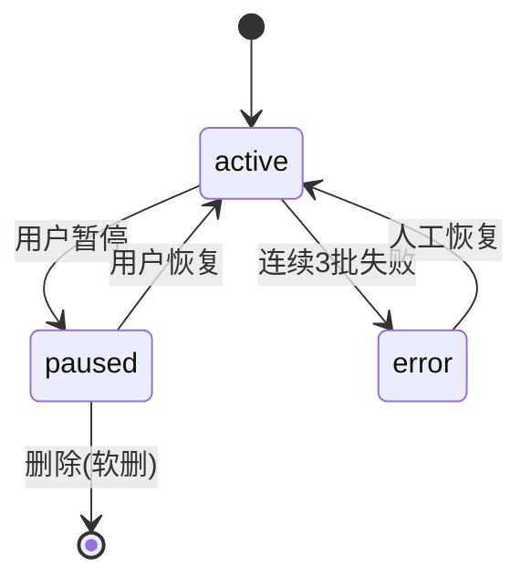
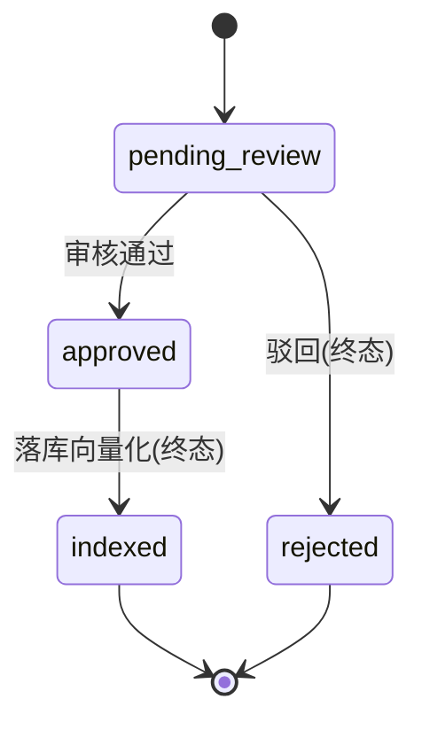
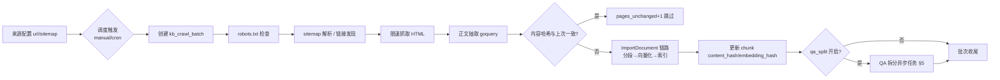

# T4 知识库冷启动设计：网站爬取入库 + LLM 自动拆 QA 对

> 关联：T1（低置信度问题回流知识库，共用审核队列）、T2（答案引用溯源）、T5（商店化运营）。
> 涉及代码（写前实读核对）：`user-server/internal/model/knowledge_base.go`、`model/kb_document.go`、
> `repository/kb_document_chunk_repo.go`（chunk 含 `EmbeddingHash`）、
> `aiagent/knowledge/service/knowledge_base_import.go`（`ImportDocument` :61、`IngestLocalFile` :138、
> `processDocumentAsync` :173）、`aiagent/knowledge/service/rag_searcher_bm25.go`、
> `internal/kbconnector/`、`model/kb_release.go`、`model/kb_item_binding.go`、
> `internal/pkg/cron/cron.go`（robfig/cron/v3）。
> 注意：`middleware/ai_crawler_monitor.go` 是**反爬监控**（识别外部爬虫打我们），不是采集器，本设计不复用它。

## 1. 竞品依据

### 1.1 Chatbase —— 网站源 + Auto-resync

- Chatbase 数据源面板里 website source 提供 auto-resync 开关，但仅 Standard / Pro 套餐可用；低套餐只能对变更过的 source 手动 "Resync now"（来源：[Data sources](https://www.chatbase.co/docs/user-guides/chatbot/data-sources)）。
- auto-retrain 语义：开启后 agent 每 7 天重训一次以反映 source 变化，且要求 agent 至少训练过一次（来源：[Toggle auto-retrain](https://www.chatbase.co/docs/api-reference/v2/agents/toggle-auto-retrain)、[Manage your AI agents with the API](https://www.chatbase.co/changelog/manage-your-ai-agents-with-the-api)）。
- 我们对齐的结论：`auto_resync` 做成**每 source 一个开关**（不是 agent 级），默认周期 7 天，允许租户在 1~30 天内改 cron 表达式；免费/试用租户只给手动"立即同步"。

### 1.2 FastGPT —— QA 自动拆分

- FastGPT 与多数产品不同：知识库以 QA 问答对为存储/检索单元而非纯 chunk，理由是缩短向量化文本长度、提高召回精度（来源：[FastGPT 知识库构建中如何避免 QA 拆分问题](https://docs.feishu.cn/v/wiki/X0Q3wNCthiX1iek7VZrcDhBFnnF/ae)、[知识库基础原理介绍](https://doc.fastgpt.io/zh-CN/guide/dataset/rag)）。
- 社区拆分 prompt 的共识要点：要求 LLM"根据这段内容生成 N 个多样化的问题，并给出 AI 风格的答案，同时标注答案所依据的上下文"——即**多样化问法 + 答案锚定原文 + 逐条独立向量化**（来源：[构建 Prompt 生成 QA](https://blog.csdn.net/star1210644725/article/details/135537942)、[RAG-QA-Generator](https://github.com/wangxb96/RAG-QA-Generator)、阿里云 [GraphRAG 生成高质量 QA 对](https://help.aliyun.com/zh/analyticdb/analyticdb-for-postgresql/user-guide/generate-high-quality-qa-pairs-based-on-graphrag)）。
- 对齐结论：qa_candidates 每行 = 一条 QA 对，question 与 answer 各自独立向量（answer 向量锚定原文，question 向量扩召回），入库走审核队列而非直接上线。

### 1.3 MinerU / Unstructured —— 解析服务接入模式

- Unstructured 定位为自托管预处理服务，在 RAG 前对多格式文件做 partition + enrich（来源：[11 Best Document Processing APIs](https://www.extend.ai/resources/document-processing-apis-developers)、[RAG Pipeline Best Practices](https://unstructured.io/insights/rag-pipeline-best-practices-enterprise)）；MinerU 4.0 把复杂文档解析做成可服务化接入的转换工具（来源：[opendatalab/MinerU](https://github.com/opendatalab/mineru)）。
- 行业共识：RAG 管线里最难的是解析与清洗，不是检索（来源：[Top 10 document parsing services for RAG pipelines](https://vstorm.co/llamaindex/top-10-document-parsing-services-for-rag-pipelines-and-llm-applications/)）。
- 对齐结论：网页正文抽取本期用 Go 原生方案（见 §4.4），但**抽取出"正文抽取器"接口**，为将来接 MinerU/Unstructured 类外部解析服务（如 PDF 扫描件）留插槽，接入模式=HTTP 调用 + 兜底本地。

## 2. 目标 / 非目标

### 2.1 目标

1. 租户可提交网站 URL 或 sitemap 作为知识源，系统自动爬取、抽取正文、按既有 `ImportDocument → processDocumentAsync` 链路分段向量化入库。
2. sitemap 源支持定时 resync（默认 7 天，可配），内容哈希未变的页面跳过重分段/再向量化（复用 `kb_document_chunks.content_hash` 与 `embedding_hash`）。
3. 对爬得的长文，异步 LLM 自动拆出 QA 候选对，进 T1 审核队列，人工通过后才落知识库。
4. 全链路带 tenant_id 隔离，仅爬租户自提交且校验通过的域名，配额限流防爬虫失控。

### 2.2 非目标

- 不做 JS 动态渲染爬取（无 headless browser；SPA 站点提示用户改用 sitemap 或手动上传）。
- 不做跨站全量镜像、不做反反爬（验证码绕过等）。
- 不做外租户内容分发；爬取结果只进提交租户自己的知识库。
- 不在本期实现 MinerU/Unstructured 外部解析服务的真实接入（仅留接口）。
- 不改变 kbconnector / kb_release 既有发布语义，QA 对上线后仍走既有 chunk/检索链路。

## 3. 数据模型

### 3.1 kb_crawler_sources（爬取源配置）

```go
// model/kb_crawler_source.go
type KBCrawlerSource struct {
    TenantID uint `gorm:"not null;default:1;index" json:"tenant_id"`
    ID       uint `gorm:"primaryKey;autoIncrement" json:"id"`

    KBID      uint   `gorm:"index;not null" json:"kb_id"`              // 目标知识库 knowledge_bases.id
    SourceType string `gorm:"type:varchar(16);not null" json:"source_type"` // url / sitemap
    StartURL  string `gorm:"type:text;not null" json:"start_url"`      // 页面 URL 或 sitemap.xml
    IncludePatterns string `gorm:"type:text" json:"include_patterns"` // 逗号分隔 URL 前缀白名单
    MaxPages  int    `gorm:"not null;default:200" json:"max_pages"`
    IntervalHours int `gorm:"not null;default:168" json:"interval_hours"` // 默认 7 天，对齐 Chatbase
    AutoResync *bool `gorm:"type:boolean;default:true" json:"auto_resync"` // *bool 防 GORM 零值
    CronExpr  string `gorm:"type:varchar(32);default:''" json:"cron_expr"` // 覆盖 interval 时用
    LastCrawlAt *time.Time `json:"last_crawl_at"`
    LastBatchID string `gorm:"type:varchar(64)" json:"last_batch_id"`
    Status    string `gorm:"type:varchar(16);not null;default:'active'" json:"status"` // 见状态机
    ErrorMsg  string `gorm:"type:text" json:"error_msg"`
    CreatedAt time.Time `gorm:"autoCreateTime" json:"created_at"`
    UpdatedAt time.Time `gorm:"autoUpdateTime" json:"updated_at"`
    DeletedAt gorm.DeletedAt `gorm:"index" json:"deleted_at,omitempty"`
}
```

状态机：`active ⇄ paused`（人工）；`error`（连续 3 批失败自动置入，人工恢复回 active）。合法跃迁由 `KBCrawlerSourceTransitionAllowed(from,to)` 单点判定（对齐 `kb_release.go` 的跃迁表写法）。



### 3.2 kb_crawl_batches（爬取批次任务表，承载重试）

```go
type KBCrawlBatch struct {
    TenantID uint `gorm:"not null;default:1;index" json:"tenant_id"`
    ID       uint64 `gorm:"primaryKey;autoIncrement" json:"id"`
    SourceID uint `gorm:"index;not null" json:"source_id"`
    BatchNo  string `gorm:"type:varchar(64);index;not null" json:"batch_no"` // crawl_<unixnano>
    Trigger  string `gorm:"type:varchar(16);not null" json:"trigger"` // manual / cron
    Status   string `gorm:"type:varchar(16);not null;default:'pending'" json:"status"`
    // pending → running → succeeded / failed / partially_failed
    PagesFound int    `gorm:"not null;default:0" json:"pages_found"`
    PagesNew   int    `gorm:"not null;default:0" json:"pages_new"`
    PagesChanged int  `gorm:"not null;default:0" json:"pages_changed"`
    PagesUnchanged int `gorm:"not null;default:0" json:"pages_unchanged"`
    PagesFailed int   `gorm:"not null;default:0" json:"pages_failed"`
    RetryCount int   `gorm:"not null;default:0" json:"retry_count"`
    ErrorMsg   string `gorm:"type:text" json:"error_msg"`
    StartedAt  *time.Time `json:"started_at"`
    FinishedAt *time.Time `json:"finished_at"`
    CreatedAt  time.Time  `gorm:"autoCreateTime" json:"created_at"`
}
```

重试策略：failed 批次可人工重试或 cron 兜底重试（指数退避：15m/1h/6h，最多 3 次，由 `RetryCount` 控制）；每次重试新建 batch 行、旧行保持 failed 不覆盖——批次是只增的事件流，对齐 `kb_change_audit_logs` 的只增语义。

### 3.3 qa_candidates（QA 候选对，与 T1 审核队列共用状态机）

```go
type QACandidate struct {
    TenantID uint `gorm:"not null;default:1;index" json:"tenant_id"`
    ID uint64 `gorm:"primaryKey;autoIncrement" json:"id"`

    SourceType string `gorm:"type:varchar(16);not null" json:"source_type"` // crawl / feedback(T1) / manual
    SourceRef  string `gorm:"type:varchar(128);index" json:"source_ref"`    // crawl:docID / T1:sessionID
    KBID       uint   `gorm:"index" json:"kb_id"`

    Question string `gorm:"type:text;not null" json:"question"`
    Answer   string `gorm:"type:text;not null" json:"answer"`
    AnswerAnchor string `gorm:"type:text" json:"answer_anchor"` // 答案锚定的原文片段（§1.2）

    Status string `gorm:"type:varchar(16);not null;default:'pending_review';index" json:"status"`
    // pending_review → approved → indexed
    //              → rejected
    Reviewer  string `gorm:"type:text" json:"reviewer"`
    TaskID    string `gorm:"type:varchar(64);index" json:"task_id"` // 所属 QA 拆分任务
    LLMModel  string `gorm:"type:varchar(64)" json:"llm_model"`
    CreatedAt time.Time `gorm:"autoCreateTime" json:"created_at"`
    UpdatedAt time.Time `gorm:"autoUpdateTime" json:"updated_at"`
}
```

状态机与 T1 审核队列**共用一份**：跃迁表常量放 `model/qa_candidate.go`（`QACandidateTransitionAllowed`），T1 的 feedback 回流行与本表唯一差别是 `source_type`。审核通过（approved）后由 worker 调 `IngestLocalFile` 同款链路转成文档/chunk（`indexed` 为终态）。



### 3.4 迁移

- 建表登记走 `internal/pkg/db` 的 `RegisterExtraModels` + `AutoMigrate()`（对齐 `kb_document_chunk_repo.go:38` 先例：repository 包与 db 包反向 import 会成环，所以不产出 `v3_NN_*.go`，生产建表只跑 AutoMigrate——同 `kb_release.go` 文件头 T-P9-02 实测口径）。
- 新迁移文件（如确需 SQL 级索引，如 `tenant_id,source_id` 复合）编号沿用 **036+** 语义编号，命名 `v3_83_0_kb_crawler_source_migration.go`，目录 `internal/migration/migrations/`，风格对齐 `v3_82_0_message_hub_platform_msg_id_migration.go`。
- 所有新表列带 `tenant_id not null;default:1;index`（对齐 `knowledge_bases`/`kb_documents` 现状），可空列一律走 DEFAULT 不加 NOT NULL 约束，回滚 = `DROP TABLE IF EXISTS` 三张新表 + 删对应列（幂等 `IF EXISTS`）。

## 4. 爬取管道

### 4.1 总体流程



### 4.2 调度（对齐仓库现有机制）

仓库定时任务统一在 `internal/pkg/cron/cron.go`，基于 `robfig/cron/v3`，`cron.WithSeconds()`，各 cron 文件（如 `snooze_recovery_cron.go`、`wecom_quota_reset_cron.go`）一个文件一条任务、构造后注册。对齐方案：

- 新增 `internal/pkg/cron/kb_crawler_cron.go`：每 10 分钟扫一次 `kb_crawler_sources` 中 `status=active AND auto_resync=true` 且到期的源（`last_crawl_at + interval_hours <= now()` 或 `cron_expr` 命中），创建 pending 批次。
- 租户扇出沿用 cron 测试文件（`cron_churn_tenant_test.go`、`cron_bridge_replay_tenant_test.go`）钉住的约定：cron 交来的 ctx 不含租户，需逐租户注入（走 `tenant_id` 列遍历，而不是依赖 ctx）。
- 批次执行是异步的：cron 只负责"到期的源→建批次行"，worker 池（复用 `internal/pkg/utils/async` 的 `RunWithTimeout`，同 `knowledge_base_import.go:123`）消费 pending 批次。

### 4.3 robots.txt 与限速

- 每个源首次爬取前取 `<host>/robots.txt`，解析 `User-agent: *` 的 Disallow/Allow 与 Crawl-delay；UA 统一 `hivemtk-kb-crawler/1.0 (+tenant crawl)`。
- robots.txt 获取失败 fail-open（同仓库 cron 通道的 fail-open 惯例，如 `browser_automation_routes.go:55`），但 4xx 明确拒绝的按全站禁爬（401/403 视为 Disallow all）。
- 限速：同 host 串行 + 请求间隔 ≥ `max(Crawl-delay, 1s)`；单批次并发 1（不并发打同一站点），不同源之间可并发（worker 池上限默认 2）。
- 每源单次最多 `MaxPages`（默认 200，配额见 §8）。

### 4.4 正文抽取选型：goquery vs readability

| 维度 | goquery（goquery + 自写选择器） | go-readability 类算法库 |
|---|---|---|
| 依赖 | 纯 Go、零 CGO，已在 Go 生态广泛使用 | 需引入第三方移植，质量参差 |
| 控制力 | 可按站点白名单选择器精确抽取，FAQ/文档站命中率高 | 通用算法，对中文文档站常漏正文/混入导航 |
| 可测试性 | 选择器规则纯函数、易表驱动测试 | 算法黑盒，回归难断言 |
| 失败兜底 | 需自己写"无正文"分支 | 内置评分 |

论证：我们的目标是**结构化程度高的企业自建站/文档站**（租户自提交，§8），站点模式可枚举（FAQ 页、帮助中心、Markdown 导出），精确选择器收益大于通用算法；goquery 依赖更轻、可测性更好。**选 goquery**，但把"标题 + 正文"抽取封装成 `extractor.Extractor` 接口（`Extract(html, url) (*Page, error)`），默认实现 `goqueryExtractor`，规则缺失时降级到简单文本密度启发式——该接口即 §1.3 的 MinerU/Unstructured 服务插槽。落选 go-readability 的风险（中文站点正文识别不稳）由"抽取后正文 < 200 字符判空页跳过"兜底。

### 4.5 sitemap 解析

- `source_type=sitemap`：抓 `start_url`，解析 `<urlset><url><loc>`（用 `encoding/xml` 标准库，不引额外依赖）；`<sitemapindex>` 递归展开一层（防环：已见 sitemap URL 集合去重）。
- `<lastmod>` 参与变更检测预筛：有 lastmod 且早于 `last_crawl_at` 的 URL 直接跳过（节省请求，不影响正确性——最终仍以内容哈希为准）。
- `source_type=url`：抓起始页后仅抽取同域、命中 `include_patterns` 的 `<a href>`，广度优先、深度 ≤ 3、总量 ≤ MaxPages。

### 4.6 内容哈希去重与变更检测 → 重分段 → 再向量化

- 每页正文抽取后计算 `sha256(title + "\n" + normalizedContent)` 记入该源的上次哈希快照（keyed by source_id + url）。
- 哈希命中 = `pages_unchanged`，**跳过 ImportDocument 全链路**（这是 Chatbase "reflect any source changes" 语义的成本控制点）。
- 哈希变化 = 判定新增/变更：
  - 新 URL → 走 `ImportDocument` 同款路径：这里直接复用 `KnowledgeBaseService` 的内部流程——参照 `IngestLocalFile`（:138）绕过 multipart，新增一个 `Ingest CrawledPage(ctx, kbID, title, content string) (docID uint, err error)`：落 `kb_documents`（`file_type="html"`、`content` 直存）→ `async.RunWithTimeout(processDocumentAsync)` 分段 → `vector.EmbedBatch` → `indexer.BuildIndex`，与现有链路**完全同一条**，不复制代码。
  - 旧 URL 变更 → 先对旧 doc 的 chunks 走 `repository/kb_document_chunk_repo.go` 的 `MarkSuperseded`（:78），再按新内容重建；`content_hash` 列本身就是分段级判据，`embedding_hash` 判"分段文本没变但 embedding 模型换了"的重向量化场景（本期仅写值，消费留给 T2/混合索引）。
  - URL 从 sitemap 消失 → 不物理删，标记 `kb_documents.status` 不动，只在批次日志记录（删除留给用户手动，避免爬虫抖动误删语料）。

## 5. QA 拆分

### 5.1 触发与执行

- 爬取管道 §4.6 中，每篇 `indexed` 成功且开启 qa_split（source 级开关，默认开）的文档，投一个 `qa_split` 异步任务（任务表复用 `kb_crawl_batches` 的思路不合适，单独立轻量任务记录：直接以 `qa_candidates.task_id` 聚合判断任务完成度，不新建任务表——一条任务 = 一篇文档，开销就是一批 LLM 调用）。
- 执行：`async.RunWithTimeout`（同 `knowledge_base_import.go:123` 模式），超时与 LLM 单次调用上限由参数中心注入（对齐 `maxUploadFileSizeProvider` 的 provider 注入先例，:41）。
- 文档超长（> 8000 token）时按 chunk 边界分批调用，每批 ≤ 5 个 QA 对，防止一次 prompt 装不下与输出截断。

### 5.2 Prompt 与 JSON Schema

Prompt 要点（对齐 §1.2 共识：多样化问法 + 答案锚定原文 + 不编造）：

```
你是一名知识库编辑。下面是来自企业官网的一段内容。
请从中提取 3~5 个"客户最可能这样问"的问题与对应答案：
1. 问题要多样化：同一段内容若有多个独立知识点，每个知识点单独一问；不要改写原文没说的东西。
2. 答案必须锚定原文：只允许改写措辞，不允许新增事实；answer_anchor 字段抄录答案所依据的原文片段。
3. 输出严格为如下 JSON 数组，不要输出任何其他文字：
[{"question":"...","answer":"...","answer_anchor":"..."}]
若内容不含任何可提取的问答信息（如纯导航页），输出 []。
```

结构化输出解析：要求 JSON 数组，解析失败重试 1 次（温度降 0），再失败则任务记 failed、不产生候选行——宁可少产出不产生脏候选。

### 5.3 结果进审核队列（与 T1 前端复用）

- 每条解析成功的 QA 对落一行 `qa_candidates`（`source_type="crawl"`，`source_ref="doc:<id>"`，`status=pending_review`）。
- 审核队列的查询/裁决 API 与状态跃迁表与 T1 共用同一套（§3.3）；T1 前端页面（反馈回流列表）按 `source_type` 过滤即可展示爬取来源的候选，**不新开第二套审核页**。
- 审核通过后由 worker 将 QA 对转成知识库条目（answer 为正文、question 进 metadata），落库走 §4.6 的 `IngestCrawledPage` 同链路，之后状态翻 `indexed`。

## 6. API 设计

对齐 `aiagent/knowledge/service/knowledge_base_import.go` 风格：controller 薄、service 收口业务、错误消息中文、返回结构带 `document_id` 类字段。路由挂在既有知识库路由组下（前缀示意，注册进 `internal/aiagent/knowledge/controller` 与对应 routes 文件）。

### 6.1 爬取源管理

| 方法 | 路径 | 说明 |
|---|---|---|
| GET  | `/api/kb/crawler/sources?kb_id=` | 列出该知识库的爬取源（含状态/上次同步时间/最近批次摘要） |
| POST | `/api/kb/crawler/sources` | 创建源；body：`{kb_id, source_type:"url"\|"sitemap", start_url, include_patterns?, max_pages?, interval_hours?}`；service 校验 URL 与 KB 归属租户 |
| PUT  | `/api/kb/crawler/sources/:id` | 更新（改 interval/auto_resync/include_patterns；改 start_url 视为新建源重建） |
| POST | `/api/kb/crawler/sources/:id/pause` / `/resume` | 状态机 `active⇄paused`，非法跃迁返回 409 |
| DELETE | `/api/kb/crawler/sources/:id` | 软删；不删已入库文档 |

### 6.2 批次

| 方法 | 路径 | 说明 |
|---|---|---|
| POST | `/api/kb/crawler/sources/:id/sync` | 手动触发一次同步（等价 Chatbase "Resync now"）；返回 `{batch_no, status:"pending"}`，异步执行 |
| GET  | `/api/kb/crawler/batches?source_id=&page=` | 批次列表（pages_found/new/changed/unchanged/failed 计数） |
| POST | `/api/kb/crawler/batches/:id/retry` | 重试 failed 批次（校验 RetryCount < 3） |

### 6.3 QA 候选（与 T1 共用路由，新增过滤参数）

| 方法 | 路径 | 说明 |
|---|---|---|
| GET | `/api/kb/qa/candidates?source_type=crawl&status=pending_review` | 审核队列列表（T1 同一接口，加 `source_type` 过滤） |
| POST | `/api/kb/qa/candidates/:id/approve` / `reject` | 裁决；内部走 `QACandidateTransitionAllowed` |
| POST | `/api/kb/qa/candidates/:id/publish` | approved → indexed 落库 |

Service 层新文件 `aiagent/knowledge/service/kb_crawler.go` 与 `kb_qa_split.go`，结构对齐 `KnowledgeBaseService`（方法挂在 service 上、repo 注入、中文 error）；Controller `controller/kb_crawler.go` 仿 `controller/knowledge_base.go` 的参数绑定与响应包裹。

创建源的请求校验顺序（对齐 `ImportDocument` 的"先校验后落库"）：参数绑定 → `source_type` 枚举 → URL scheme 必须 http/https → 域名归属校验（§8.1）→ 配额（§8.2）→ 建 `KBCrawlerSource` 行（`status=active`）→ 可选立即触发首次同步。

## 7. 前端页面

对齐 `user-web/src/views/KnowledgeWorkspace/`（现有：KnowledgeManagement.vue、BatchImport.vue、ExternalImport.vue、Connectors.vue、FeedbackList.vue 等）：

1. **知识库详情页新增"网站爬取"Tab**（进 `KnowledgeWorkspace/KnowledgeManagement.vue` 的既有 Tab 结构，或独立 `CrawlerSources.vue`）：源列表卡片（URL/类型/周期/状态/上次同步/最近批次计数）+ 新建源弹窗（URL 或 sitemap 切换、高级项折叠：include_patterns、max_pages、interval）。
2. **批次历史抽屉**：点源卡片展开，时间线展示每次批次的 new/changed/unchanged/failed，failed 批次带"重试"按钮。
3. **同步进度反馈**：手动 sync 后轮询 batch 状态（见 §9 轮询约定），完成后 toast 汇总。
4. **QA 审核队列**：不新开页面——在 T1 的 FeedbackList（或其抽出的审核列表组件）上加 `source_type` 筛选 tab："客户反馈"(T1) / "网站拆分"(本设计)；候选行展示 question/answer/answer_anchor 原文对照，通过/驳回按钮走 §6.3 接口。

## 8. 安全合规

### 8.1 仅爬租户自提交域名

- 创建源时域名进入该租户的"已验证域名"集合：校验方式对齐 kbconnector 的接入思路——要求租户在域名的根路径放置校验文件，或提交页面 HTML 含指定 meta 标签（`<meta name="hivemtk-site-verify" content="<token>">`），首次爬取前校验一次通过并缓存，不通过则源停在 `error` 并提示。
- 未通过验证的源**不发起任何请求**（包括 robots.txt）——这是硬门槛不是软提示。
- 爬取时 URL 严格限定在 `start_url` 同 host + `include_patterns` 内；重定向跨 host 一律终止该 URL；禁止 IP 直连、内网地址（SSRF 防护：解析后校验非 RFC1918/loopback/link-local，对齐仓库对外部请求的通用防护）。
- 明确说明：`middleware/ai_crawler_monitor.go` 是我们站点侧的反爬监控（识别外来爬虫），与本功能互不复用、互不影响。

### 8.2 配额

| 配额项 | 默认值 | 说明 |
|---|---|---|
| 每租户源数 | 10 | 超出返回中文错误 |
| 单源 MaxPages | 200 | 单次批次上限 |
| 每租户每日爬取页面数 | 2000 | cron 建批次前查当日累计，超了推迟到次日 |
| 每租户每日 QA 拆分 LLM 调用 | 5000 次 | provider 注入参数中心可调 |
| 请求间隔 | ≥ 1s/请求·host | §4.3 |

- LLM 调用走既有模型网关，计入租户用量（与 T1/T5 的归因口径一致）；配额不足时任务标 failed 而非静默丢弃。
- 爬取内容只进该租户 KB；`tenant_id` 全表带齐（§3），所有仓储查询带租户条件（对齐 cron 租户扇出测试钉住的通道）。

## 9. 测试计划

### 9.1 单元测试（表驱动，对齐 `kb_release.go` 测试风格）

- 状态机：`KBCrawlerSourceTransitionAllowed` / `QACandidateTransitionAllowed` 全合法/非法跃迁表驱动断言。
- sitemap 解析：urlset / sitemapindex / 环引用 / 空 loc 四类 fixture。
- 内容哈希与变更判定：同哈希跳过、异哈希重建、lastmod 预筛。
- QA prompt 解析：合法 JSON / 带多余文字 / 空数组 / 截断——后三类按 §5.2 策略断言。
- 限速器与 robots 解析：Crawl-delay 生效、403 全站禁爬。
- extractor：三档真实样式（帮助中心页/FAQ 页/纯导航页）HTML fixture 断言抽取结果与空页跳过。

### 9.2 集成测试（httptest + 本地 fixture 站点）

- 起 `httptest.Server` 提供 robots.txt/sitemap/页面，端到端跑"创建源→手动 sync→断言 kb_documents/chunks/批次计数"。
- 变更检测：改一页内容再 sync，断言 `pages_changed=1` 且旧 chunk `status=superseded`、新 chunk `content_hash` 更新。
- QA 拆分：LLM client 用 fake（注入接口），断言候选行落 `pending_review`，approve → publish 后进检索。

### 9.3 异步断言（有上限轮询）

异步链路（`async.RunWithTimeout`）在测试中**不允许 sleep 固定时长**：封装 `waitFor(t, cond, 5*time.Second, 50*time.Millisecond)` 上限轮询 helper（5s 总超时、50ms 间隔，超时 fatal 打印最后状态）；每次轮询条件 = 查 DB 状态字段（`indexed` / batch `succeeded`），保证 CI 稳定且失败信息可读。cron 触发路径不走真实 cron，直接调"扫源建批次"函数（对齐 `cron_*_tenant_test.go` 直接调函数的先例）。

### 9.4 迁移回滚

- 三张新表回滚 SQL：`DROP TABLE IF EXISTS kb_crawler_sources, kb_crawl_batches, qa_candidates;`（幂等）；若走了 v3_83_0 补索引文件，对应 `DROP INDEX IF EXISTS`。
- 升级路径验证：空库 AutoMigrate 建表 → 老库（存量 kb_documents/chunks 不动）→ 断言既有知识库检索行为零变化（回归跑既有 KB 集成测试）。
- 软删/暂停的源回滚后不留孤儿请求源（无后台 goroutine 持有，cron 每轮重查库，天然满足）。

## 10. 任务拆解与风险

### 10.1 子任务与估时

| # | 子任务 | 估时 |
|---|---|---|
| T4-01 | 三张新表 model + RegisterExtraModels + 迁移（v3_83_0 如需）+ 回滚脚本 | 1d |
| T4-02 | 状态机函数 + 表驱动测试 | 0.5d |
| T4-03 | crawler 管道：robots/sitemap/限速/URL 发现 | 2d |
| T4-04 | goquery extractor + 接口封装 + fixture 测试 | 1.5d |
| T4-05 | 变更检测 + IngestCrawledPage 接 ImportDocument 链路 + superseded 重建 | 1.5d |
| T4-06 | cron 调度接入（kb_crawler_cron.go）+ 租户扇出测试 | 1d |
| T4-07 | QA 拆分任务：prompt/解析/qa_candidates 落库 | 1.5d |
| T4-08 | API：源/批次/QA 审核三组 controller+service+路由 | 1.5d |
| T4-09 | 前端：爬取 Tab + 批次抽屉 + T1 队列 source_type 筛选 | 2.5d |
| T4-10 | 配额、SSRF/域名验证 | 1d |
| T4-11 | 集成测试 + waitFor helper + 回归 | 1.5d |
| 合计 | | ~16.5d |

### 10.2 风险

| 风险 | 影响 | 缓解 |
|---|---|---|
| 目标站 JS 渲染，抓到空壳 | 内容缺失 | 空页跳过 + 前端提示改 sitemap/手动上传（非目标 §2.2） |
| 爬虫被目标站封禁/限流 | 批次大量 failed | 限速保守、fail-open 边界明确、error 状态需人工恢复 |
| LLM 拆分幻觉（编造事实） | 脏候选污染 KB | answer_anchor 锚定 + 人工审核队列强制 + 解析失败宁缺毋滥 |
| QA 拆分成本失控 | token 费用 | 每日调用配额 + 长文分批 + 源级开关 |
| 与 T1 审核队列耦合 | 联调阻塞 | 跃迁表/接口先行独立合入，前端仅加 filter，互不阻塞 |
| 变更重建期间检索到旧内容 | 短暂不一致 | superseded 标记 + 重建事务收口；进一步对齐 kb_release 发布闸门属 T5 范围 |
