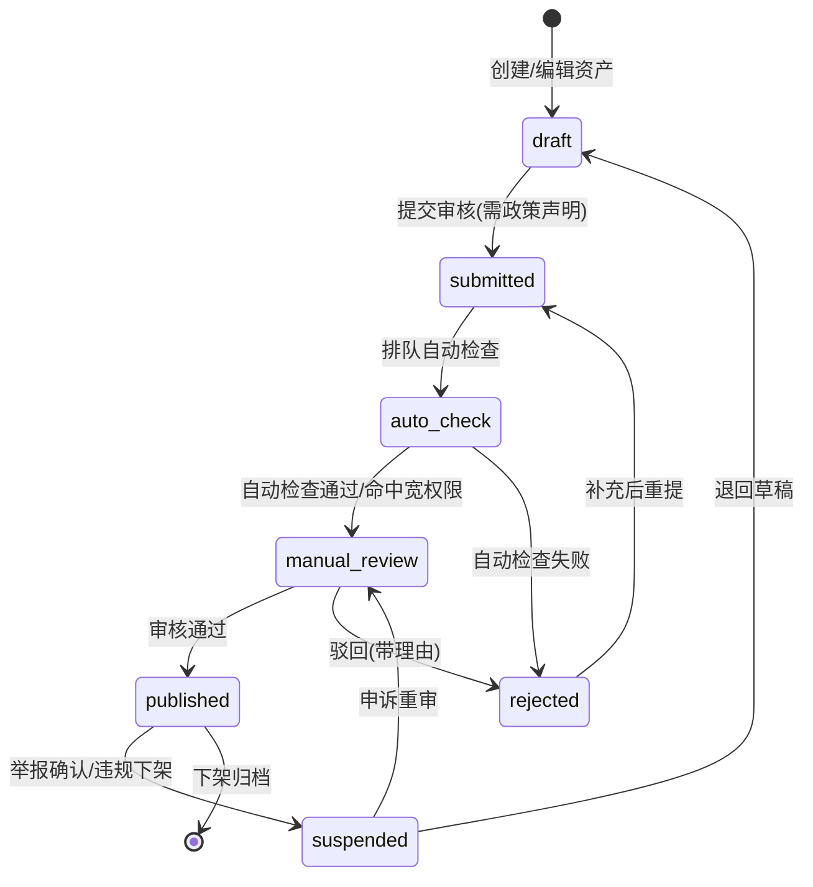
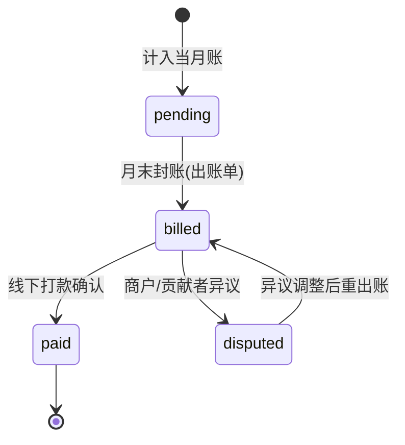

# T5 资产市场商店化：审核状态机、版本管理、评分举报、扩展分发与用量归因

> 设计文档 · user-server · 2026-10
>
> 写前核对：本文所有"现状"描述均基于实际读码核对——
> `internal/controller/asset_market.go`（ListMarket/MarketDetail/Purchase/Sync/ListLocal/ToggleActive/SyncLog/ReportUsage/MyPurchases/BindToAgent）、
> `internal/service/asset_market.go`（对平台 `PlatformAPIClient` 的纯代理）、
> `internal/repository/template_market_repo.go`、`internal/model/local_asset.go`（local_assets / local_asset_data / local_asset_sync_log，全部带 tenant_id）、
> `internal/service/asset_bundle.go`（CreateBundle/UpdateBundle/PublishBundle/ArchiveBundle + AssetBundleVersionLog 版本审计）、
> `internal/controller/asset_bundle_submit_platform_test.go`（submit_platform 链路测试）、
> `internal/platform/contributor_client.go`（CreateAsset → `POST /contributor-api/v1/assets`，SubmitAudit → `POST /contributor-api/v1/assets/{id}/submit`）、
> `internal/middleware/bridge_ingress_guard.go`（fail-closed 的 X-Bridge-Token 校验，token 候选：KV `bridge_ingest_token`(+prev) → 环境变量）、
> `internal/bridge/tenant_binding.go`（缺 tenant_code 时 `ErrBridgeTenantUnresolved`）。

## 1. 竞品依据

| 竞品 | 机制 | 对本设计的启示 |
|---|---|---|
| OpenAI GPT Store / ChatGPT App Store | 草稿 → Submit for review → 完成政策声明（policy attestations）→ 展示页追踪 Review status；上架要求合规使用政策、全年龄段适用、第三方 ToS 合规；用户安装前可查看隐私政策 | 上架必须显式提交审核动作而非"发布即上架"；政策声明（声明收集了什么数据、用途）作为提审的前置必填字段；详情页公开展示隐私/数据声明 |
| 扣子（Coze）自定义渠道 | 智能体发布到渠道后触发渠道审核回调；审核耗时长可先回"审核中"再异步更新审核结果；超时（10 分钟）视为失败 | 审核结果异步化：提审后进入 `auto_check`/`manual_review`，结果通过状态更新落地，不阻塞提审方 |
| Chrome Web Store | MV3 强制、隐私政策必须、`host_permissions` 每条须逐条说明用途，宽权限触发 in-depth review 拉长审核；新账号有发布数量限额 | 浏览器扩展类资产需上传 `.crx/.zip` 二进制 + manifest 校验 + 权限用途声明；权限越多越进人工队列；账号级发布限额防滥用 |
| Open VSX（Eclipse） | 轻量审核：命名空间认领 + 个人访问令牌 + `ovsx publish`，无重人工队列 | 内部市场走"自动检查 + 抽样人工"，避免全量人工瓶颈；命名空间归属即贡献者身份 |
| LiteLLM | 按 Virtual Key / user / team / tag 维度实时归因 spend，月度重置 | 用量归因按"扩展 Key"为最小归因单元，ReportUsage 上报 → Key → 月账聚合，支持月度对账与结算 |

来源：
- GPT Store 政策：https://developers.openai.com/plugins/plugin-guidelines
- GPT Store 提审流程：https://developers.openai.com/plugins/deploy/submission
- ChatGPT App Store 上架要求：https://openai.com/index/developers-can-now-submit-apps-to-chatgpt/
- 扣子审核结果回调：https://docs.coze.cn/developer_guides_update_review_result
- 扣子渠道审核回调机制：https://docs.coze.cn/dev_how_to_guides_receive_handle_callbacks
- Chrome Web Store 隐私与数据处理要求：https://developer.chrome.com/docs/webstore/program-policies/user-data-faq
- Chrome 扩展 host_permissions 审核说明：https://extensionbooster.net/blog/chrome-extension-host-permission-in-depth-review-warning-fix-guide/
- MV3 权限模型：https://www.orlandoascanio.com/notes/chrome-extension-permissions-manifest-v3
- Chrome 新账号发布限额：https://support.google.com/chrome/thread/464410990/google-chrome-extension-dashboard-showing-limit?hl=en
- Open VSX 发布流程：https://github.com/eclipse-openvsx/openvsx/wiki/Publishing-Extensions
- Open VSX 注册表：https://open-vsx.org/
- LiteLLM Spend Tracking：https://docs.litellm.ai/docs/proxy/cost_tracking
- LiteLLM Tag/Key 归因：https://docs.litellm.ai/docs/proxy/tag_budgets

## 2. 目标 / 非目标

### 2.1 目标

1. **审核状态机**：资产上架走 `draft → submitted → auto_check → manual_review → published / rejected / suspended` 全链路，驳回可带理由重提。
2. **版本管理**：新增 `asset_versions`，每次提审产生不可变版本记录（版本号、changelog、bundle 内容哈希、独立审核状态），已发布版本回滚可追溯。
3. **评分与举报**：购买者（purchase 门槛）可评分；任何登录用户可举报，举报进入审核队列可触发 `suspended`。
4. **扩展分发链路**：浏览器扩展作为新 asset_type 走同一市场模型，支持二进制上传、下载页、版本化分发；接通 `ReportUsage` 归因。
5. **用量归因与月账**：`ReportUsage` 上报按扩展 Key 聚合到月账表，支撑分成结算与对账。

### 2.2 非目标

- 不做支付/资金流（仅出账单与结算状态，实际打款线下）。
- 不做自动恶意扫描的全套杀毒引擎（复用 bundle 校验 + 规则扫描 + 可选外接扫描器接口）。
- 不改造 platform-server 现有 contributor API 之外的新平台协议。
- 不做多币种、发票、税务。

## 3. 数据模型

沿用现网约定：**每张表首列 `tenant_id`**（参照 `model/local_asset.go` 中 `TenantID uint gorm:"not null;default:1;index"`），迁移放到 `internal/migration/migrations/`，版本号 **036 号段 / v3_83_0** 起（紧接 v3_82_0_message_hub_platform_msg_id），风格对齐 v3_70_0 迁移（struct 实现 `migration.Migration` 接口：`Version() / Name() / Migrate() / Rollback()`，注释写明事实链与回滚策略）。

### 3.1 `asset_listings`（上架单，商店化主表）

| 字段 | 类型 | 说明 |
|---|---|---|
| tenant_id | uint, not null, idx | 租户 |
| id | int64 PK | |
| asset_code | varchar(64), unique | 对应 local_assets.asset_id / 平台 AssetCode |
| contributor_id | int64, idx | 贡献者（对应 contributor_client 的平台账号） |
| asset_type | varchar(32), idx | prompt / knowledge / tool / **extension** |
| name / industry / summary | varchar / text | 展示信息 |
| status | varchar(16), idx | `draft / submitted / auto_check / manual_review / published / rejected / suspended` |
| policy_declaration | jsonb | 政策声明：数据收集项、用途、第三方 ToS、隐私政策链接（对齐 GPT Store attestation） |
| permission_declarations | jsonb | 扩展类：manifest 每条权限 → 用途说明（对齐 Chrome Web Store） |
| reject_reason | text | 最近一次驳回理由 |
| reviewed_by | int64 | 审核人（平台级账号） |
| reviewed_at | timestamptz | |
| current_version_id | int64 | 当前已发布版本 |
| download_count / rating_avg / rating_count | bigint / numeric(3,2) / int | 评分统计冗余列（见 §3.4） |
| created_at / updated_at / deleted_at | | gorm 约定 |

### 3.2 `asset_versions`（版本表，不可变）

| 字段 | 类型 | 说明 |
|---|---|---|
| tenant_id | uint | 租户 |
| id | int64 PK | |
| listing_id | int64, idx | → asset_listings |
| version | varchar(16) | semver；(listing_id, version) 唯一 |
| changelog | text | 变更说明 |
| bundle_hash | varchar(128) | 资产内容哈希（sha256），复用 asset_bundle 校验产物 |
| bundle_ref | varchar(256) | 二进制/JSON 存储 key（扩展类指向对象存储） |
| status | varchar(16) | 版本级审核状态，同 listing 状态机 |
| auto_check_result | jsonb | 自动检查逐项结果（复用 `asset_bundle.go` 校验 + manifest 权限检查 + 恶意扫描） |
| reject_reason / reviewed_by / reviewed_at | | 同上 |
| published_at | timestamptz | |
| created_at | | |

### 3.3 `asset_reports`（举报）

tenant_id / id / listing_id / version_id / reporter_id / category(`policy_violation|malicious|infringement|other`) / detail text / status(`open|confirmed|dismissed`) / handled_by / handled_at / created_at。

### 3.4 `asset_ratings`（评分，purchase 门槛）

tenant_id / id / listing_id / user_id / purchase_id（必须能对应到 `my_purchases` 记录） / score smallint (1~5) / comment text / status(`visible|hidden`) / created_at / updated_at；唯一键 `(listing_id, user_id)`（一人一评，可更新）。`asset_listings.rating_avg/rating_count` 由评分写入后重算（COUNT/AVG 单事务内更新）。

### 3.5 `extension_usage_monthly`（扩展用量归因月账）

| 字段 | 说明 |
|---|---|
| tenant_id / id | |
| listing_id / version_id | 归属资产 |
| extension_key | varchar(128)：扩展实例 Key（归因最小单元，对齐 LiteLLM per-Key） |
| tenant_code | varchar(32)：上报方租户短码（`tenant_binding.go` 解析结果，防止归因串租户） |
| period | varchar(7)：`YYYY-MM`；唯一键 `(listing_id, extension_key, period)` |
| usage_count | bigint：ReportUsage 聚合 |
| tokens_in / tokens_out | bigint：可选 token 维度 |
| revenue_share | numeric(12,4)：按分成比例计算 |
| settle_status | `pending / billed / paid / disputed` |
| created_at / updated_at | |

### 3.6 迁移文件

`036_asset_market_storefront_migration.go`（Version `v3.83.0`）：建上述 5 表 + 索引；`TenantLeadingIndex` 规范（tenancyidx.Normalize）自动补 `(tenant_id, ...)` 前导索引。回滚：drop 5 表（发布前表均新建，无数据迁移风险）。

## 4. 状态机与审核流程

### 4.1 状态图



### 4.2 自动检查项（`auto_check`）

1. **Bundle 校验**：复用 `internal/service/asset_bundle.go` 的 CreateBundle/Weave 校验路径（messages 结构、ChatML 可解析、`resolveLocalAssetSystemPrompt` 兼容）。
2. **Manifest 权限检查（扩展类）**：解析 manifest.json，`host_permissions`/`permissions` 每条必须在 `permission_declarations` 中有用途说明；声明缺失或权限超集直接 fail；宽权限（如 `<all_urls>`）强制进 manual_review。
3. **恶意扫描**：规则扫描（可执行内容、外联域名黑名单、反射 eval），保留 `auto_check_result` 逐项记录；接口预留外接扫描器。
4. **发布限额**：对齐 Chrome Web Store 新账号限额——贡献者 7 天内提审数超阈值（默认 10）自动拦截。

### 4.3 人工审核队列

- 平台级专用写入口（见 §6），列 submitted/auto_check/manual_review 单，展示 policy_declaration、auto_check_result、diff（与上一 published 版本的 bundle_hash 对比）。
- 审核动作：approve（published）、reject（必填 reject_reason，写回 listing 与 version）、suspend。
- 驳回重提：rejected → 修改 → submitted，保留历史 version 记录形成审计链。

## 5. 浏览器扩展分发链路

### 5.1 现状与缺口

- 现有链路：贡献者经 `contributor_client.go`（CreateAsset/SubmitAudit）打到平台 `/contributor-api/v1/assets` 与 `/assets/{id}/submit`；`asset_bundle_submit_platform_test.go` 已覆盖 submit_platform。
- **缺口**：扩展二进制（.zip/.crx）没有上传通道；无下载页；扩展端上报（bridge 链路）与 asset_market 的 `ReportUsage` 未打通。

### 5.2 设计

1. **二进制上传**：`asset_versions.bundle_ref` 指向对象存储；上传走平台级 `POST /api/v1/asset-admin/listings/:id/versions/:version/bundle`（multipart，服务端校验扩展名 + 大小上限 + 重算 bundle_hash）。
2. **下载页**：`user-web/src/views/assetMarket/Detail.vue` 扩展"下载"按钮 → 新增公开端点 `GET /api/v1/asset-market/:asset_code/download`，仅 published 版本可下，返回带签名的对象存储 URL，同时 `download_count+1`。下载页展示版本号、changelog、bundle_hash、权限声明、评分。
3. **与现有 asset_market 复用**：`extension` 作为新 asset_type 挂进 ListMarket/MarketDetail/Purchase/Sync 既有代理路径（`service/asset_market.go` 无需分支，platform 侧返回带 bundle_ref 即可）；本地侧 `local_assets` 照常承接同步。
4. **已知坑位（必须写进验收）**：
   - **桥接扩展缺 tenant_code 曾 404**：`tenant_binding.go` 在账号未注册且无 `tenant_code` 时返回 `ErrBridgeTenantUnresolved`。扩展端安装即上报时，必须在安装引导中携带 `tenant_code`（query 或 `X-Tenant-Code`），或先走注册归属流程；否则 ReportUsage 会 404。
   - **线上未配 BRIDGE_INGEST_TOKEN**：`bridge_ingress_guard.go` 是 fail-closed——token 未配置时直接 503（除非显式 `BRIDGE_INGEST_AUTH=off`）。上线前必须配置 `bridge_ingest_token`（KV `bridge_ingest_token` / `bridge_ingest_token_prev` 支持轮换，或环境变量 `BRIDGE_INGEST_TOKEN`/`BRIDGE_INGEST_TOKEN_PREV`），并把"扩展上报 503"加入告警。

## 6. API 设计

对齐 `controller/asset_market.go` 现有风格：gin handler + `[AUTO]` 注释块 + `@Tags asset-market` + `assetOK/assetFail` 包装；`BizError` 经 `ErrorWithBusinessCode` 透出；平台写操作先过 `rejectPlatformDisabled`。

### 6.1 商户侧（复用现有 controller，路由前缀 `/api/v1/asset-market`）

| 方法/路径 | 说明 |
|---|---|
| GET `/list` / `/detail/:asset_id` | 既有，detail 增加 versions/changelog/rating/permission_declarations |
| GET `/:asset_code/download` | 新增，published 版本下载，签名 URL |
| GET `/:asset_code/versions` | 新增，版本列表（版本号/changelog/发布时间） |
| POST `/rate` | 新增，评分：`{asset_id, purchase_id, score(1-5), comment?}`，服务端校验 purchase 归属 |
| POST `/report` | 新增，举报：`{asset_id, category, detail}`，幂等（同 user+listing+category 未结单去重） |
| POST `/report-usage` | 既有 ReportUsage，扩展为可带 `extension_key`（缺省回退 local_assets.asset_id） |

### 6.2 贡献者/开发者侧

| 方法/路径 | 说明 |
|---|---|
| POST `/api/v1/asset-contributor/listings` | 创建 listing（draft），body 含 policy_declaration、permission_declarations |
| PUT `/api/v1/asset-contributor/listings/:id` | 编辑 draft |
| POST `/api/v1/asset-contributor/listings/:id/submit` | 提审（对应 contributor_client.SubmitAudit，触发状态机） |
| POST `/api/v1/asset-contributor/listings/:id/versions` | 新版本（version + changelog + bundle 上传凭证） |
| GET `/api/v1/asset-contributor/listings/:id/status` | 审核进度与 reject_reason |
| GET `/api/v1/asset-contributor/stats` | 开发者统计：下载、评分、用量月账 |

### 6.3 平台审核后台（平台级专用写入口）

鉴权：平台管理员角色中间件（区别于商户租户路由）。

| 方法/路径 | 说明 |
|---|---|
| GET `/api/v1/asset-admin/review-queue` | 队列：status in (submitted, auto_check, manual_review)，可按 asset_type/贡献者过滤 |
| GET `/api/v1/asset-admin/listings/:id/review-detail` | 政策声明 + auto_check_result + 与上版本 diff |
| POST `/api/v1/asset-admin/listings/:id/approve` / `reject` / `suspend` | reject/suspend 必填 reason；写 reviewed_by/reviewed_at |
| GET `/api/v1/asset-admin/reports` / POST `/api/v1/asset-admin/reports/:id/handle` | 举报处理：confirmed(触发 suspend)/dismissed |
| GET `/api/v1/asset-admin/attribution?period=YYYY-MM` | 月账查询（§7） |

### 6.4 归因上报（扩展链路）

扩展端 → bridge 通道（`BridgeIngressGuard` + `tenant_binding`）→ 内部转发 `ReportUsage`，payload：`{asset_id, extension_key, usage_delta, tenant_code}`；网关侧按 Key 去抖（本地计数批量上报，复用 local_assets.UseCount/ReportedUseCount 的累计模式）。

## 7. 分成结算

### 7.1 归因口径

```
扩展运行 → 本地计数 → POST /report-usage (asset_id, extension_key)
  → platform 聚合 extension_usage_monthly (listing_id, extension_key, period)
  → 月末封账 → revenue_share = usage_count × 单价 × 分成比例
  → settle_status: pending → billed → paid
```

- 归因最小单元是 **extension_key**（对齐 LiteLLM per-Key），一层兜底：Key 缺失时归到 `(listing_id, tenant_code)` 匿名桶，月账标记 `key_missing=true` 供对账。
- 重复上报幂等：`(listing_id, extension_key, period)` 唯一键 + usage 累加。

### 7.2 结算状态机



### 7.3 对账

- 三方对齐：`extension_usage_monthly`（平台账）↔ `local_assets.ReportedUseCount`（商户端账）↔ 扩展本地累计。差超阈值（默认 5%）生成 dispute 工单。
- 封账后 period 锁定，`ReportUsage` 对已封账 period 的增量进下月账。

## 8. 前端页面

在 `user-web/src/views/assetMarket/`（现有 Detail.vue / Market.vue / MyAssets.vue / SyncLog.vue）基础上扩展：

1. **平台审核后台** `views/assetAdmin/`（新）：
   - `ReviewQueue.vue`：队列表格（状态、类型、贡献者、提交时间、auto_check 结果徽标），筛选与批量操作。
   - `ReviewDetail.vue`：政策声明、权限声明逐条勾验、bundle diff、approve/reject（带理由弹窗）。
   - `ReportHandle.vue`：举报列表 + 处理动作。
2. **下载页** `Detail.vue` 扩展：扩展类型展示版本列表、changelog、bundle_hash、权限声明表、下载按钮（公开可访问，不要求登录）。新增独立路由 `/asset-market/download/:asset_code`。
3. **开发者统计页** `views/assetContributor/`（新）：我的 listing 状态时间线（draft→published）、reject_reason 展示、下载/评分/月账（revenue_share、settle_status）图表。
4. 复用现有请求封装与 `BizError` 提示约定；MyAssets.vue 增加"评分/举报"入口（评分按钮在无 purchase 记录时禁用并提示购买门槛）。

## 9. 测试计划与迁移回滚

### 9.1 测试计划

| 层级 | 内容 | 参照 |
|---|---|---|
| 单元-状态机 | 全状态迁移表驱动测试：非法迁移（draft→published 等）必须拒绝；驳回→重提→发布全链路 | 仿 `v3_70_0_..._migration_test.go` 风格 |
| 单元-自动检查 | manifest 权限缺声明 fail；宽权限强制 manual_review；bundle_hash 一致性；发布限额拦截 | 仿 `asset_bundle_submit_platform_test.go` |
| 单元-评分举报 | purchase 门槛（无记录 403）；一人一评唯一键；举报幂等 | |
| 单元-归因 | ReportUsage 聚合正确；唯一键冲突累加；封账后进下月；key 缺失落匿名桶 | |
| 集成-bridge | 扩展上报：无 tenant_code → 明确错误（回归 `ErrBridgeTenantUnresolved` 404 坑）；token 未配置 → 503 fail-closed | 对齐 `bridge_ingress_guard.go`/`tenant_binding.go` |
| 集成-迁移 | 036 迁移 up/down 幂等；tenancyidx 前导索引校验 | |
| E2E | 提审→审核→发布→下载→上报→月账→后台查账全链路冒烟 | |

### 9.2 迁移回滚

- 036（v3.83.0）只建新表，`Rollback` 为 `DROP TABLE IF EXISTS asset_listings, asset_versions, asset_reports, asset_ratings, extension_usage_monthly`（级联顺序：先子表后主表）。
- 上线顺序：迁移 → 后端 API → 前端；回滚代码不回滚数据（新表留置无害）。
- 灰度：`extension` asset_type 先内部租户试运行，评分/举报功能由 KV 开关（`system_config_kv`）控制。

## 10. 任务拆解与风险

### 10.1 子任务与估时（人日）

| # | 子任务 | 估时 |
|---|---|---|
| 1 | 迁移 036：5 张新表 + 模型 + tenancyidx 校验 + 迁移测试 | 1.5 |
| 2 | 状态机 core（状态迁移守卫 + service 层） | 2 |
| 3 | 自动检查（bundle 校验复用 + manifest 权限 + 限额） | 2 |
| 4 | 平台审核后台 API（queue/approve/reject/suspend） | 2 |
| 5 | 版本管理（versions CRUD + bundle 上传通道 + hash） | 2 |
| 6 | 评分 + purchase 门槛 + 举报 | 1.5 |
| 7 | 下载端点 + Detail.vue 下载页 | 1 |
| 8 | 扩展上报链路接通（bridge → ReportUsage 带 extension_key/tenant_code） | 2 |
| 9 | 月账聚合 + 结算状态 + 对账查询 | 2 |
| 10 | 前端：审核后台 + 开发者统计页 | 3 |
| 11 | 集成/E2E 测试 + 文档 + 上线 checklist（BRIDGE_INGEST_TOKEN 配置项） | 1.5 |
| 合计 | | **约 20.5 人日** |

### 10.2 风险

| 风险 | 影响 | 缓解 |
|---|---|---|
| 桥接扩展缺 tenant_code 上报 404（已发生） | 归因数据缺失 | 安装引导强制带 tenant_code；上报失败重试队列；对账兜底匿名桶 |
| 线上未配 BRIDGE_INGEST_TOKEN → 上报 503 fail-closed | 扩展链路全断 | 上线 checklist 强制项；503 告警；轮换用 `_prev` 键 |
| 平台侧 contributor API 能力不足（审核/版本字段） | 状态机落到 user-server 本地而非平台 | 双轨：本地 asset_listings 为事实源，平台 submit 保持兼容 |
| 自动检查漏判恶意扩展 | 安全 | 人工审核兜底 + 举报通道 + suspend 快速下架 |
| 评分门槛绕过（伪造 purchase_id） | 数据污染 | 服务端校验 purchase 归属当前用户 |
| 月账聚合量大 | 性能 | 唯一键 upsert 增量写；封账离线批任务 |

